# 吴恩达《数据工程（导论，源系统、数据摄取和管道，数据存储和查询｜1-2-3课）｜DeepLearning.AI Data Engineering》 - P24：23_数据服务.zh_en - GPT中英字幕课程资源 - BV1wTtWeeEH5

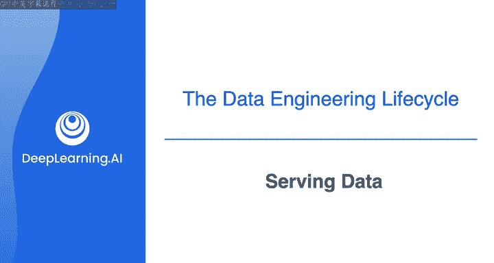

Once you've ingested， transformed and sort your data。

 you're ready for the final stage of the data engineering lifecycle serving data This stage is about more than just making data available It's really when you give stakeholders the opportunity to extract business value from data and like I mentioned last week value means different things to different stakeholders generally data has value when it's used for practical end use cases like analytics machine learning reverse EL or other use cases in this video rather than discussing specific mechanisms for serving data well instead take a brief look at each of these end use cases to provide more context and how serving data might look different for different scenarios later in course 4 we'll get into the specifics of how exactly you will serve data for each of these use cases So let's start with analytics which is the process of identifying key insights and patterns within data as a data engineer。

 you're almost guaranteed to serve data that powers one。

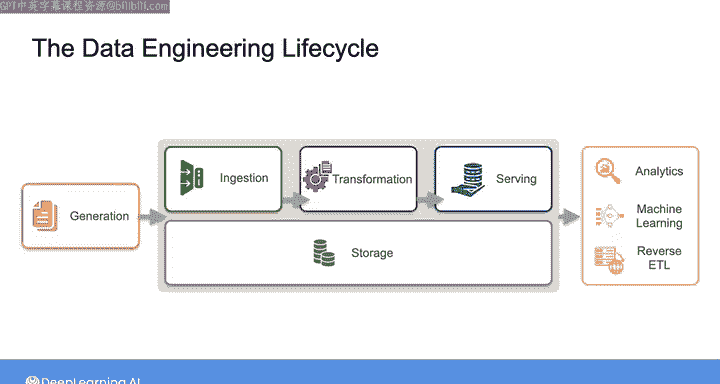

or more of the three most common forms of analytics， business intelligence。

 operational analytics and embedded analytics business intelligence or BI for short is where analysts explore historical and current business data to discover insights As a data engineer you will serve data that ultimately gets presented in the form of reports or dashboards that help users make strategic and actionable decisions for example。

 analysts on sales and marketing teams will use BI reports and dashboards of spot patterns and trends and to monitor things like marketing campaign engagement regional sales and customer experience metrics or imagine a scenario where an analyst observes a sudden spike and product returns they might then investigate existing reports or dashboards to compare this phenomena with historical trends they might also pull more data by running SQL queries against the database you provided or ask you to serve up additional data for ad hoc analytics In contrast to the reflective。

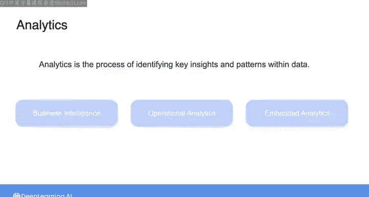

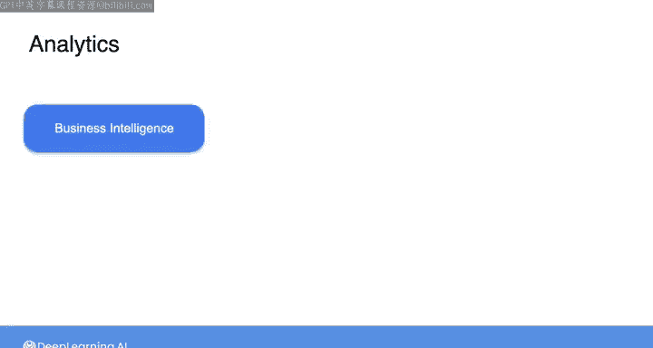

Or In-driven nature of BI operational analytics is about monitoring real-time data for immediate action For example。

 an ecommerce-commerce platform team might need to monitor a dashboard of realtime performance metrics for the website if the website goes down for some reason whether that's because of a spike in user traffic or a data center going offline they need to know immediately so they can triage the situation and get the site up and running again and in this case your role as a data engineer would be to ingest。

 transform and serve event data from the website's application logs to populate the platform team's dashboard while BI and operational analytics or internally focused data practices that have been in use for many decades a somewhat newer trend is external or customer facing embedded analytics you've most likely interacted with a variety of embedded analytics applications yourself For example。

 your bank might provide you with dashboards that show you historical trends in your spending or how your purchases break down across different categories like food retail and utility。

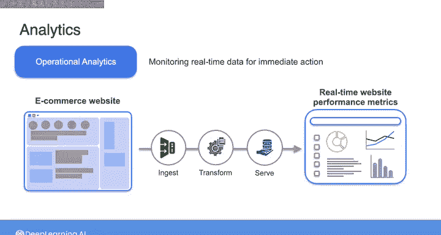

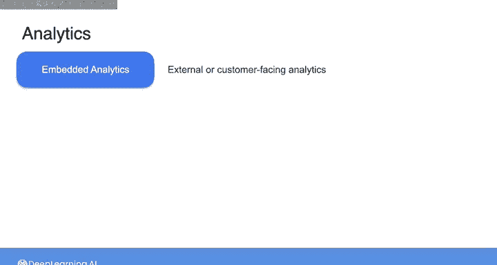

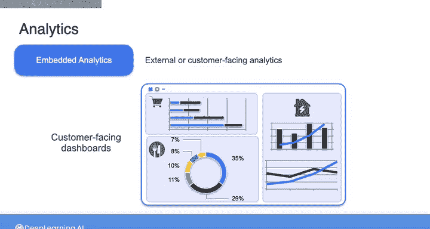

Or maybe you have a smart thermostat in your home that's connected to a mobile application the application might show the current temperature inside your home as well as historical metrics like temperature over time when it comes to embedded analytics as a data engineer your job would be serving real-time and historical data for use in user facingcing applications with the rise of machine learning in recent decades。

 it's quite likely that your role as a data engineer will involve serving data for machine learning use cases in these courses will treat machine learning as separate from other serving use cases。

 simply because it can involve additional complexities that we' want to look at in detail for example。

 with a machine learning use case， you may be responsible for serving feature stores of data that facilitate model training and you might also need to serve data for real-time inference or support metadata and cataloging systems that track data history and lineage we'll take a closer look at all these scenarios later in these courses apart from analytics and machine learning another common use case。

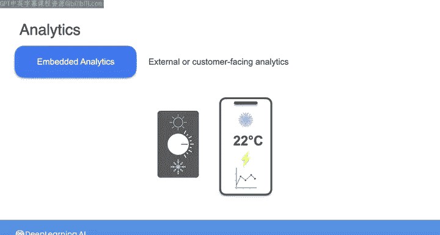

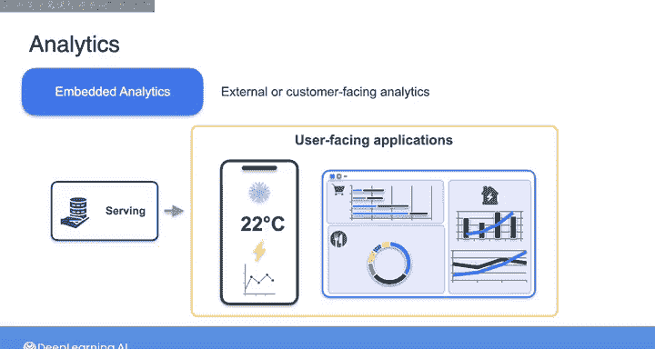

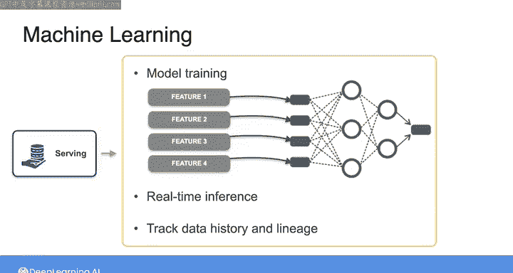

serverving data is what's at least today called reverse ETL with reverse ETL you'll take transform data as well as analytics and perhaps machine learning model output and feed it back into source systems For example。

 let's say you've ingested data from a customer relationship management or CRM system and this might include information like names contact info form data or other relevant client information and you've then transformed the data into the appropriate format and stored it in a data warehouse Ana can then retrieve the data to train a lead scoring model which is a model that attempts to say which clients are the most promising for various engagements or product offerings the model results could then be returned to the data warehouse and then push back into the CRM as an enhancement of the client data already stored there Now I'll just say that the name reverse ETL for this process is not so much an attempt to describe what's going on as it is for just a lack of a better name to describe。

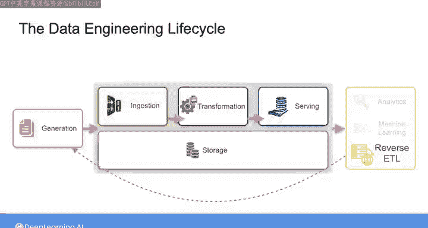

Pretty longstanding process in any case this practice is increasingly common and in your work as a data engineer you're likely to be engaged in reverse ETL or whatever it happens to be called in the future。

 as part of your role and with that we've taken a quick look at all the phases of the data engineering lifecycle。

 including So systems， ingestion， transformation， storage and serving。

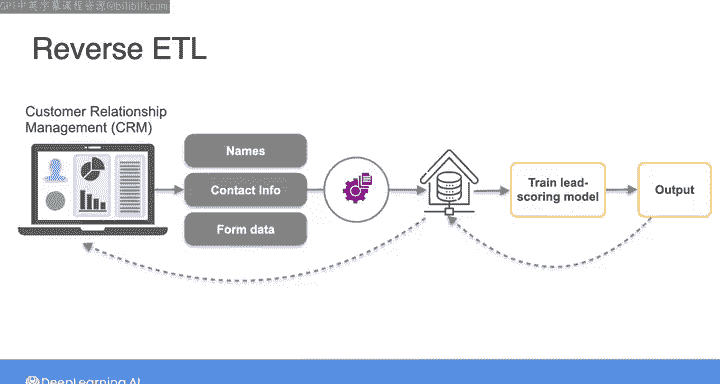

In the next lesson， we'll shift our focus to the undercurrents of the life cycle to touch all of these phases。

I'll see you in the next lesson。