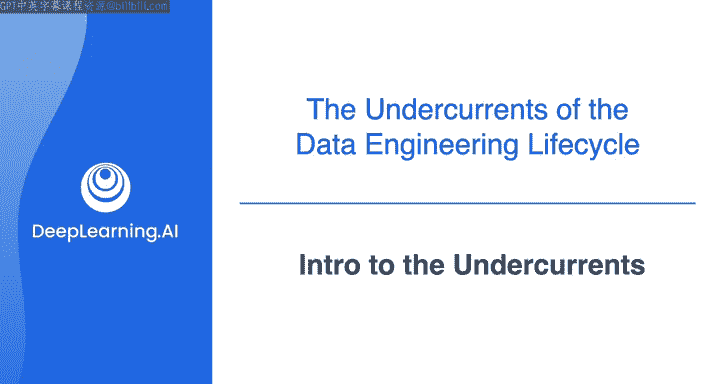
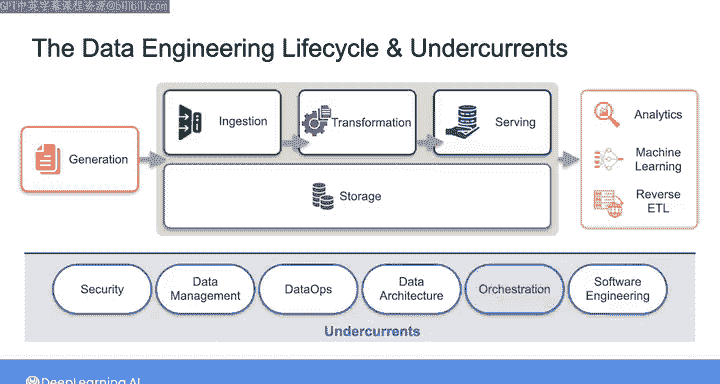

# 吴恩达《数据工程（导论，源系统、数据摄取和管道，数据存储和查询｜1-2-3课）｜DeepLearning.AI Data Engineering》 - P25：24_底层技术介绍.zh_en - GPT中英字幕课程资源 - BV1wTtWeeEH5

We've been looking at the data engineering lifecycle and how you'll ingest data from store systems。

 transform it， store it， and serve it to end users。As a field， data engineering is rapidly maturing。

 whereas just a decade ago， the role of a data engineer was primarily focused on the technology layer。

 the continued abstraction and simplification of tools has expanded the scope of the role。

Data engineering now encompasses far more than just tools and technologies， In other words。

 the field is moving up the value chain， which is great news for you as a data engineer。

Modern data engineering incorporates traditional enterprise practices such as data management and cost optimization as well as newer practices like data ops when it comes to your work as a data engineer there's a set of such practices that will apply to your work across the entire lifecycle in the fundamentals of data engineering book we describe these practices as the undercurrents of the data engineering lifecycle these undercurrents include security。

 data management， data ops， data architecture， orchestration and software engineering through the next several videos we'll take a closer look at each of these undercurrents and after that you'll begin exploring how the data engineering lifecycle and undercurrents take shape in real life on the AWS cloud。

Let's get started。