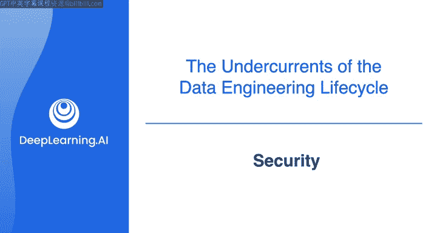
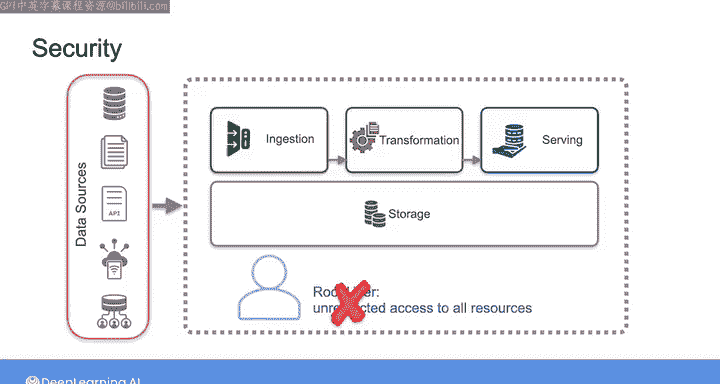
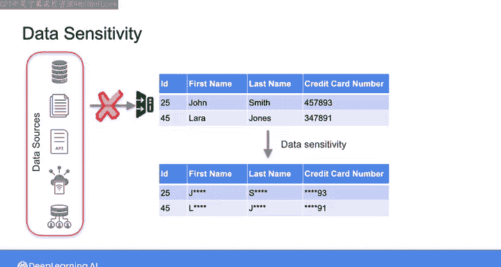
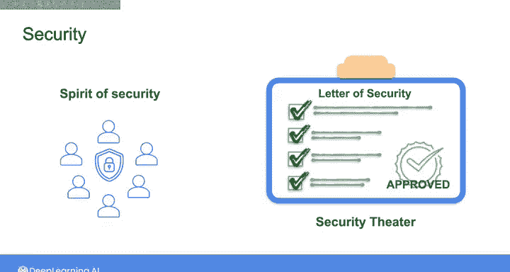

# 吴恩达《数据工程（导论，源系统、数据摄取和管道，数据存储和查询｜1-2-3课）｜DeepLearning.AI Data Engineering》 - P26：25_安全.zh_en - GPT中英字幕课程资源 - BV1wTtWeeEH5

Before getting into how security applies to your role as a data engineer。

 I'd like you to think for a moment about how security concerns apply to your own personal data every day。

 For example， you probably don't give out your bank account information to just anyone。

And you don't publish the passwords to all your online accounts where others can see them。

 Similarlyly you wouldn't give the keys to your house to someone you don't know and trust in your role as a data engineer。

 you're entrusted with sensitive data， whether that's the personal and private information of your clients or proprietary business information The owners of that data are trusting that you'll keep their information safe and so it's important to recognize your role in bringing together the right set of principles。

 protocols and cultural practices to ensure security in the systems you build in this video I'll cover some of those foundational principles and best practices for data security when you're managing a data pipeline and serving data to end users you will need to give access to the data and system resources to other users or applications a key security principle to keep in mind when doing so is the principle of least privilege This means you give users or applications access to only the essential data and。

So they need to do their jobs and only for the duration that's required。

 you need to apply the principle of least privilege， not only to others in the organization。

 but also to yourself that means， for example， just like you don't give everyone a team administrator access when it comes to your own work。

 don't operate from the root shell when it's not necessary and don't use administrator or super user permissions unless it's absolutely essential when you think about how to best secure data in your work you need to be thinking not only about data access。

 but also data sensitive， adhering to the principle of least privilege means making sensitive information visible to users only when it's absolutely necessaryBeyond that。

 the best way to protect sensitive data is not to ingest it into your system in the first place and if you don't have a clear purpose for ingesting and storing sensitive data simply don't do it and youll have it entirely removed the risk of accidentally leaking that data in today's cloudcentric world。

 security takes on yet another。

dienssion one that requires you to understand things like identity and access management or IM ruless。

 encryption methods and networking protocols you'll see more on these topics throughout the specialization as well delve deeper into ensuring the security of your data pipelines beyond that security is not just about principles and protocols。

It's also about people， Security starts and ends with you， the individual。

 as well as other individuals across your organization。When it comes to security。

 you should adopt a defensive mindset。Always be cautious when asked for credentials or for sensitive and confidential data。

Imagine potential attack and leak scenarios and design your data pipelines and storage systems with them in mind when it comes to real-w data leaks。

 individual people have been the source of many of the biggest security breaches people ignoring basic precautions like sharing their passwords insecurely with others people falling victim to phishing attacks or an attacker tries a steal of sensitive information by impersonating an authority figure or someone you trust or people otherwise acting irresponsibly while working in a company' systems in data when it comes to security and data engineering。

 it never ceases to amaze me how often I see data engineers leap， say an AWS S3 bucket。

 a server or database exposed to the public internet when that was not the intention and there are some simple fixes to prevent this from happening。

 but I often see this happen because the data engineer simply doesn't know security best practices or they accidentally forgot to apply these practices when it comes。

to security at the organizational level I have seen that all too often organizations are set up with a facade of security。

 maybe a set of checklists to show they're compliant with regulations or compliance standards。

 but a deeper spirit of security is lacking in the organization's culture this approach of adhering to the letter of security without a culture and spirit of security is what I call security theater。

 true security emerges from a culture where every team member recognizes the role in protecting data and everyone from top to bottom embraces security as a priority and a habit So on your journey as a data engineer remember that while principles and protocols as well as tools and technologies are your allies when securing data。

 a true security culture emanates from a shared understanding of responsibilities and vulnerabilities across the organization as we progress in the specialization you'll get handson experience with security considerations as they apply to all ask。

Of your data architecture in the upcoming video， we'll take a look at the next undercurrent in the data engineering lifecycle data management。

