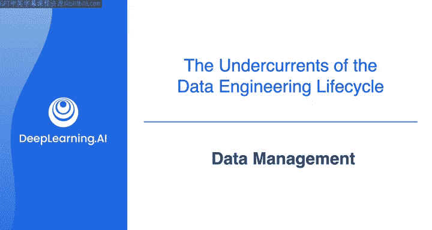
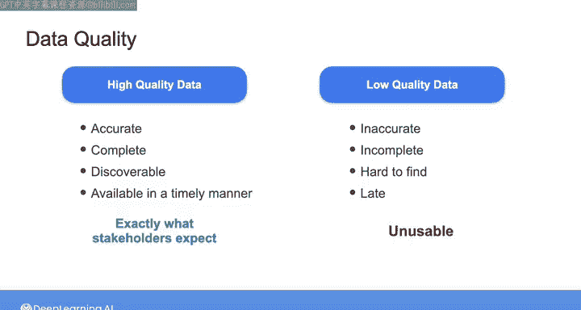

# 吴恩达《数据工程（导论，源系统、数据摄取和管道，数据存储和查询｜1-2-3课）｜DeepLearning.AI Data Engineering》 - P27：26_数据管理.zh_en - GPT中英字幕课程资源 - BV1wTtWeeEH5

Throughout these courses， I'll be emphasizing that whatever you're working on as a data engineer。

 you need to be thinking about how your work adds value for stakeholders in your organization。

Data can be an incredibly valuable business asset， but only when it's managed properly。

 data management is so important， in fact， that there's an international organization。

 the data management Association International or Dama。

 dedicated entirely to providing resources for companies and individuals to get data management right Dma provides this neat little publication。

 the data management book of knowledge or DMmB for short and as you can see there's a lot to know when it comes to data management but before you start freaking out let me just say that as a data engineer you don't need to memorize everything in this book and in fact while this is a great reference volume in your work as a data engineer you'll focus on a subset of data management tasks and you'll share the full responsibility of data management with teams including software engineering IT and others in this video。

 I'll quickly highlight the key aspects of data management that you need to be concerned with as a data engineer first of all。

The DMmB defines data management as the development， execution and supervision of plans。

 programs and practices that deliver， control， protect and enhance the value of data and information assets throughout their life cycles Now that's a mouthful and perhaps even sounds a little vague but let's break it down a little bit as a field data management consists of many facets and disciplines each with their own set of responsibilities and this can make the data management environment confusing the DMmB breaks down the different facets of data management into 11 what they call data knowledge areas。

 these include data governance， data modeling data integration and interoperability。

 metadata security and more and they arrange all that in a diagram like this you'll be seeing more on all these topics throughout these courses but as you can see in this diagram data governance touches all other areas of data management and as it。

many of the other knowledge areas interact with each other through data governance practices。

 so here in this video， I'll just focus on data governance as it relates to a lot of the areas that will be important in your role as a data engineer。

According to another book called Data Governance， the Defitive Guide。

 data governanceoverance is first and foremost， a data management function to ensure the quality。

 integrity， security， and usability of the data collected from an organization。From this definition。

 you can start to see that data governance covers a lot of ground everything from data security and privacy to data quality and usability。

 we touched on security and privacy a bit in the previous video and for the purposes of this video。

 I'd like to zero in on data quality which is closely related to some of the other key terms you've seen here like integrity usability and reliability。

Data quality is a deep and nuanced topic， but at its core this concept is relatively straightforward。

 high quality data is accurate， complete， discoverable and available in a timely manner Beyond that。

 high quality data represents exactly what stakeholders expect it to represent in terms of well defined schema and data definitions data that conforms to these standards of quality is a powerful tool in decision making and adds great value in an organization。

By contrast， low quality data might be inaccurate， incomplete or otherwise unusable。

 low quality data can cause stakeholders to waste their time。

 make poor decisions or even fire their entire data team you'll learn more about how to monitor and ensure data quality in your data pipelines in the next course。

 but for now we'll move on and take a look at the next undercurrent。

Joining me in the next video to explore data architecture as it applies to the data ensuring lifecycl。

