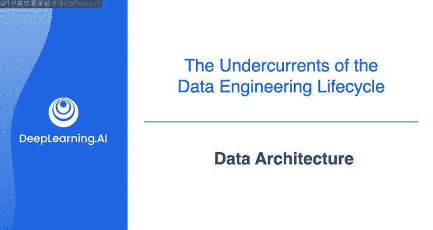
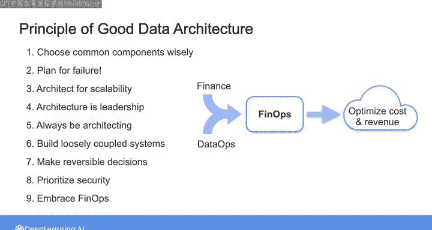

# 吴恩达《数据工程（导论，源系统、数据摄取和管道，数据存储和查询｜1-2-3课）｜DeepLearning.AI Data Engineering》 - P28：27_数据架构.zh_en - GPT中英字幕课程资源 - BV1wTtWeeEH5

You can think of data architecture as a sort of roadmap or a blueprint for your data systems。

In the first week of this course， we talked about requirements gathering and how to think about taking stakeholder needs and turning those into specific requirements that you can use to make design and technology choices in order to map requirements to a successful design for your system you need to think like an architect Now just to be clear in your role as a data engineer depending where you work you may not actually be directly responsible for making architect and design choices。

 your organization may have someone in the role of data architect who is responsible for establishing the design and passing it on for you to implement。

 However， in my experience， being able to think like an architect will make you more successful in your role as a data engineer and in some circumstances like if you're working at a small startup you may in fact be both the architect and the engineer In any case I wish someone had taught me how to think like an architect when I was getting started with data engineering。

 So in this video， I'll briefly introduce some of the key principles that are。

Of thinking like an architect and throughout these courses we'll be revisiting these principles so you can feel confident in your abilities to design and build robust data systems In our book Fundamentals of data engineering。

 Matt Haussley and I define data architecture as the design of systems to support the evolving data needs of an enterprise achieved by flexible and reversible decisions reached through a careful evaluation of tradeoffs。

 Let's take a minute to unpack that definition。 First off。

 you'll notice that data architecture needs to support the evolving data needs of the organization。

 This means that a good design supports not only the data needs of today。 but also of tomorrow。

 In practice， this means that data architecture is an ongoing effort rather than something you just do once and be done with The next part of this definition says that a good design is achieved through flexible and reversible decisions This is calling out the fact that the data needs of your enterprise may evolve in ways you hadn anticipated。

 and that you'll need to update your architecture。Over time。

 if your initial design choices were flexible and reversible to begin with。

 then you'll have a much easier time evolving your architecture to meet the needs of the organization。

 And finally， you'll see that in this last part of the definition。

 all this is achieved through a careful evaluation of tradeoffs these might include tradeoffs in performance or cost or scalability or other parameters。

 Now I think it's worth mentioning at this point that back when essentially all data architectures were built as onpres systems making flexible and reversible decisions was much harder in some cases impossible for example。

 if you decided to purchase and install millions of dollars worth of server hardware you're likely to be committed to that system for some number of years。

 whether you like it or not nowadays， with most data architectures being built in the cloud。

 you can in some sense， change your mind as often as you want about the technology choices you've made for your architecture provided you've made flexible and reversible decisions to begin with。

To expand on these ideas a little more， let's take a look at a set of principles of good data architecture that will be revisiting throughout these courses。

 And before I get into these， I'll just say that you don't need to worry about memorizing any of the stuff right now。

 I just want to give you a preview of what's to come in these courses and get you started thinking like an architect。

 Okay， so principle number one， chooseose common components wisely。

 Common components or the parts of your architecture that will be used by multiple individuals and teams across your organization。

 a good choice of common components is one that provides the right set of features for individual projects and simultaneously facilitates collaboration between teams。

 principleple number two， plan for failure。 This means exactly what it says。

A good architecture is designed not only for the case where everything is working as expected。

 but also for when things break。 principle number three， Archect for scalability。

 scalable systems can scale up to meet demand as needed and scale down to minimize costs when demand recedes。

 when you build scalability into your architecture。

 you can be responsive to a changing demand and optimize for costs at the same time。

 principle number four， architecture is leadership。 Now。

 while the principle of architecture as leadership may not directly apply to you in your role as a data engineer。

 if you work towards thinking like an architect and seek mentorship from data architects。

 you will be better able to lead and mentor other team members as your skills develop and you become more senior。

 eventually， you may occupy the data architecture role yourself。 Pri number5。

 always be architectureing， As I said before， architecture design is not something that happens only once。

 Instead， you will be constantly evaluating your systems against the evolving needs。

Your organization and rearchitecting on an ongoing basis principle 6 and7 build loosely coupled systems and make reversible decisions。

 A loosely coupled system as one that is built from individual components that can be easily swapped out for other ones without having to rearchitect the whole system in choosing to build with easily interchangeable components like this You're making a set of reversible decisions。

 which is to say if you change your mind or the needs of your organization evolve。

 you can easily reverse your prior set of decisions and swap out components of your architecture to meet your new design specs。

 principle number8， prioritize security。 We've already looked at some security principles like the principle of least privilege and later in our discussions of architecture will get into others like the zero trust principle the main takeaway with all these principles is that security is central to your role as a data engineer principle number9。

Ebrace Finops the cost structure of data has evolved dramatically in the cloud era。

 and Finopps is a movement to bring together the business priorities of finance and DevOs。

 or in this case data ops on the cloud， most data systems are pay as you go and readily scalable。

By embracing FinOs， you can design your systems to be simultaneously optimized for cost and potential revenue generation。

 so that's a quick look at the key principles of good data architecture。

Next week in this course， we'll look more closely at these principles and good data architecture in general。

 but for now let's move on to the next undercurrent of the data engineering lifecycle。

Join me in the next video to take a look at data ops。

