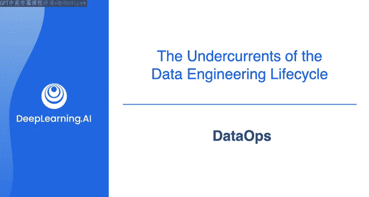
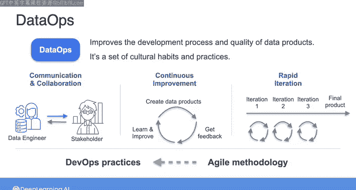
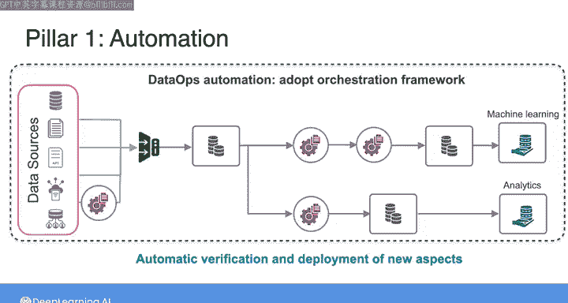
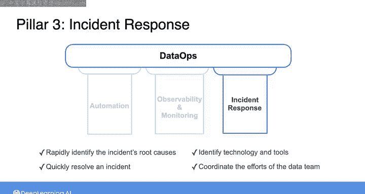

# 吴恩达《数据工程（导论，源系统、数据摄取和管道，数据存储和查询｜1-2-3课）｜DeepLearning.AI Data Engineering》 - P29：28_DataOps.zh_en - GPT中英字幕课程资源 - BV1wTtWeeEH5

Around 2007， a framework called DevOs emerged in software development to break the silos between software development teams who write and test code and the software deployment teams who deploy and maintain code。

 DevOs borrows some other well-known methodologies。

 including lean and agile to accomplish things like the removal of bottlenecks。

 the reduction of waste and the quick identification of problems as well as rapid iteration。

The DevOs movement has resulted in increased release cycles and enhanced quality for software products as the data field has matured。

 we've adopted a similar approach known as dataOs to the development of data products。

 similar to how DevOs improve the development process and quality of software products。

DataOs aims to improve the development process and quality of data products DataOs is first and foremost a set of cultural habits and practices that you can adopt these include things like prioritizing communication and collaboration with other business stakeholders continuously learning from your successes and failures and taking an approach of rapid iteration to work toward improvements to your systems and processes these are also the cultural habits and practices of DevOs and they're borrowed directly from the agile methodology which is a project management framework focus on delivering work and incremental and iterative steps in terms of the technical elements of dataOs there are three key pillars the first pillar you see here on the left is automation then the second pillar is observability and monitoring and finally the last pillar is incident response these are similar to the core components of DevOs where the end goal is to provide specific functionality and features in a software product。

But in dataOs， the goal is to provide high quality data products where you can think of a data product as any data or data system that you're providing to end users。

And so let's take a closer look at each of these three pillars of dataOs in terms of automation。

 one of the DevOs practices that accelerated the software build lifecycl is what's known as continuous integration and continuous delivery or CicCD for short with CICD developers are able to automate many of the manual processes required to build test and deploy code this automation results not only in faster review and deployment cycles but also fewer errors。

 ultimately making software teams more efficient and effective in building high-quality software products DataOs employs a similar automation framework to data processing as DevOs applies the software development within dataOs。

 the highlevel goal of automated change management remains the same for example。

 when it comes to managing changes in code configuration or environment In addition。

 dataOs is focused on change management when it comes to data processing pipelines and the data itself。

To get a sense of how automation applies to data processing。

 let's imagine that you just got started at a small organization and you've been tasked with building a data pipeline that starts with ingesting data from multiple source systems。

 So maybe you're ingesting from a database as well as some files and an API or a data sharing platform。

 then perhaps you're performing some inflight transformations during the ingestion process。

 then storing the ingested data in a storage system， perhaps a database。

 and then let's say you've got two end use cases you're serving。

 one for analytics and one for machine learning。 So next let's suppose you're performing some further transformations。

 maybe modeling and aggregating the data before pushing it to another storage system and making it available to end users。

And so you've got essentially two pipelines for the transformation and serving stages here。

 If you're the first data engineer at this organization and you're in the early stages of developing your data systems。

 you might choose to manually execute the various tasks in the data pipeline like manually starting each of these ingestion processes then once those are complete manually executing each of the subsequent steps in the transformation storage and serving stages This could be a reasonable approach to get started quickly and prototype some aspects of your data pipeline in the long run however。

 this sort of multistage manual execution will be prone to errors and be inefficient because it requires you to manually run each task with a minimal level of automation。

 you might choose to take a so-called pure scheduling approach。

 meaning that you would set each task in your pipeline to start at a particular time of day so maybe you start all these ingestion tasks at midnight every night then you would estimate how long it takes for all the data to be ingested and loaded into your storage system then you could schedule the downstream transformation task to start after that and so on through all the tasks in your pipeline。

So this is called scheduling because you create a schedule to automatically start each of the tasks in your data pipeline to take things to the next level of data ops automation。

 you could adopt an orchestration framework like airflow orchestration frameworks check the dependencies between tasks within your data pipeline before each task is run So you can decide the time and frequency you want the first task of your pipeline to start then the orchestration framework will automatically start the subsequent tasks once the previous ones have been completed successfully the orchestration framework can also notify you when there's an error with any of the tasks so that the downstream tasks that are dependent on the previous ones don't start when they're not supposed to Many orchestration frameworks not only automate the execution of tasks in your data pipelines。

 but they also enhance the development of these pipelines by enabling automatic verification and deployment of new aspects of your data pipeline similar to the CicCD process for software deployment When it comes to the next pillar of observability and monitoring the main thing you need to keep in mind is that any data pipeline you set up。

Is bound to fail eventually， to quote Verner Vogels， the CTO of Amazon Web services。

 everything fails all the time。This means that if you're not closely observing and monitoring your data systems。

 you'll be caught unaware when they fail in a worst case scenario。

 you might only become aware of these system failures when your downstream stakeholders discover these problems on their own。

 for example， in their reports or analytics dashboards。In my own work with clients。

 I've seen countless cases of bad data lingering in reports for months or even years due to undiscovered failures and data processing systems。

 these sorts of failures can be a waste of time and money。

 lead to ill- informedformed decisions and ultimately could cost you your job if stakeholders lose trust in your work So observability and monitoring are crucial aspects of the data systems you build The third pillar of data ops as incident response。

 which is about using the observability and monitoring capabilities you set up to rapidly identify the root causes of an incident and resolve it as quickly and reliably as possible。

 as I said before， things will break and it's only a matter of time before they break with incident response。

 It's not just about the technology and tools you use to identify and respond to an issue It's also about open and blameless communication and coordination of the efforts of members of the data team responding to the incident as well as others across the organization as a data engineer you should be proactively finding issues。

or they are reported to you by other stakeholders in your organization DataOs is a relatively new set of ideas that is still a work in progress and not all organizations have adopted dataOs best practices in your work as a data engineer you might find yourself in an organization where data ops is fairly mature or somewhere that is not yet embrace data ops Next up we're going to take a closer look at orchestration which is a key component of dataOs and such a critical component of modern data architectures and pipelines that we consider it as a separate undercurrent of the data engineering lifecycl。

