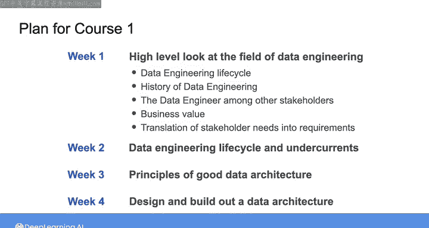

# 吴恩达《数据工程（导论，源系统、数据摄取和管道，数据存储和查询｜1-2-3课）｜DeepLearning.AI Data Engineering》 - P2：1_第1课程概览.zh_en - GPT中英字幕课程资源 - BV1wTtWeeEH5

Throughout these courses I'd like you to picture yourself in a particular scenario so you've just been hired as a data engineer at an exciting new company let's say in the ecommerce-commerce space so first congratulations on the new job In fact this company first hired a data scientists because they were interested in doing analytics to learn more about their customer interests behaviors and purchasing habits they also wanted to develop machine learning tools using large language models to automate various aspects of customer support however when this poor data scientists got started they discovered that none of the data infrastructure they needed to tackle the analytics or machine learning tasks even existed yet they quickly started studying up on data architectures and systems to try to help build the infrastructure they needed but also explained to those in leadership that building data infrastructure was not their forte and optimize for success the company should also hire a data engineer and so that's where you come in Now this might sound like a really silly story。

But I can't tell you how many times I've seen this exact scenario played out in real life。In fact。

 I was one of those data scientists who got hired by a company just like the one I described。

 I found myself thrown into a situation where I needed to quickly learn how to build various aspects of data infrastructure just to get the company's data and systems into a state where I could begin working on the data science projects I'd been hired to do that was a while ago many years ago actually and back then the role of data engineer didn't even exist yet。

So maybe the company that hired me as a data scientist could be forgiven for not knowing what they really needed。

 and as I dove into designing and building data systems。

 I was both overwhelmed and excited by what I was learning。

I discovered that the set of core skills to build robust data infrastructures was largely the same。

 no matter what sort of downstream tasks you're trying to accomplish when it comes to things like data science and machine learning as well as other things like delivering embedded analytics to users within applications Over time that core set of skills has come to be known as data engineering All right so back to our scenario here you've just been hired as a data engineer and your company is looking for you to build data systems that can deliver on their goals to accomplish this you'll need to be able to translate the needs of the stakeholders in your company into system requirements and then choose the right set of tools and technologies to build that system Now that might sound relatively straightforward but all too often I've seen data engineers dive straight into the implementation of a system choosing tools and technologies before they've deeply understood how their systems will deliver value for the organization taking such an approach can。

leaad to disaster， like wasting time， resources at your company and could even cost you your job and so rather than diving straight into implementation here and these courses。

 particularly in this first course， we'll be spending a fair amount of time looking at the big picture。

Talking about a set of principles that will apply it to all of your data engineering projects。

 inform forming that mental framework for building successful data systems。And don't worry。

 we'll also get into the implementation side of things。

In the lab exercises in these courses you'll be working with cutting edge tools and technologies to build out data systems on the AWS cloud so here's the plan in the first week of materials we'll be taking a highlevel look at the field of data engineering we'll start with the data engineering lifecycle and a bit of history as well as where data engineering sits within the context of other roles and stake in your company After that we'll take a look at what it means to add value to the business as a data engineer and then we'll discuss how to gather stakeholder needs and translate those into requirements for your data systems which is a theme we'll be revisiting throughout these courses Now I want to just pause for a moment。

And be super clear with you right up front as we start this first week。

You're not going to be writing any code this week。You're not going to be using any cloud tools this week。

Instead this week is all about how to think like a data engineer。

So it's probably going to feel a little different from what you might have been expecting signing up for a course like this。

 but trust me on this one， being able to think like a data engineer is really step one to being successful in this field。

And that's why it's the focus of the first week of materials。

With the right amount of high level knowledge and mindset。

 all the rest of successful data engineering becomes possible。And without it。

 really no amount of technical know how or coding skills can save you。And like I said before。

 we will definitely be going deep on the technical side throughout the specialization as well so don't worry that's coming in the second week of this course。

 well take a deep dive into each of the stages of the data engineering lifecycle that second week of materials also contains a lot of theory and highlevel orientation to the field of data engineering so yourself will be building on your knowledge of how to think like a data engineering in week two and then you'll get handson practice with cloud data pipelines on AWS in the lab at the end of the week in week three we'll focus on the principles of good data architecture and in week four we'll pull it all together to design and build out a data architecture that delivers value based on stakeholder needs join me in the next video to get started with a closer look at the data engineering lifecycle。

