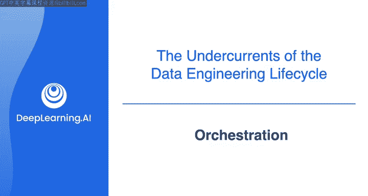
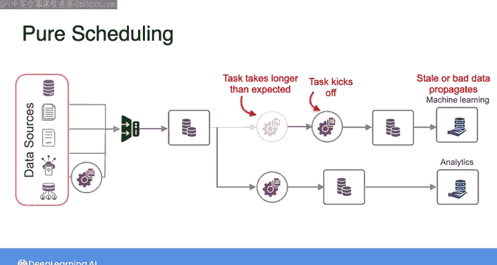
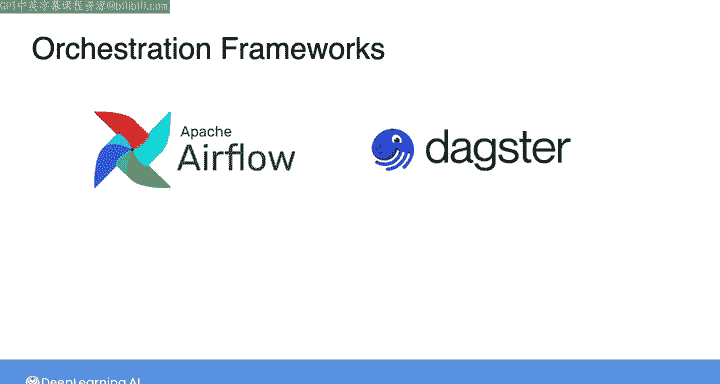
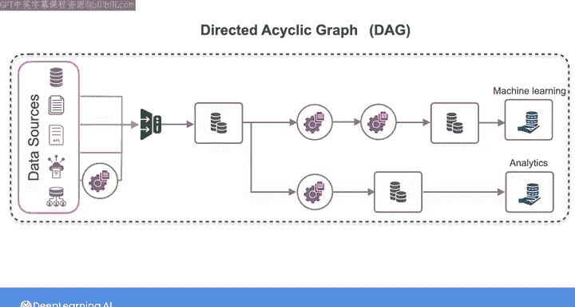
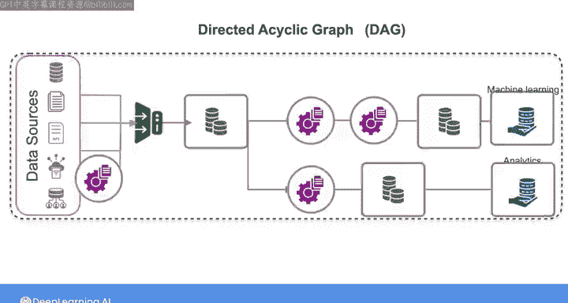
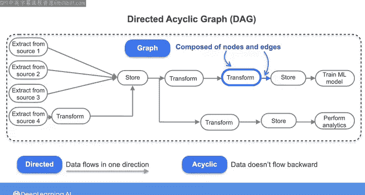

# 吴恩达《数据工程（导论，源系统、数据摄取和管道，数据存储和查询｜1-2-3课）｜DeepLearning.AI Data Engineering》 - P30：29_编排.zh_en - GPT中英字幕课程资源 - BV1wTtWeeEH5

When you think of the word orchestration， what comes to mind。

 maybe a conductor guiding an orchestra or a choir。

 signaling when various instruments or voices should be featured and shifts in things like tempo and intensity。

 all in an effort to make good music， like an orchestra。

 a data pipeline has a lot of moving parts that must be coordinated to get a good result。

And as a data engineer， you are the conductor in charge of coordinating and managing the tasks in data pipelines。

 We touched on orchestration briefly in the previous video as an essential component of dataOs and here I'll just say a few more words about how orchestration plays a key role as an undercurrent of the data engineering lifecycl as I mentioned in the last video if you're just getting started。

 maybe as the first data engineer at a small startup or in the prototyping stages of a new project at any size organization。

 you might initially set up a data pipeline where you're manually executing each of the tasks at each stage。

So we looked at a pipeline like this where you're ingesting data from multiple sources into your storage systems while applying some inflight transformations。

Then downstream， you have more processes to transform。

Store and serve the data to downstream users for machine learning and analytics use cases。

 manualual execution of all these steps in your data pipelines。

 meaning manually triggering each step to run when you need to might be something that can help in prototyping various aspects of your system。

 But in the long run， this is not a sustainable method for data processing。

 once you know what tasks you need to run in your data pipeline。

 you might take a pure scheduling approach to have those tasks run automatically at particular times of day or at particular frequencies。

 For example， you might schedule your ingestion and initial storage tasks to start at the same time each day。

 then you might schedule the transformation steps to kick off an hour after you expect all the ingested data to be present in your storage system。

 pure scheduling is an approach that has been widely used historically for various data processing tasks。

 However， you can run into problems with this approach。 For example。

 if the scheduled ingestion task failed to execute。

 This could cause downstream transformation tasks to fail as well。 or if this transformation task。

imply takes longer than expected and the next transformation task kicks off before the previous one finishes。

 you can end up with incomplete or stale or otherwise problematic data being propagated through your pipeline not that long ago。

 orchestration frameworks that were more sophisticated than peer schedulers were really only available to large enterprises where they had the resources to build their own custom solutions nowadays。

 there are a number of open source orchestration frameworks that make it possible for you to build sophisticated orchestration into your own data pipelines。

 no matter what sized team or company you're working with the most popular framework right now is Apache airflow。

 but several other newer open source frameworks such as Dgster prefect and mage or gaining traction as well。

 what these frameworks allow you to do is automate your data pipelines and build in complex dependencies and monitoring capabilities。

 So you could do timebased scheduling if you like， but you could， for example。

 build in a dependency that verifies that this first transformation task。

Ha been completed before starting the next transformation task or instead of predefining a particular time of day or frequency you want to start a task。

 you could have tasks that are triggered by events。 For instance。

 you can trigger the suggestiongestion step to start when there's a certain amount of new data available in the source database you could set up monitoring within your orchestration framework and trigger alerts to let you know if。

 for example， this transformation task fails to execute or has't been completed by a certain time。

 many orchestration frameworks require you to set up your data pipeline as what's known as a directed ascyclic graph。

 which is really just an overly complicated term to describe how data flows through your data pipeline So let's take a look at what a directed ascyclic graph or dag for short would look like for this pipeline we've been talking about In some sense you could say this is already a dag where each of these icons represents a different task in your pipeline and the arrows show how data moves from one task to the next。

 but now I'm going to modify the visual here， just to make it more explicitly like a dag as you'll see them represented elsewhere。

call these source systems So1， So2， So3 and source4。

 and we're ingesting or extracting data from all of these sources。

 and there's a transformation step happening in flight from source4 here。

 then you store all the extracted data into storage After that your pipeline splits where along this top branch you have two more transformation steps followed by storage that will serve the machine learning end use case and on the bottom branch you have a transformation step and then storage to serve the analytics and use case The word directed in directed acyclic graph indicates that the flow of data goes only in one direction acyclic indicates that there are no loops data doesn't flow back to a previous step and it can be described as a graph because it's composed of nodes and edges you can think of a daAg as a flow chart for how data moves through your pipelines you'll construct and deploy dags within your orchestration framework of choice and as I mentioned youll be able to specify criteria and dependencies for how each tab。

Shouldul be triggered in what kinds of monitoring and alerts you want to set up you'll get plenty of practice setting up and running dags for some data pipelines and some popular frameworks later on in these courses For now。

 though the main takeaway is that orchestration is undercurrent that spans the entire data engineering lifecycle as well as key aspects of data ops join me in the next video。

 take a look at how software engineering， the last undercurrent relates to your role as a data engineer。

