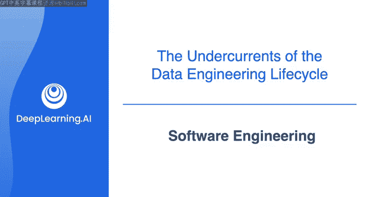
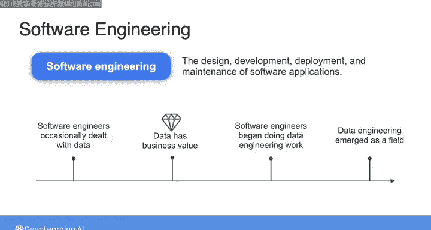
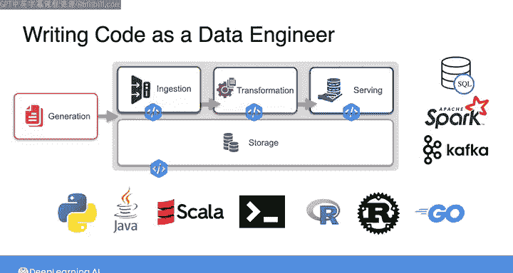
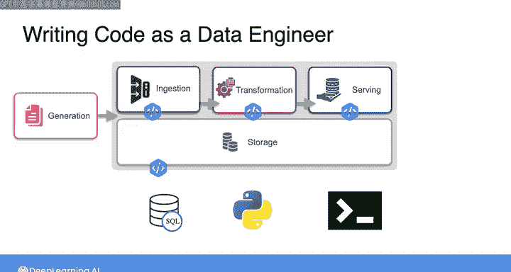
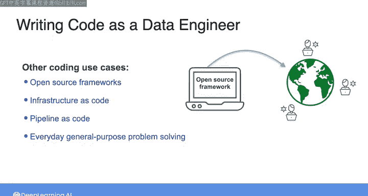

# 吴恩达《数据工程（导论，源系统、数据摄取和管道，数据存储和查询｜1-2-3课）｜DeepLearning.AI Data Engineering》 - P31：30_软件工程.zh_en - GPT中英字幕课程资源 - BV1wTtWeeEH5

In this lesson so far， we've been talking about some pretty complex stuff when it comes to the undercurrents of the data ensuring lifecycle。

Things like security， data architecture， operations and management。

 as well as the orchestration of data pipelines if all the undercurrents。

 perhaps the most straightforward one to wrap your head around is the last one software engineering what I mean by that is as a data engineer you need to know how to read and write code it's as simple as that So now just mean hacking together some code that does whatever you needed to do right now。

 but instead to write production grade code that's clean， readable， testable and deployable。

 and so software engineering is the design， development。

 deployment and maintenance of software applications。 and they not too distant path。

 there was no such thing as data engineering as an official profession there were just software engineers who occasionally dealt with data in their own work eventually as businesses recognize the value of data software engineers began taking on various aspects of data engineering as part of the work。

Growing diversity in volume of data in recent decades。

 the dataoriented component of software engineering became much more intensive and eventually emerged as its own field over the years。

 those software engineers doing data engineering build a variety of fantastic solutions。

 such that nowadays as a data engineer， you have access to a wide range of managed services and applications that allow you to more efficiently get the job done。

And this is a good thing， it allows you to spend more of your time focused on the most important aspects of adding real value to your organization。

In a sense， these existing services and applications allow you to move up the value chain。

 so to speak。This also means that as a data engineer today you are often required to write much less code than your software engineering oriented ancestors of a decade or two ago。

 this doesn't mean however， that coding is not important in your work as a data engineer。In fact。

 it's more important than ever that you can write great code and that the code you'd write is of top quality。

 For example， you will be required to write core data processing code at all stages of the data engineering lifecycle from intion to transformation and serving you'll need to be proficient in frameworks and languages such as SQL Spark or Kafka you're also likely to encounter Python or maybe Java virtual machine languages like Java or ScA as well as bash for operating at the command line you may be required to work in other languages as well like R Ru or Go but if you focus on building strong foundational software engineering skills。

 you won't have much trouble moving between languages and this specialization will focus mostly on SQL Python and bash in the lab exercises since these are the most common ways you'll interact with data as a data engineer also as a data engineer you are likely to。

Get involvedvolve in the development of open source frameworks the way this tend to happen is that you adopt a open source framework to solve a particular problem and you end up further developing the framework for your specific use case as long as you write good code you can make a pull request and add your contributions to the open source project to help others solve similar problems Other efforts you'll be involved in or in the development of so-called infrastructure as code or pipeline as code solutions。

 which we'll talk about later in these courses apart from these specific instances if where you'll write code in your role as a data engineer you'll also need to write code for everyday general purpose problem solving at all stages of the data engineering lifecycle So as I said right at the top of this video as a data engineer you'll need to know how to read and write code coding will be part of your everyday work and your ability to write clean readable testable and deployable code will translate into value for your organization as well worth your time to make friends。

with the software engineers and your organization and learn from them how to write great code and with that we finish this lesson on the undercurrence of the data engineering lifecycle at this point I'm sure you've had quite enough of all this theory stuff and you're ready to roll up your sleeves and dive in to applying some of these concepts and some practical exercises join me in the next lesson to take a look at how the data engineering lifecycle and undercurrets come to life on the AWs cloud。

