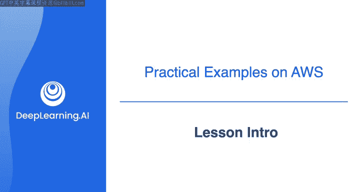

# 吴恩达《数据工程（导论，源系统、数据摄取和管道，数据存储和查询｜1-2-3课）｜DeepLearning.AI Data Engineering》 - P32：31_课程简介.zh_en - GPT中英字幕课程资源 - BV1wTtWeeEH5

Now that you're familiar with the data engineering lifecycle and undercurrents。

 it's time to take a look at how these concepts translate the tools and technologies on the AWS cloud。

 I'll first just say here that there are other cloud providers。

 including Microsoft's Azure and the Google cloud platform as well as other small providers and depending on where you work as a data engineer you might be building on one of these other platforms with that being said。

 all the concepts you're learning about in these courses will be relevant you work no matter what cloud platform you're building on just that some of the tooling and implementation details might look a little different right now。

 AWS is a leading cloud provider and we're really excited to be partnering with them on these courses so that you can gain the technical skills required for data engineering using the same tools and technologies that have been adopted by thousands of companies around the world So in the next video。

 Morgan Willis will introduce you to some of the tooling you'll be working with in the labs throughout these courses and explaining where are those。

Tools fit into the data engineering life cyclee and the undercurrents。After that。

 I'll give you an orientation to the lab exercise for this week。

