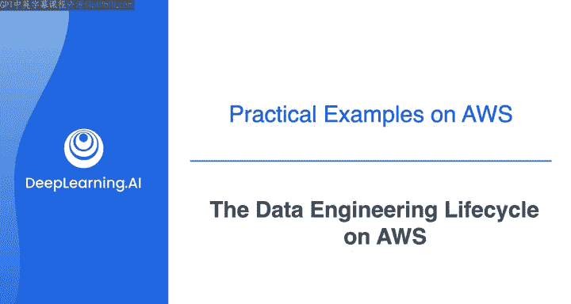
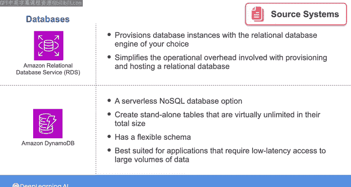
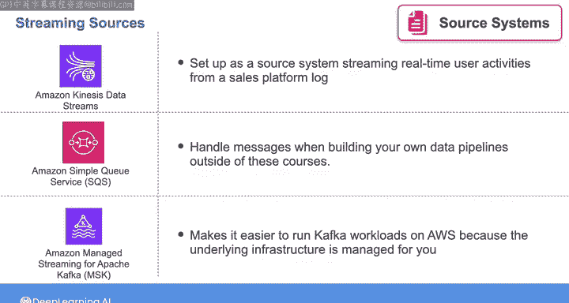
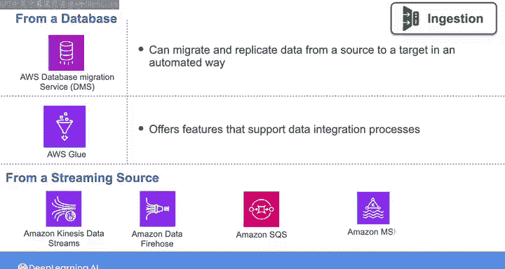
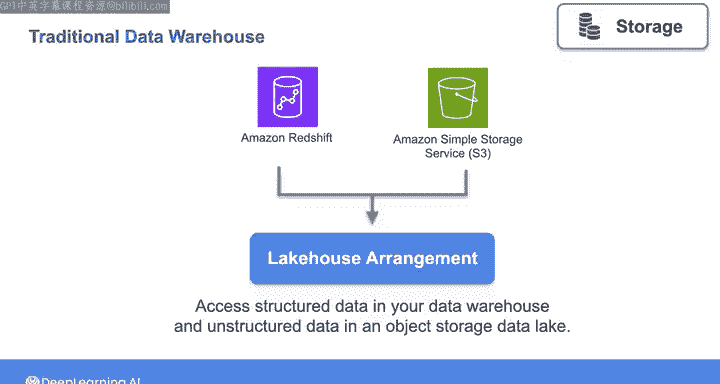
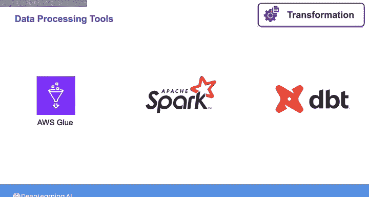
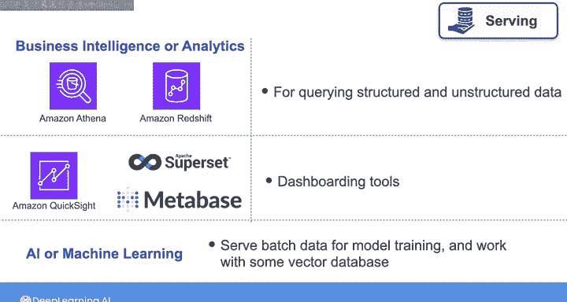

# 吴恩达《数据工程（导论，源系统、数据摄取和管道，数据存储和查询｜1-2-3课）｜DeepLearning.AI Data Engineering》 - P33：32_AWS上的数据工程生命周期.zh_en - GPT中英字幕课程资源 - BV1wTtWeeEH5

Hi again， I hope you've been enjoying the lesson so far on the data engineering lifecycle and undercurrents I'm excited to share with you how these concepts come to life with tools and technologies on the AWS cloud。

In this video， I'll step through each of the stages of the data engineering lifecycle as well as the undercurrents that Joe has presented so far and connect them to the specific cloud tools you'll be using to build your data systems when it comes to source systems on AWS as Joe mentioned previously the most common source systems you'll interact with are databases and so in several labs in these courses including the one this week。

 you'll be working with Amazon relational database service or RDs as it's called RDS is a service that provisions database instances with the relational database engine of your choice like MysqL or PostgressqL RDS simplifies the operationalal overhead involved with provisioning and hosting a relational database as well as taking care of tasks like patching and upgrading in the next course you'll also be working with Amazon dynamo Db which is a serverless NosqL database option with dynamo Db you create standalone tables and these tables are virtually。

Limited in their total size across all items in the table Dynamo Db has a flexible schema and is best suited for applications that require low latency access to large volumes of data。

 such as gaming Io mobile apps and realtime analytics where the data model can evolve over time without the need for complex migrations in terms of streaming sources in the last week of this course。

 you'll get a chance to work with Amazon kinesis data streams that' set up as a source system streaming realtime user activities from a sales platform blog and although you won't be using message queuees as sources in the labs。

 you might find yourself using something like Amazon simpleple Q service or Sqs to handle messages when building your own data pipelines outside of these courses Another popular option for streaming source systems is Apache Kafka。

 which is an open source streaming platform that you can either implement on your own or use Amazon's manage streaming for Kafka。

Or MSK service， which makes it easier to run Kafka workloads on AWS because the underlying infrastructure is managed for you。

 you won't be using Kafka in the labs， but you will learn the details of Kafka in course2 when it comes to ingestion if you're ingesting from a database you might use Amazon's database migration service otherwise known as D with Ds you can migrate and replicate data from a source to a target in an automated way but for the labs in these courses。

 you will mostly use the AWs glue ETl service which offers features that support data integration processes and when it comes to ingesting data from a streaming source you'll use Amazon kesis Data streams and Amazon data Fire hose in the labs but out in the wild you could use one of the other streaming ingestion tools that I mentioned earlier like SQ Kafka or others with cloud storage。

 you'll get practice using traditional data warehouse options including Amazon Redshift as well as object storage for a data lake on Amazon。

Storage service， which is known as S3 for short。 while also look at how you can combine services into what's known as a lakehouse arrangement for seamless access to both the structured data in your data warehouse and unstructured data in an object storage data lake for the transformation stage in these courses。

 you'll be working with Aws glue as well as Apache Spark and DBT which are tools that you can use in combination with glue or as alternatives depending on your needs when it comes to serving data will be looking at the two main potential use cases which are first the business intelligence or analytics use case and second an AI or machine learning use case for analytics you'll use tools like Amazon Athena or redshift for  querying structured and unstructured data you'll also get some experience working with a dashboard in a Jupiter notebook in this week's lab and depending on the company and team you work with you might also use dashboard tools like Amazon Quicksite as well as Apache superet and。

Both of which are open source options for the AI and machine learning use cases。

 you'll serve batch data for model training and work with some vector database options for serving data for product recommenders and use with large language models it's important to keep in mind that for each stage of the data engineering lifecycle there are numerous other open source and managed service options。

 but I wanted to name a few specific ones here so you can start to connect some of the concepts you've been learning about to the tools and technologies you'll be practicing with in these courses In the next video hourly each of the undercurrents of the data engineering lifecycle to concepts and technologies on AWS I'll see you there。

