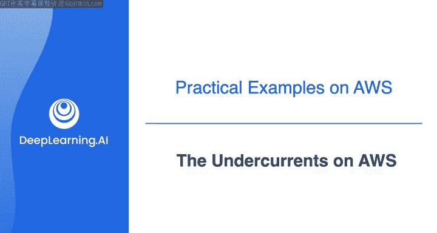
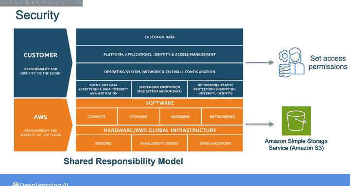
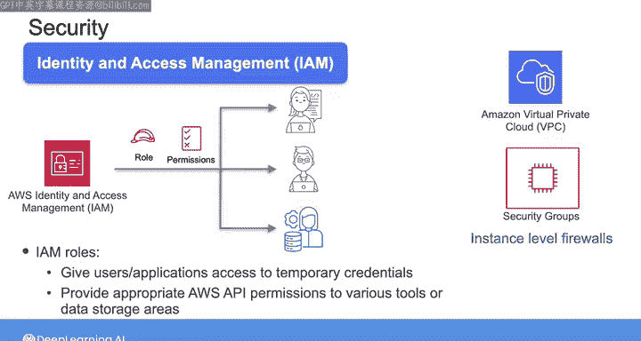
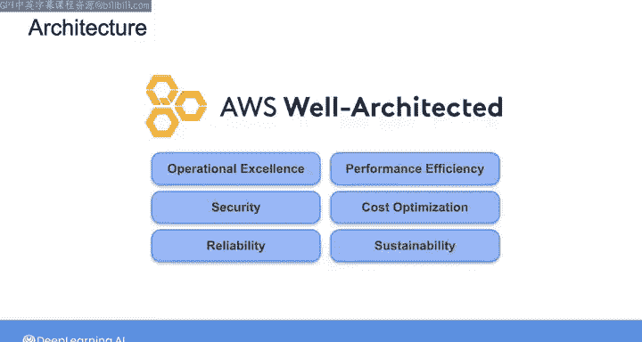
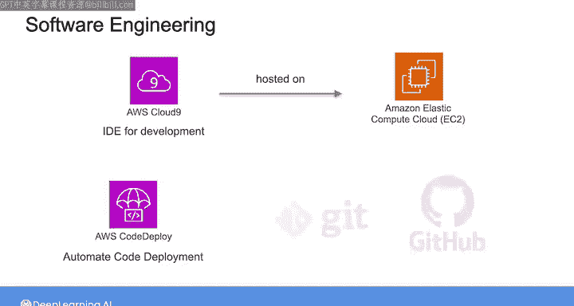

# 吴恩达《数据工程（导论，源系统、数据摄取和管道，数据存储和查询｜1-2-3课）｜DeepLearning.AI Data Engineering》 - P34：33_AWS上的底层技术.zh_en - GPT中英字幕课程资源 - BV1wTtWeeEH5

The undercurrents of the data engineering lifecycle that you've been looking at this week are security。

 data management， data ops， data architecture， orchestration， and software engineering。

When it comes to how these undercurrents appear on AWS。

 there are some aspects that are more conceptual and others that are more tool oriented。 For example。

 security as a concept will appear in many forms in your work on AWS。

 while something like orchestration is more about choosing the right tool or service to meet your needs So in this video。

 I'll say a bit about each undercurrent as it will relate to your work on AWS so you can start to connect these ideas。

 So let's start with security Last week I mentioned the shared responsibility model as it relates to security of data systems or other applications built in the AWS cloud In short。

 the shared responsibility model says that AWS is responsible for security of the data centers and services they provide and you are responsible for the security of the systems you build with those resources。

 For example， if you store your data on Amazon S3。 It is AWS's responsibility to make sure the S3 service itself is secure and then it's your responsibility to make sure the access permission。

arere set correctly so your data is only available to people and applications that should have access to it speaking of access permissions。

 one key security concept on AWS is what's known as identity and access management or IA through IA you can set up roles and permissions which control access to AWS resources ensuring that users and services have the necessary access to perform their tasks securely within your data pipelines。

 you'll use IA roles which give users or applications access to temporary credentials that automatically rotate and provide appropriate AWS API permissions to various tools or data storage areas network security is also crucial for security on AWS and you'll need to be familiar with services and features like Amazon virtualr private cloud or VpC as well as security groups which are instance level firewalls that are another key aspect of implementing secure data pipelines with the undercurrent。

Data management in these courses， you'll use AWS glue crawlers and glue data catalogs。

 which allow you to discover， create and manage metadata for data stored in Amazon S3 or other storage and database systems you will also get familiar with lake formation which helps you centrally manage and scale finegrained data access permissions。

 All of these are also related to security but I'm listing them here under data management because they have to do specifically with data privacy and discovery for data ops in the next course。

 you'll work with a service called Amazon Cloudwatch that collect metrics and provides monitoring features for cloud resources。

 applications and even onpres resources。 Then there is also Amazon Cloudwatch logs which can help you store and analyze operational logs in course2 you will also work with Amazon simple notification service or SNS which provides a means of setting up notifications either between applications or via text or email。

That are triggered by events within your system。 There are also many open source observability tools you might use in your own work。

 like Monte Carlo or Big eye with orchestration in these courses， you'll work with airflow。

 which is an orchestration tool that you can implement as an open source tool or use a managed version from AWS Airflow is currently the industry standard。

 but you should be aware of newer orchestration tools like Dgster。

 Prefect and me that aim to solve some of the issues that airflow isn't designed for。

 when it comes to architecture， we'll take a look at the AWs well architectected framework next week。

 which is a set of principles and practices developed by AWs that can help you build systems with an eye towards operational efficiency security scalability and sustainability。

 And with regard to software engineering， in these courses。

 you'll use the Amazon Cloud 9 Ide for development。 Cloud 9 is hosted on Amazon Ec2。

 So this service is essentially a Vm that has an Ide installed on it that you can。

UseIn your browser in your own work， you may also use tools like Amazon's code deploy。

 which allows you to automate code deployment， as well as various CicCD tools。

 You'll also handle version control with Git and Github。

 And so that's a quick overview of some of the tools you'll be using as they relate to the undercurrents of the data engineering lifecycle。

 Next up， Joe's going to walk you through the first live exercise where you'll spin up an end to end data pipeline on AWS。

