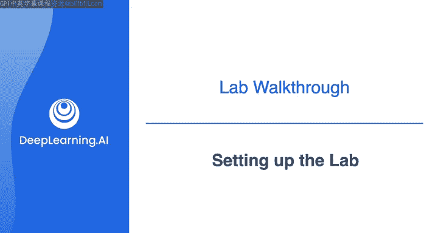
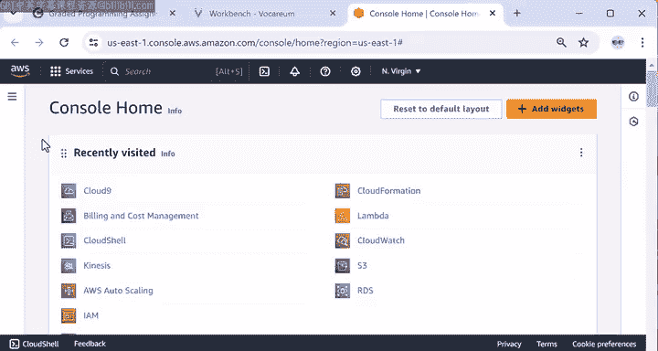
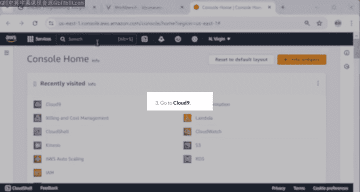
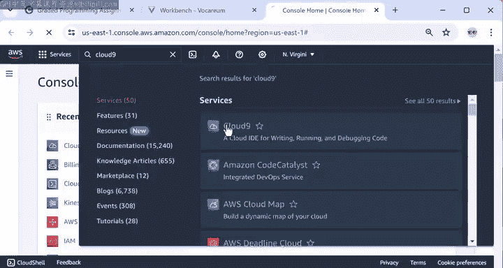
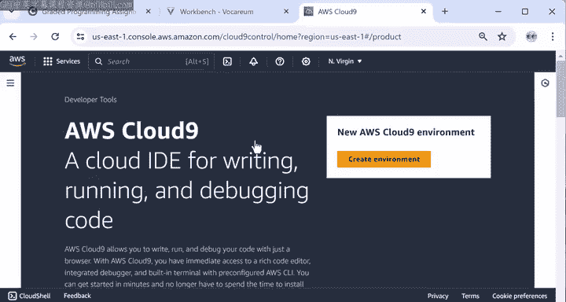
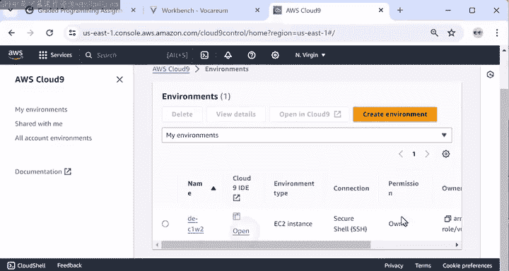
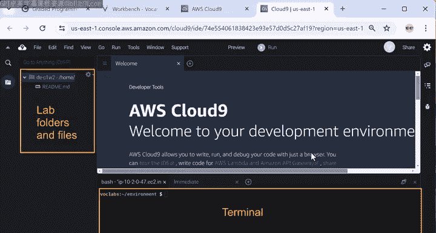
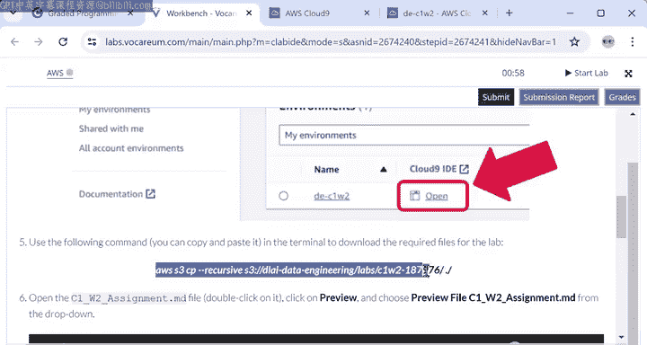
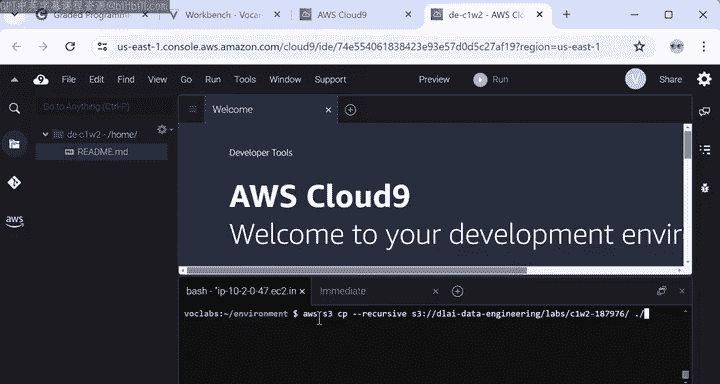
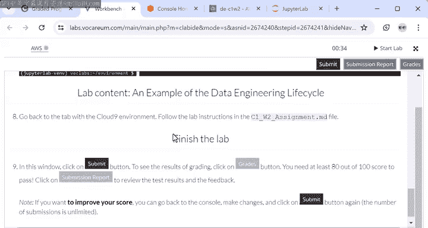

# 吴恩达《数据工程（导论，源系统、数据摄取和管道，数据存储和查询｜1-2-3课）｜DeepLearning.AI Data Engineering》 - P36：38_实验演练：设置实验环境.zh_en - GPT中英字幕课程资源 - BV1wTtWeeEH5

In this video， we'll take a look at how you'll access to lab instructions and the Jupiter notebook needed for the first lab in the specialization。

 Feel free to open the lab yourself in another browser tab as I go through this。

 or just watch for now and head into the lab later。 So here I in Coursera。

 and I've clicked on the lab for this week， which is this one called graded app。

 I'll scroll down to sign the Coursera honor code and then launch the app。

 this will open the welcome page of the lab that contains the instructions for how to set up the lab launch cloud 9 and open the Jupyter notebook。

 Once you finish the lab。 you need to come back to this page to submit the lab。

Following along with step one and the instructions here to start the lab。

 I'll click on this button and wait for the circle up here to turn green in order to open the AWS console。

 note that the first time you start the lab， the environment should load in a few seconds。However。

 subsequent attempts may take around 10 minutes because the AWS account that was created needs to go through a cleanup procedure。

Allright， so now this icon is green， I can click on it to open the AWs console in our new browser tab。

 The next step is to launch the AWS Cloud 9 I to get access to the code and the detailed instructions for the lab。

 So following step 3 of the lab instructions I type cloud 9 in the search bar and select that service。

 This will take you to another page where you can create an AWS cloud 9 environment。

And next， I'll click on Create Environment。Following along with the details of step 4。

 the name of the environment is DEC C1W2， and the EC2 instance type is T3 small。For network settings。

 I'll select the secure shell， then click on the VPC settings drop down to choose the VPC named D C1W2 and the public Subnet named D C1W2 public subnet for future labs you might need to select other EC2 types or choose different VPC settings。

 so make sure to read the setup instructions carefully。

 otherwise you won't build access to cloud 9 environment you need for the lab。

Now let's scroll down and click Cre。It will take AWS a few minutes to set up the environment。

Once it's ready， you can open the IDE。

In this environment， you have the terminal here at the bottom。

 and you should have the lab folders and files here on the left。 Right now。

 there are no files for the lab yet to download them into this workspace。

 I'll go back to the lab set instructions。

Copy this command from step 5 and paste it in the terminal here。

This command downloads a lab content from an S3 bucket that is set up for the lab。Once downloaded。

 you will see the folders and files for the lab on the left。To access the detailed lab instructions。

 follow Step 6 and the setup instructions。Open this mark on file and then click on Preview and select Preview fileile C1w2assignment。

md from the dropdown。If the detailed lab instructions are not rendered。

 just make sure to click on this refreshsh button。Here we go。

 these are the instructions you'll follow to complete the rest of this lab。Before getting started。

 though， there's one more setup step I need to perform to install Terraform and launch the Jupiter notebook。

 so I'll go back to the lab setup instructions here。

Copy this command from Step 7 and then paste it in the terminal here。

 This command contains a ba grips that are needed for installing terraform and launching the notebook through Jupiter La。

 So terraform is now installed， and the Jupiter lab is being installed。

 which might take a few minutes。Once this is done， you'll get a URL here for the Jupiter labb。

 you will copy this URL and paste it in our new browser tab to access the Jupyter lab environment。

 you won't be using this environment until the last part of the lab after you build and run your data pipeline。

So there's a cloud9 environment you'll use to set up your data pipeline。

 you'll also have the AWS management console where you can see the details of the created AWS resources。

 then the Jupyter Lab environment that you will use in the last part of the lab is in this other tab and there's the lab setup instructions page that you need to return to at the end to submit the lab I know that's a lot of tabs and navigating back and forth between them might be overwhelming in the beginning but this will all become more familiar as you progress through the specialization。

So that's a setup for this lab In the next video， I'll walk you through the next steps for setting up your data pipeline。

 I'll see you there。

