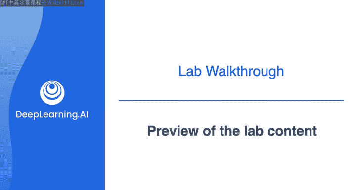
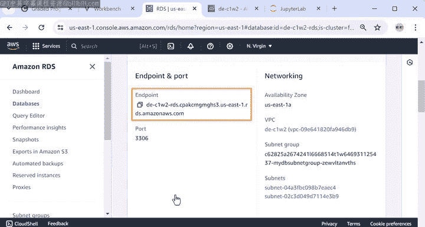
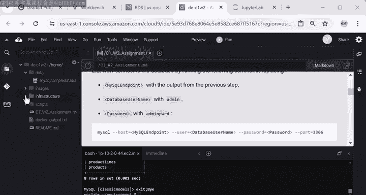
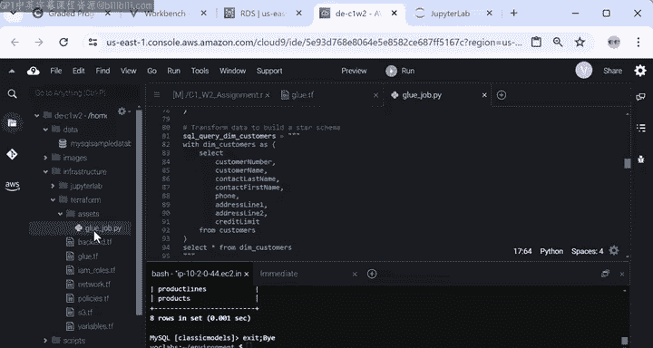
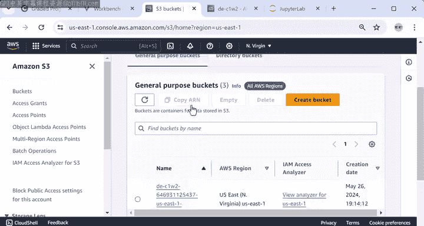
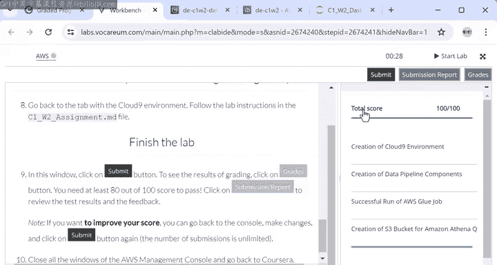

# 吴恩达《数据工程（导论，源系统、数据摄取和管道，数据存储和查询｜1-2-3课）｜DeepLearning.AI Data Engineering》 - P37：39_实验演练：实验内容预览.zh_en - GPT中英字幕课程资源 - BV1wTtWeeEH5

In this video， I'll give you a preview of what you'll be doing in the lab。

As a reminder in the previous video， we went through the setup steps for the lab and ended up with the cloud9 environment that looked like this where you have all the files needed for the lab in this folder structure here on the left。

 and you've opened the file called C1 W2 assignment Md that contains a detailed instructions for the rest of lab exercise and these instructions。

 youll find some introduction here at the top and then your work begins in section 2 exploring the source system As I mentioned before。

 the source system database is already instantiated for you。

 You can view the details of this database and the AWS console to do that。

 you can go to the console and type RDS and then select that service。 on the left here。

 I'll click on databases。 Here's the instance of the source database。 If I click on the identifier。

 I get all the details of the database such as the endpoint or the URL that allows you to access the database。

 the port number and other networking info such as the VpC and subnet where the RDS instance is set up to explore the database and the table stored within this instance you'll need this endpoint。

You can also get the end point through the terminal by running this command。

You'll need to replace this part with a database identifier and then run it。Now。

 there's the same endpoint you saw in the console， you need to establish a connection to this database before you can see its contents。

Since a database is a MySQqL database， you can connect to it by typing MySQqL。

 then specifying the host or the endpoint of the database， the username which is admin in this case。

 the password which is user admin， and finally the port which is 3306。

Now that you have the connection established， you can choose the database you want to explore with the command use。

And then specify the name of the database， which is classic models。

You can view the tables inside the database by typing show tables。If you're curious。

 you can also view the script that was used to populate the database by going up here to the data folder and opening this file called MysqL sample databasease。

sQL。Here you can see some information about where the data came from and a bit of version history。

If you scroll down， you'll find a bunch of SQL code First there's a line to create the database itself。

 then there's a whole series of create table commands that are populating each of the tables in the database。

For now you won't need to worry about all this SQL code in the next course you'll get a chance to read。

 write and interpret SQL commands。Finally， to exit the database connection and continue with the lab instructions。

 you'll type exit。Next let's create the resources for the data pipeline。

 namely the AWS Glu Inscense and the S3 bucket for that you are provided with terraform files that contain code for creating and configuring those resources。

If you click on the terraform folder here on the left。

 all these files here that end with the do Tf extension are terraform files。 So for instance。

 the glue do Tf file contains the configurations for the AWS glue instance and the S3 do TF file contains the configurations for the S3 bucket。

 The other terraform files contain networking and permission settings that you will learn more about in course2 For now。

 I'll quickly skim through the glue do Tf file to show you the resources declared in this file。

 So here's the AWS glue data catalog and we're going to define a connection between AWS glue and the RDS source database。

Here's another resource that defines a glue crawler， which will be used to crawl the S3 bucket。

And finally， here's the glue job where we specified the connection to the source system。

 the e location of the script that contains a transformation code。

 and the target location for the transform data， you can find the script under the asset folder。

 which consists of the code that extracts the data， transforms it， and finally loads it into S3。

We'll get further into the details of AWS glue and Course4 If you're curious。

 you can also have a look at the transformations that will be applied to the data by opening up this Python script called Glujob。

 Pi in the infrastructure/chform s assets folder， but you don't need to worry about the details here of what you're doing with a script is taken the data in a so-called normalized form and modeling it as a star schema of fact and dimension tables for easier analytics。

And this is a very common practice in data engineering of tabular data for analytics and use cases to actually create the resources for this pipeline。

 you need to run the terraform files in the terminal here。

 let's navigate to the terraform directory and start with the command terraform in it。

This command will install any files that are needed to create the AWS resources。

Then you can create the terraform plan command， which shows you the list of resources that  Terraform is planning to create。

 Finally， you can run the  Terraform apply command to create the resources。 At this point。

 you'll see the plan again and have to confirm that you want terraform to perform these actions。

 I'll type yes and wait for the resources to be created。Once the resources are created。

 you can see them through the AWS Management console。

So let's go to the console and type AWS gluelu in the search bar， click on that service。

 and on the left， click on ETL Jobs here you'll see the instance that was just created。

You can also search for the S3 bucket。 here's the bucket that will contain the transform data。

Now that the resources have been created， let's run the glue job。

 I'll copy this command from the lab instructions and paste it here in the terminal to start the glue job。

To monitor the status of the job， let's go to the console and again search for AWS glue。

 you'll navigate to the ETL job section and then click on the job name in the runs tab。

 you will see the status of the job， which is now running。

You might need to wait two or three minutes for the job to be done。

 You can refresh your browser to see the latest status。

Once a glue job is done and the status shows succeeded。

 you should have the transform data in the S3 bucket。

 Let's verify that by accessing the contents of this S3 bucket。

Here you can find the folders that contain the tables of the transform data。

In the last part of this lab， you'll explore how the data sets can be queed by the data analyst and the Jupiter lab environment that we set up earlier。

 I'll click on the Jupiter Note。Here's the Python notebook that contains cells that perform analytical queries on the transformed data。

 In this first cell， the package AWS Wrangler imported here allows you to use Amazon Athena to extract data from the S3 bucket。

Here's the first query statement that extracts all products from the Dm products table。

 The next cell contains a query that finds the total sales per country。

The following cell contains a query that further groups the total number of sales by country。

 product lines， order date， product line， and product name。

If the code and these SQL query statements don't look familiar to， don't worry。

 you'll get hands on experience with writing and interpreting queries in courses 2 and 3。

 If you're familiar with SQL， then you can try this optional query question in this cell or any other query of your choice。

 And finally， you can run this interactive dashboard to further explore the data。

 Once you're done with the steps in this lab。 make sure to go back to the lab setup instructions page and click submitit。

Keep in mind that the lab environment will expire in two hours。

 so be sure to submit before your time runs out now that you have a better idea of what you'll be doing in this week's lab。

 it's your turn to try it out。Please follow the lab instructions carefully and you can always revisit these videos if you get stuck at any point after you've completed this lab。

 I'll see you back here for a quick summary of the week。

