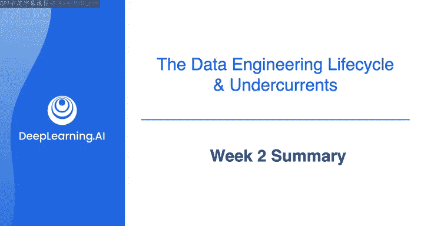
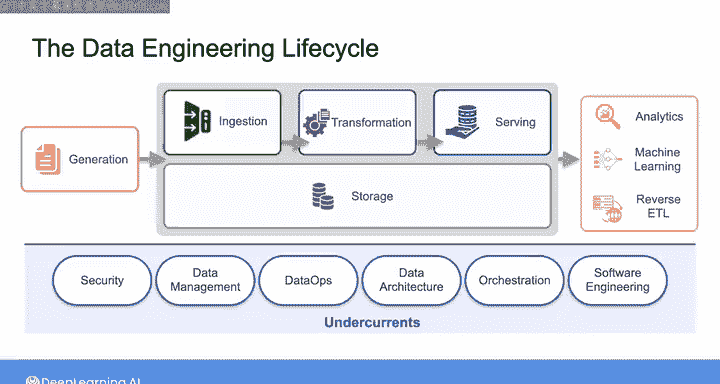

# 吴恩达《数据工程（导论，源系统、数据摄取和管道，数据存储和查询｜1-2-3课）｜DeepLearning.AI Data Engineering》 - P38：40_第2周总结.zh_en - GPT中英字幕课程资源 - BV1wTtWeeEH5

Congratulations on completing the second week of this course。As I highlighted right at the top。

 this week has been more focused on a high level mental framework for data engineering rather than about actually building data infrastructure。

 you did however get a chance to explore an end to end data pipeline on AWS。

To start getting oriented on how you're going to put all this theory into practice。

 both the practice and that mental framework we've been putting together will help make you more successful in all aspects of your work as a data engineer And so this week you looked at the data engineering lifecycl and undercurrents。

 which are all the various aspects of how you as a data engineer we'll get raw data from somewhere turn it into something useful and make it available to end users In lesson1。

 we looked at each stage of the data engineering lifecycle starting with data generation and storage systems and then at ingestion。

 transformation serving and storage of data for multiple use cases like analytics。

 machine learning and reverse El In lesson two， we looked at the undercurrents of the data engineering lifecycle which are security data management。

 data ops， data architecture， orchestration and software engineering you'll be seeing more detail in getting。

more practice with all aspects of the data engineering lifecycle and undercurrents throughout these courses coming up next。

 we'll be doing a deep dive into what it means to build good data architecture I'll see you there。

