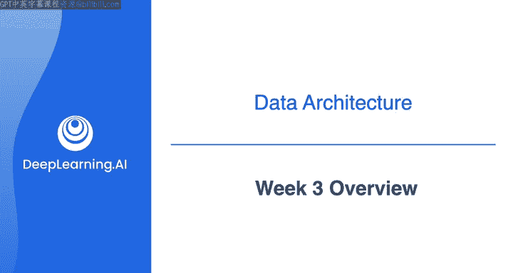
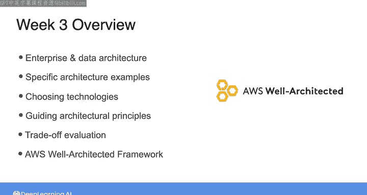

# 吴恩达《数据工程（导论，源系统、数据摄取和管道，数据存储和查询｜1-2-3课）｜DeepLearning.AI Data Engineering》 - P39：41_第3周概览.zh_en - GPT中英字幕课程资源 - BV1wTtWeeEH5

Last week， we took a brief look at data architecture and how in your work as a data engineer。

 you'll be most successful if you can think like an architect。

 even if data architect is not technically your role this week。

 we're going to dive deeper into what it means to build good data architecture We'll first take a look at how data architecture fits within the broader context of enterprise architecture。

 which is to say the architecture for your entire organization After that。

 we'll look at some specific architecture examples and how you can start to think about translating stakeholder needs into technology choices for your data systems I'll also share with you some guiding principles you can keep in mind as you're learning to think like an architect in the lab this week。

 you'll be evaluating the tradeoffs when it comes to things like cost performance。

 scalability and security for an actual data architecture on the AWS cloud youll also get a chance to explore the AWS well architect and framework。

 which is a complementary set of。s that can help you design robust and effective data systems by the end of this week。

 you'll be armed with a set of tools that will serve you at all stages of your data engineering journey。

Join me in the next video to get started。