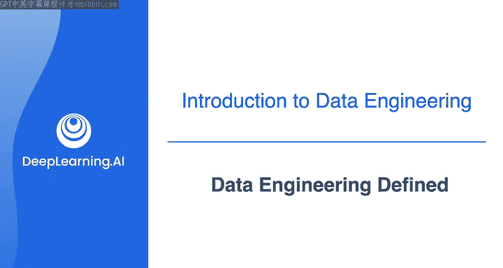
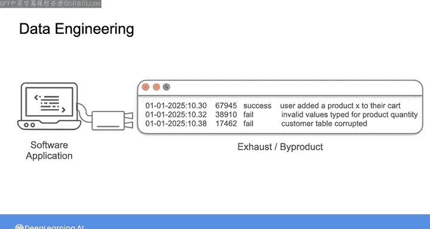
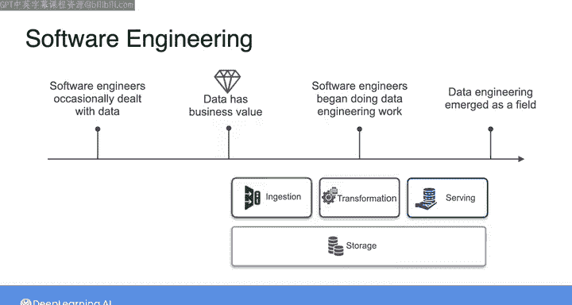
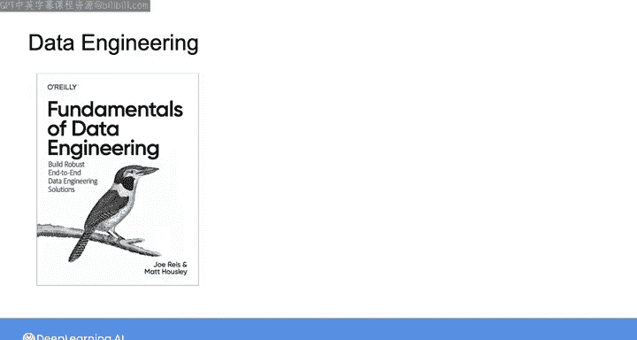
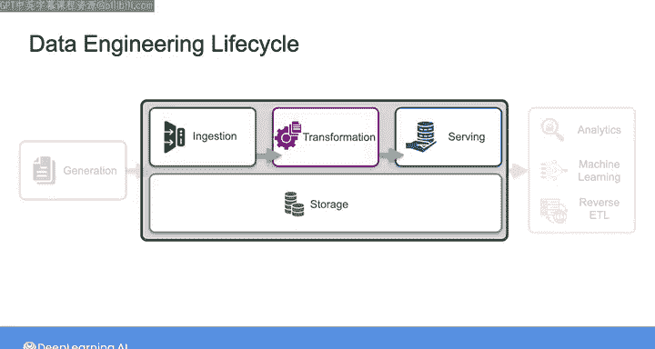
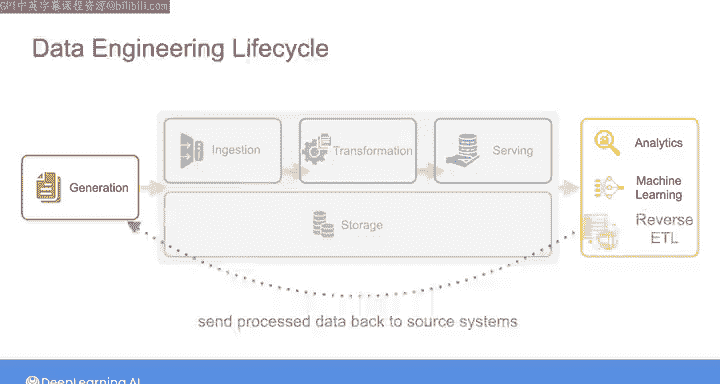
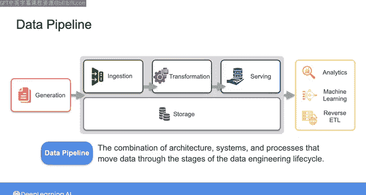
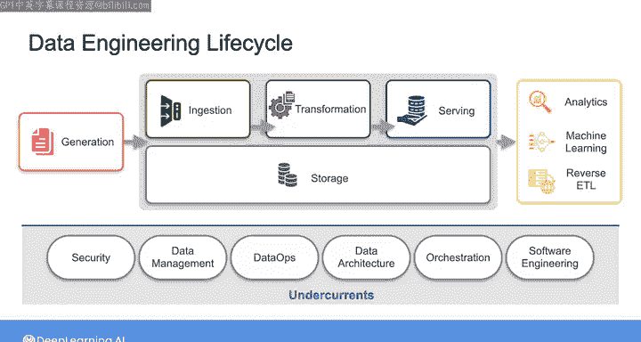

# 吴恩达《数据工程（导论，源系统、数据摄取和管道，数据存储和查询｜1-2-3课）｜DeepLearning.AI Data Engineering》 - P3：2_数据工程定义.zh_en - GPT中英字幕课程资源 - BV1wTtWeeEH5

I've seen the field of data engineering change over time。

 The original data engineers were software engineers whose primary work was building the software applications。

 the organizations needed and not that long ago， the data being generated by the software applications was mostly regarded as a sort of byproduct or exhaust So what I mean by that is let's say you have a software application running over here like this and it's recording various events within this application to a log。

 then this data recorded in the log might have been considered useful for things like troubleshooting or monitoring the health of the application but it wasn't thought of as having much intrinsic value on its own So I'll draw this little exhaust pipe coming out of the application and then you'll have data being generated like the exhaust from a car or really just a byproduct of the application Over time however。

 as organizations began to recognize the intrinsic value of data and as a volume and variety of data being generated by。

Software applications uploaded by users or created through the digitization of various records continued to grow though the same software engineers became increasingly focused on building systems specifically for the purposes of ingesting storing。

 transforming and serving data for various use cases with the emergence of data engineering as essential function within many organizations that work with data the role of data engineering was born in our book Fundamentals of data engineering my co-author Matt Hausley and I propose the following definition for data engineering data engineering is the development implementation and maintenance of systems and processes that take in raw data and produce high quality consistent information that supports downstream use cases such as analysis and machine learning data engineering is the intersection of security data management。

 data ops data architecture orchestration and software engineering Now at this point in the course。

 I realized this definition might be a little confusing。

Or at least sound like it requires some further explanation of the terms that appear here。

 Don't worry though in this course we'll get into all the details of everything you see in this definition so you're comfortable with what this means and how it looks in practice apart from the definition of data engineering to visualize the lifecycle of data engineering in our book we put together this diagram you'll be seeing this diagram a lot throughout these courses and so I'd like to spend a little time introducing it right now you can think of the data engineering lifecycle as comprising a series of stages on the left here you have data generation and So systems and these So systems might be any kind of software application or user generated data or sensor measurements or something else one way or another the lifecycle starts with data generation then in the middle here you have ingestion transformation storage and serving I've drawn a box around these stages to indicate that these are the stages of the lifecycle that will be your focus as a data engineer you'll notice here that storage sits underneath。

getion， transformation and serving and spans the entire width of the box This is to indicate that data storage is an integral part of each of the stages above in practice the data systems you build may not look quite as simple as a lifecycl diagram might appear but in my experience it's helpful to think of the lifecycle in this way when it comes to visualizing the common elements of any data system on the right side of the diagram you have the end use cases and these are the ways in which stakeholders in your organization will actually derive value from the data these include things like analytics machine learning or something called reverse ETL。

 which is basically sending the transformed or process data back to the source systems to provide additional value for individuals in your organization who use these systems will be using the term data pipeline frequently throughout this course to collectively describe the various steps data passes through on its way from generation of source systems on through to end use cases you can think of the data。

Pline as a combination of architecture systems and processes that move data through the stages of the data engineering lifecycle As a data engineer。

 you'll manage the data engineering lifecycle beginning with getting data from So systems and ending with serving data for use cases including analytics and machine learning in simpler terms your job as a data engineering is to get raw data from somewhere turn it into something useful and then make it available for downstream use cases within the definition of data engineering I said that data engineering sits at the intersection of security data management data ops data architecture orchestration and software engineering in our bookFaals of data engineering we presented these six components of data engineering as what we will call the undercurrents of the data engineering lifecycle and so with this diagram of the data engineering lifecycle I like to write the undercurrents down below here these undercurrents are not stages of the lifecycle like the elements above but rather they span。

entire lifecycle so the way to read this diagram now is that you have these stages of the data engineering lifecycle up here。

 including data generation， ingestion， storage， transformation and serving and then you have your undercurrents down below here including security。

 data management， data ops， data architecture， orchestration。

 and software engineering and now each of these undercurrents is relevant to all the stages of the lifecycl above。

In the second week of this course， we'll zoom in on each of the stages and undercurrents shown here to give you a clear understanding of how all these pieces fit together。

 as I mentioned in the previous video， it can be tempting as a data engineer to jump straight into implementation and experiment with different tools and technologies in doing so it can be easy to lose sight of the higher level goals of your work and how exactly you aim to provide value for your organization。

Throughout these courses we'll be looking at how you can think holistically about the entire data engineering lifecycle and the undercurrents so that you can successfully transform stakeholder needs into requirements for your systems and deliver real value for your business before we move ahead。

 I think it's worthwhile to take a brief look at the history of data and data engineering to get a sense of how we got where we are today With that being said the next video is optional you won't need to remember any of this history to be successful in these courses so if you'd rather just jump right into how to get started in your work as a data engineer then you can skip ahead。

Otherwise， join me in the next video for a quick look at the history of data and data engineering。

