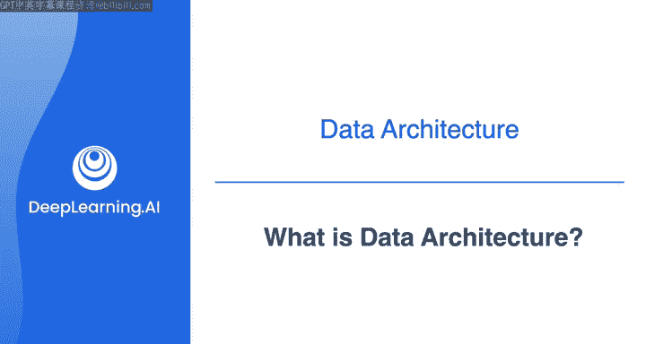
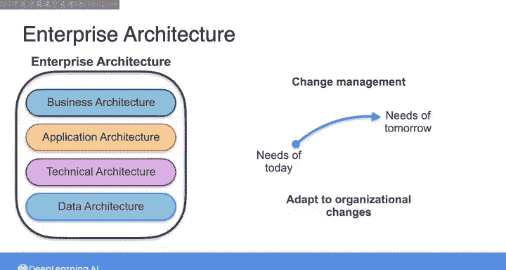
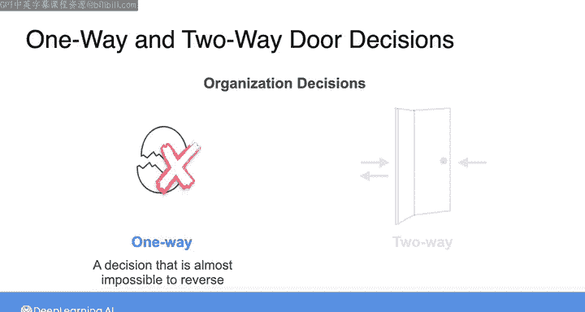
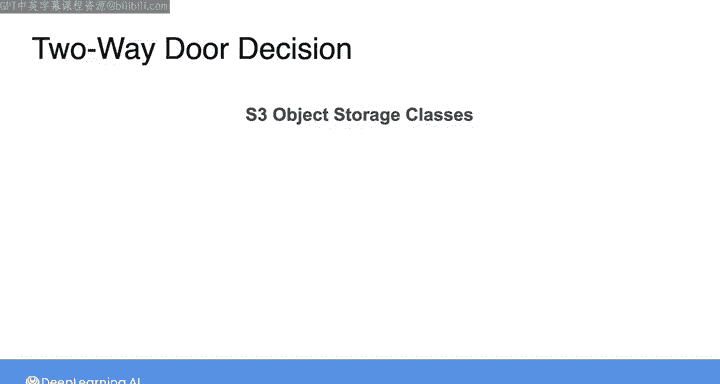
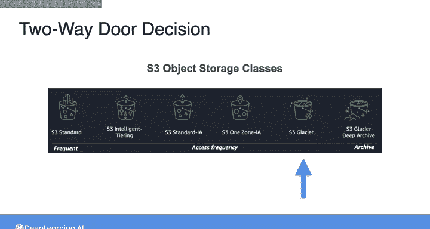
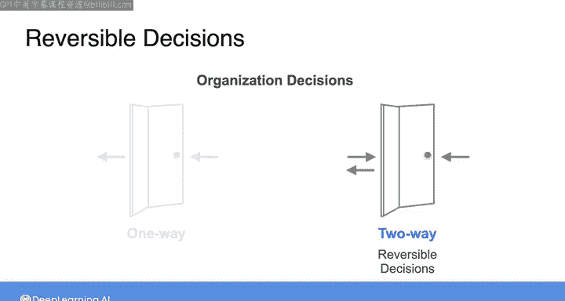
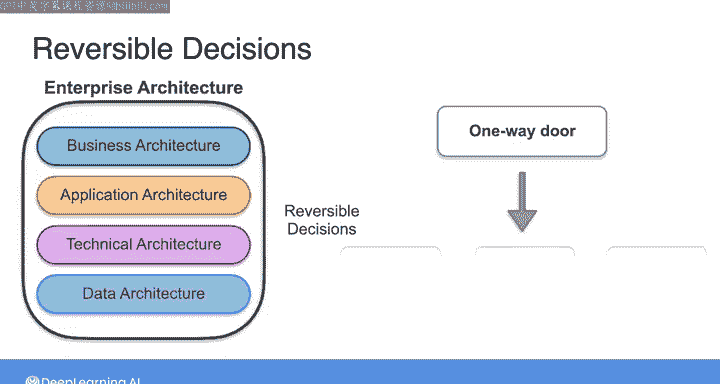

# 吴恩达《数据工程（导论，源系统、数据摄取和管道，数据存储和查询｜1-2-3课）｜DeepLearning.AI Data Engineering》 - P40：42_什么是数据架构.zh_en - GPT中英字幕课程资源 - BV1wTtWeeEH5

Before getting into the details of data architecture。

 I'd like to zoom out for a moment and look at how data architecture fits within the broader context of what's called enterprise architecture。

 which can admittedly be a somewhat vague and abstract concept in terms of a definition for enterprise architecture there's no clear consensus out there and different groups have defined it differently。

 but here's a definition we settled on in the fundamentals of data engineering book En architecture is the design of systems to support change in an enterprise achieved by flexible and reversible decisions reached through a careful evaluation of tradeoffs Now you might be thinking hey wait a minute haven't we already seen this definition in the context of data architecture last week。

yeah， you'd be right and in fact， the definition of data architecture that you saw last week was data architecture is the design of systems to support the evolving data needs of an enterprise。

 achieved by flexible and reversible decisions reached through a careful evaluation of tradeoffs。

Given the similarity between these two definitions。

 you can see that data architecture is very well alignedd with and fits within the context of enterprise architecture。

 In fact， enterprise architecture encompasses various domains and you can think of these domains as including four main areas。

 the first is business architecture， which applies to the product or service strategy and business model of an enterprise。

 The second is application architecture， which describes the structure and interaction of key applications that serve business needs third you have technical architecture。

 which relates to the software and hardware technology components that are required to support the deployment of business systems and applications and finally。

 theres data architecture， which as you've already seen is all about supporting the evolving data needs of the enterprise so you can think of data architecture as an element of enterprise architecture。

This way you can start to see how your work as a data engineer ties in directly with the highest level goals and the structure of your organization as the structure of an organization may change over time this leads to another important concept change management which is right at the heart of enterprise and data architecture。

 you can expect the needs of your organization to be constantly evolving in your data architecture will need to adapt to those changes Jeff Bezos。

 the former CEO of Amazon is credited with the idea of one way and twoway doors as it applies to any decision that is made in an organization a oneway door is a decision that is almost impossible to reverse the door shuts and locks behind you and there's no way to get back as a simple example of this concept you can think of it maybe in this way so if you crack an egg to cook it。

 you can't change your mind later and uncrack the egg so breaking an egg is a one way。

Or decisionOr as this concept relates to an organization， Amazon， for example。

 could have decided at some point to sell AWS and all of its cloud services or just shut it down and after taking such an action it would be nearly impossible for Amazon to rebuild a public cloud with the same market position On the other hand a two-way door is an easily reversible decision so you can walk through the door and if you like what you see you can perceive or if you don't like what you see you can walk back through the door for example。

 when it comes to choosing how you store your data in an object storage system like S3 you can choose from a range of storage classes based on your performance data access and cost requirements an example of a two-way door decision would be if you chose to store your data in the standard storage class in S3 then later if your storage needs change you can transition to any other storage class for a fee So this decision is reversible。

Since the stakes attached to each two a door decision are typically low。

 organizations can easily make more of these types of reversible decisions。

 rapidly iterating and improving on how they collect， use， and store data。

Flexible and reversible decision making is central to enterprise and data architecture in aiming for twoway door decisions wherever possible in your architecture。

 you'll be better able to handle change as it comes to your organization。

 if you find yourself faced with what looks like a oneway door decision。

 See if you can break it down to a series of smaller decisions for each individual decision is a two-way door and so architecture is not simply about mapping out business I or data processes and vaguely looking toward a distant utopian future。

 architects need to be actively solving business problems and creating new opportunities if you're thinking like an architect in your role as a data engineer you'll build technical solutions that exist not just for their own sake。

 but in direct support of business goals。 Next up， we'll be looking at the principles of good data architecture。

 but before we do that， I want to highlight a very interesting phenomenon known as Conway's law that affect the architecture of all data systems。

 The next video is optional。

And I'm not going to test you on Conway's law。 so if you want to skip ahead， that's perfectly fine。

 but I feel that I'm going to do you a disservice if I don't at least mention Conway's law in these courses。

 because I can guarantee that this will influence the types of systems that you build。

