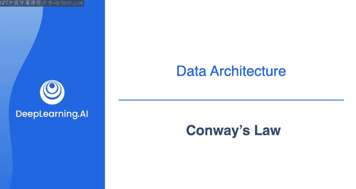
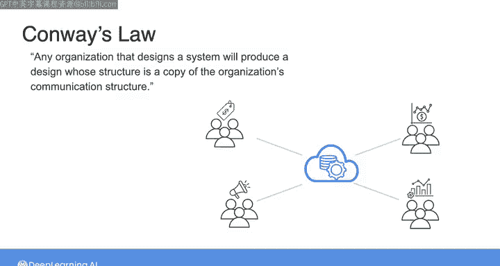

# 吴恩达《数据工程（导论，源系统、数据摄取和管道，数据存储和查询｜1-2-3课）｜DeepLearning.AI Data Engineering》 - P41：43_可选：康威定律.zh_en - GPT中英字幕课程资源 - BV1wTtWeeEH5

Throughout these courses， I want you to keep in mind that the various principles and architecture patterns that we discuss will apply to different scenarios depending on the type of architecture and systems that you're building to support your organization's objectives。

 but there is one very important guiding principle that has affected every architecture and system I've ever encountered。

So I want to introduce you to what's known as Conway's Law Conway's law was best described by its author Melvin Conway who stated that any organization that designs a system will produce a design whose structure is a copy of the organization's communication structure now that might sound like a very strange assertion to make but here's how it works in practice imagine a company with four different departments sales。

 marketing finance and operations now if these departments operate in relatively isolated silos。

 their communication patterns。will be isolated and siloed as well and when it comes to building data architectures and systems they will inevitably build for relatively isolated and siloed systems so in other words。

 sales will develop one data system marketing will build another finance third and operations yet another system and so you get the idea if instead the four departments in the same organization。

 communicate crossfunctionally share ideas and collaborate between departments then the data systems they build will reflect the culture of crossfunctional collaboration and communication again。

 I realize this might sound strange but as odd as it may seem Conway's law is remarkably consistent across all types of organizations。

 the main takeaway for you as a data engineer is that when it comes to understanding what kind of data architecture is going to work for your organization。

And you first need to pay attention to and understand the communication structure of the organization even said you attempt to build a data architecture that clashes with your company's communication structure you're bound for trouble if you're interested in learning more about Comwayis law I've included a link in the resources section at the end of the week。

Join me in the next video to have a closer look at the key principles of good data architecture。

