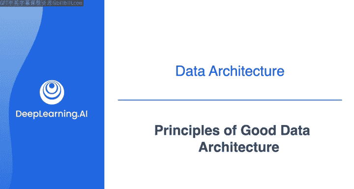
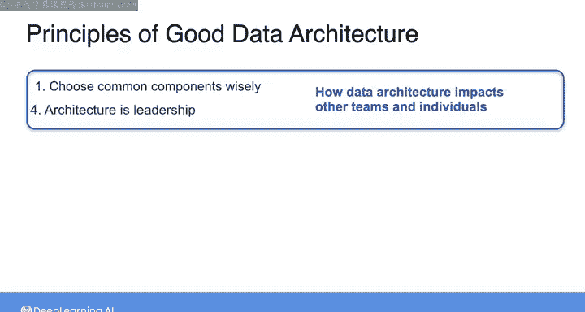
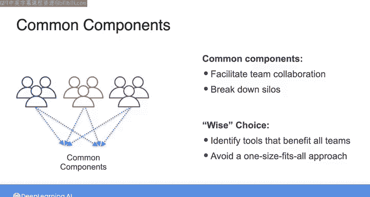
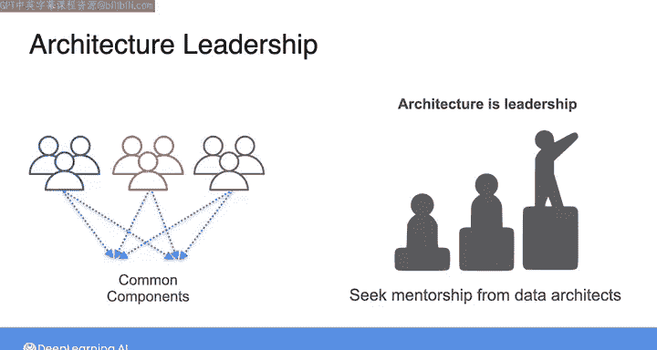

# 吴恩达《数据工程（导论，源系统、数据摄取和管道，数据存储和查询｜1-2-3课）｜DeepLearning.AI Data Engineering》 - P42：44_良好数据架构的原则.zh_en - GPT中英字幕课程资源 - BV1wTtWeeEH5

Last week I briefly mentioned nine principles to keep in mind in your approach to data architecture。

Here they are again to jog your memory we'll be revisiting these principles throughout the specialization This week is all about data architecture and so I'd like to spend a little more time on the details of each of these principles before we can do some specific architectures in some sense。

 these principles are all related to one another but for the purposes of this discussion I'd like to break them up into three groups which can see here to me what these two principles in the first group have in common is that they both relate to how data architecture impacts other teams and individuals in your organization this second group of principles are all about the fact that data architecture is an ongoing process and that you can expect your architecture to evolve over time and this third group is kind of like you said of unspoken but understood priorities that underlie any data architecture namely that you need to be thinking about things like cost。

Security， scalability and failure modes for any system you build Of course。

 there are other ways you could think about combining or relating these principles。

 but here I'll discuss them in these three groups in this video I'll talk about the first pair principles that relate to how data architecture impacts other teams and individuals in your organization and in the next couple videos will take a look at the other two groups So here I have choose common components wisely and architecture is leadership one of the primary jobs of a data architect and potentially part of your job as a data engineer is to choose common components and practices that can be used widely across an organization common components can be anything that has broad applicability within an organization including things like object storage Vi control systems observability Mon and orchestration systems and data processing engines cloud platform。

are an ideal place to adopt common components。 so for example。

 the separation of compute storage in cloud data systems means you can serve data to different teams in organization with a shared storage later that allows users to query the data for their particular use case when you choose common components wisely they become part of a fabric of the organization facilitating team collaboration and breaking down silos。

 This is not to say that there will always be common components that can provide the right solution for every team making a wise choice of common components means identifying use cases where teams can benefit from using the same data tools and practices while not creating obstacles to productivity by blindly applying a one size fits all approach in your data systems as a data engineer。

 you can practice architecture leadership by identifying the right common components in consultation with members any organization and as you become more senior and take on more response。

You might be the one to mentor others and provide proper training around these components as well and as I said before。

 as a data engineer， I also recommend you seek mentorship from data architects in your organization or elsewhere because eventually you may well occupy the role of architect yourself join me in the next video to take a look at the second group of principles。

 which are all about building flexibility into your architecture。

