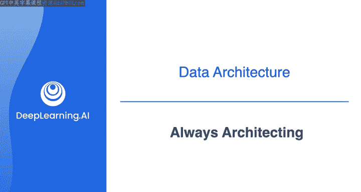
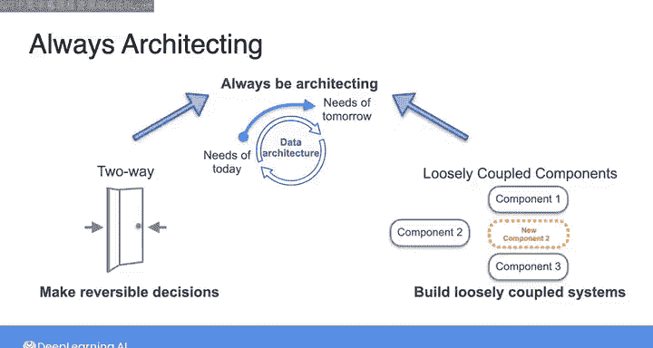

# 吴恩达《数据工程（导论，源系统、数据摄取和管道，数据存储和查询｜1-2-3课）｜DeepLearning.AI Data Engineering》 - P43：45_持续架构.zh_en - GPT中英字幕课程资源 - BV1wTtWeeEH5

In a previous video， I mentioned the idea of one way and two way doors。

 where one way doors represent those decisions that you make that are difficult or impossible to reverse while two way doors represent reversible decisions。

Systems built around reversible decisions allow you to always be architecting I want to mention another concept that came out of Amazon。

 the so-called API mandate that came in the form of an email from Jeff Bezos to all Amazon employees in 2002 you can read more about the details of this mandate by following the link in the resources section at the end of this week but the gist of this mandate was this all teams must use service interfaces otherwise known as application programming interfaces or APIs to communicate as well as do serve data and functionality the mandate also ended by Jeff Bezos saying that those who don't follow this mandate will be fired so you can tell how seriously he took this notion of APIs at Amazon what this meant was that no matter what kind of complicated mess any particular team had going on in their own systems what they would be required to provide any data functionality and communications to other teams。

Stable and predictable service interface This allowed teams of Amazon to function together as a loosely coupled system where individual teams plugged into one another through these service interfaces and any reconfiguration or retooling within a given team did not affect the other teams the other part of the API mandate was that all of these service interfaces or APIs had to be built from the ground up to eventually be public facing to developers in the outside world this reorientation towards service interfaces laid the foundation for what would eventually become Amazon web services or AWS which much of the world now uses as a cloud platform and so in this next group of principles have make reversible decisions。

Build loosely coupled systems and always be architecting as you already know。

 those reversible decisions are your twoway doors。 The decisions that you can easily undo if you don't like the outcome one key way to ensure your decisions are reversible is to build your data system from loosely coupled components and by loosely coupled in the context of architecture。

 I mean components that can be swapped out relatively easily without having to redesign your whole system where a system built from loosely coupled components and reversible decisions you will always have the ability to always be architecting as we've already touched on data architecture needs to support the evolving data needs of your organization and that means data architecture itself must also be able to evolve as a data engineer。

 your job is not only to build systems that serve of the data needs of your organization today but also to have an eye toward the future so that you can constantly be adapting to the changes and business requirements。

As well as available technology， join me in the next video to look at the last group of principals。

 focus on best practices when it comes to understanding the cost， security。

 scalability and failure modes for the systems you build。

