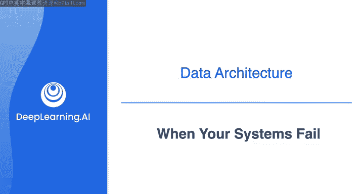
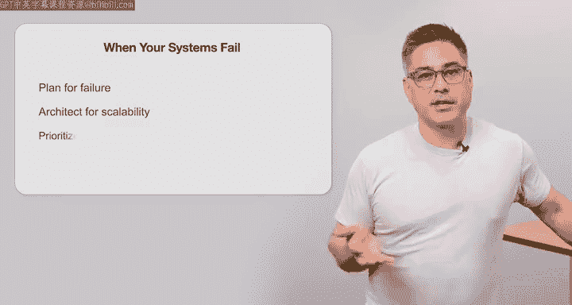
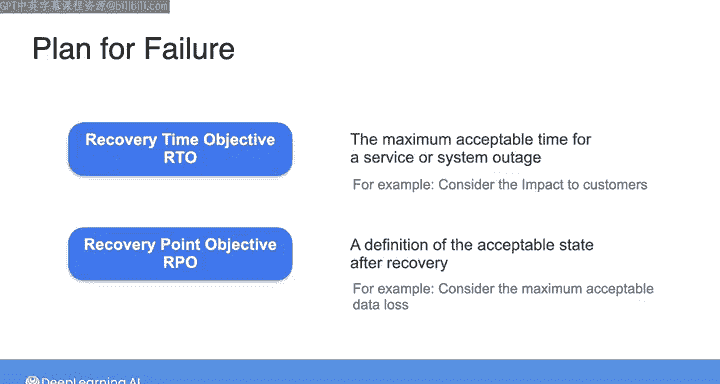
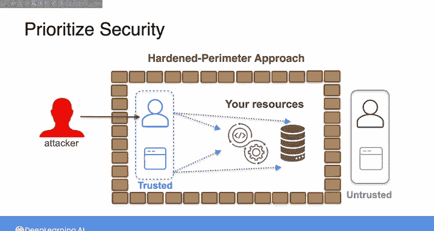
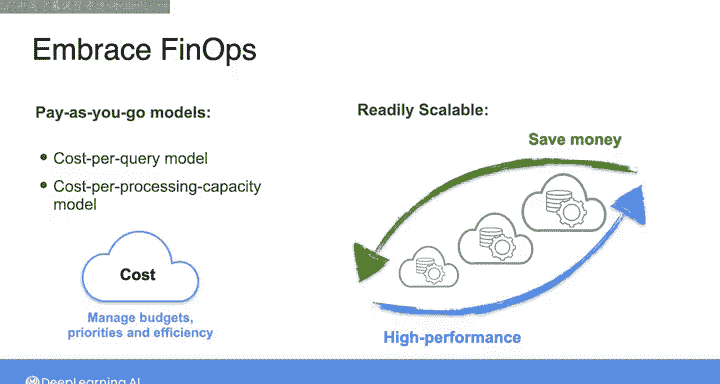
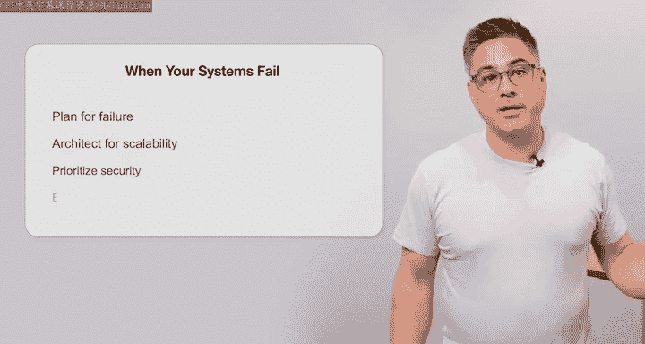

# 吴恩达《数据工程（导论，源系统、数据摄取和管道，数据存储和查询｜1-2-3课）｜DeepLearning.AI Data Engineering》 - P44：46_系统故障时.zh_en - GPT中英字幕课程资源 - BV1wTtWeeEH5

Apart from building data systems that serve the needs of stakeholders。

 break down silos across teams and evolve with the changing needs of your organization。

 if that's not already enough， you also need to anticipate what happens when things go wrong。

 and believe me， things will go wrong in this next group of principles I have planned for failure。

 architect for scalability， prioritize security and embrace Finops。

When it comes to failure modes in your systems， it's best to take a practical and quantitative approach。

 just like you would with any other aspect of the performance for your system。

 and so now we get to define more explicitly what is meant by terms that describe your system metrics。

 like availability reliability and durability of your data systems。Availability。

 often called uptime is the percentage of time a service or component is expected to be in an operable state。

 If you take a look at the different storage classes and Amazon S3 optic storage， for example。

 you'll see that they range in availability from 99。5% up to 99。99% over the course of a year now 99。

5% and 99。99% might sound like high availability and even like very similar numbers。

 but keep in mind that a 99。5% annual availability means you can expect your storage system to be unavailable for around 44 total hours each year while 99。

99% availability。Means you can expect just about  one hour of downtime per year。 Unfortunately。

100% availability is never possible to guarantee since failure scenarios can include unexpected power outages or impairment of network devices。

 But depending on the needs of your system， you can choose a storage class with the availability that you require。

 reliabilityability is similar to availability， but is instead the probability of a particular service or component to perform its intended function within a given time interval within welldefined performance standards。

 durability refers to the ability of a storage system to withstand data loss due to hardware failure。

 software errors or natural disasters in the cloud。

 durability is crucial as businesses rely on cloud services to store and access or critical data。

 For example， Amazon S3 boasts very high durability at 99。99。

Okay that's probably2 many9 to see out loud， but that's a total of 119s of data durability。

 meaning the loss of objects in Amazon S3 is extremely rare related to the concepts of availability reliability and durability are the recovery time objective or RTO for short and the recovery point objective or RPO for short the RTO is your maximum acceptable time for a service or system outage to establish an RTO for your application you want to consider the impact to internal and external customers if this application is unavailable then you can for example。

 decide on the S3 storage class to meet this objective your RPO on the other hand。

 is a definition of the acceptable state after recovery For example。

 when talking about a data storage system the RO might refer to the maximum acceptable data loss your system can tolerate。

to an outage being deliberate about your RTO and RPO for these systems you build will help you choose components with the right availability。

 reliability and durability specs to meet your needs and that's one aspect of what it means to plan for failure another way your system can fail is through security breaches that's why the principle of planning for failure and the principle of prioritizing security go hand in hand we already talked a little bit about cultivating a culture of security and the principle of least privilege。

Here I'd also like to introduce what's called zero trust security to understand what zero trustt is all about。

 it's useful to take a look at what you might call a more traditional approach to security。

 which is known as hardened perimeter security， taking a hardened perimeter approach is equivalent to building a big wall like this around your systems where everyone and everything outside the wall is untrusted wall everything and everyone inside the wall is trusted in the sense of having access to sensitive of data and systems the problem with a hardened perimeter approach is that would be attackers only need to get past the wall to gain unfettered access to all of your data and your systems and the cloud era the idea of building a hardened perimeter has the additional problem of there really being no physical perimeter with data and systems connecting across the internet zero trust by contrast means that every action requires authentication。

And you build your systems such that no people or applications。

 internal or external or trusted by default， instead access is granted only as needed。

 your system can also fail when you do things like incur large unforeseen costs or mis opportunities for revenue。

For example， when it comes to unforeseen costs， I'm talking about things like accidentally running expensive cloud services such that your entire annual budget is consumed in a month or less。

 and believe it or not， I've seen this happen。A lot。Or conversely。

 a missed opportunity might be getting a sudden spike in demand for your products and having your whole system crash because you weren't well prepared to scale up quickly So in this way the principles of embracing Finops and architecting for scalability are connecting to the principle of planning for failure as a data engineer you need to think about the cost structures of cloud systems So for example。

 when running a distributed cluster， what is the appropriate mix of AWS on demandmand EC2 instances versus spot instances by the way spot instances or the unused EC2 instances that are available at a sharp discount on AWS what is the most appropriate approach for running a sizable daily job in terms of cost effectiveness and performance in the cloud era。

 most data systems are payaz you go and readily scalable systems can run at a cost per query model cost per processing capacity model or another variant of a payaz you go model。

It's now possible to scale up for high performance and then scale down to save money。However。

 the Payage yougo approach makes spending far more dynamic。

 so the new challenge for data engineers is to manage budgets。

 priorities and efficiency when building and maintaining their systems。

 so the main takeaways here are that if you plan for failure， architecture for scalability。

 prioritize security and embrace FinOs。

You'll be better positioned to serve the needs of your organization。

 not only when the systems you're building are functioning as expected。But also when failures happen。

Next up， we'll dig into the details of some specific architecture approaches for different types of data systems。

Join me in the next video to take a closer look at batch architectures。

