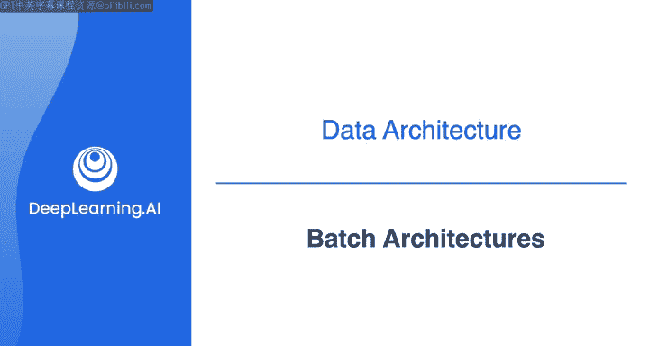
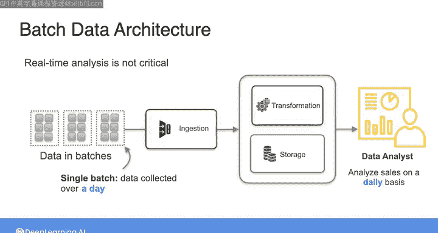
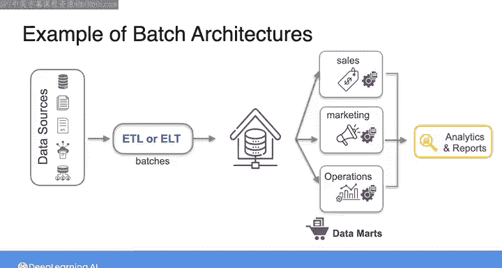
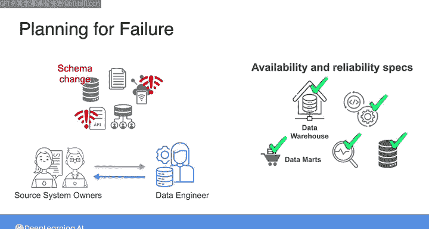
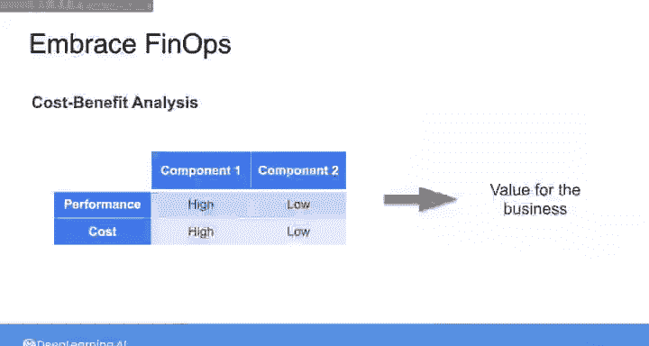

# 吴恩达《数据工程（导论，源系统、数据摄取和管道，数据存储和查询｜1-2-3课）｜DeepLearning.AI Data Engineering》 - P45：47_批处理架构.zh_en - GPT中英字幕课程资源 - BV1wTtWeeEH5

Last week we looked briefly at the concepts of batch versus streaming in the context of data ingestion now I'd like to focus on how some of these concepts appear in some well established architecture patterns that you'll run into as a data engineer。

The goal here is to get you thinking about some of the trade offs and implications of the different choices you can make with your architectures。

In this video we'll take a closer look at batch architectures and in the next video we'll take a look at streaming architectures。

 batch data architecture is what you might call the traditional approach to data processing where you ingest transform and so data in batches or chunks batch processing is most practical when real-time analysis is not critical usually a batch of data consists of data collected over some fixed period of time maybe over the course of a day。

 and for instance， in an ecommerce-commerce company a data analyst might be interested in analyzing the history of sales of a particular product on a daily basis and so you might set up a batch architecture where you ingest in process this data once a day So what might this look like this could be the beginning of a so-called extract transform load or ETL pipeline where you first ingest or extract batches of data from one or multiple sources perhaps into a staging error。

And then apply some transformations to clean up， standardize and model the data and then load it into a data warehouse for storage and serving There's also a variation of this pattern known as extract load and transform or ELT with ELT。

 the idea is that after you ingest the data， you load it into your data warehouse and then perform transformations directly inside the data warehouse this ELT architecture or pattern is becoming more popular nowadays given the expanded computational power in many modern cloud data warehouses in other storage abstractions What happens next whether you're working with an ETL or ELT architecture is that you'll serve data for downstream use cases which all represent on the right side of the data warehouse over here。

 these might typically be analytics or machine learning but another possibility as I mentioned before is that your end use cases。

So called reverse ETL where some analysis is performed and then the process data is actually sent back to the source systems that are at the start of your data pipeline you could also have an additional layer here between your data warehouse and your end use case for something called a datamart a datamart is a more refined subset of a data warehouse that is focused on a specific department function or business area a datamart is designed to serve analytics and reporting so you might have a datamar focus on sales another for marketing and you another for operations this kind of setup can make data more easily accessible to analysts and those who need to create reports with datamarts you can also provide an additional stage of transformation beyond that provided by the initial ETL or ELT pipelines and so these additional transformations might be things like additional joins between tables or aggregations that can help improve the performance of live query。

です。So these are some examples of typical batch processing architectures。

If you are setting up an architecture like this for your organization。

 then there are a number of things you could be considering in terms of the principles of good data architecture。

 For example， if you're serving multiple end use cases for different teams or departments how might you choose common components for your data warehouse and data pipelines that help facilitate collaboration and interoperability between teams。

 when it comes to planning for failure， you'd want to be thinking about what happens for example。

 if a source system goes offline or the upstream data schema changes。

 connecting with source system owners would be a great first step toward building a system that can handle changes in the source。

 you'd also be looking for the availability and reliability specs for each of the components in your pipeline and you'd be figuring out how to build flexibility into your system for example。

 if you decide later to change the cadence of ingestion or if you expect the volume in each batch of data to be dramatically different over time to embrace Fops。

 you'd also be doing some cost benefit。

analysislysis to understand what kind of tradeoffs you might need to consider when it comes to performance different components of your system。

 as well as what kind of value you can provide for the business under different scenarios will be keeping these principles in mind throughout these courses and remember that the technologies you choose when building your data systems will always present a certain set of risks as well as opportunities that can add value to your organization。

Next up we'll take a look at some common streaming architectures， I'll see you in the next video。

