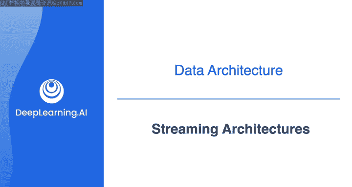
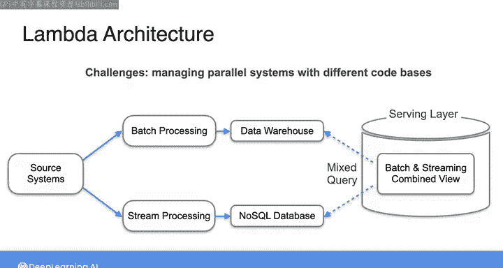
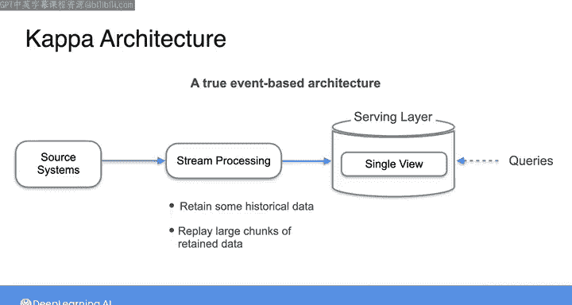
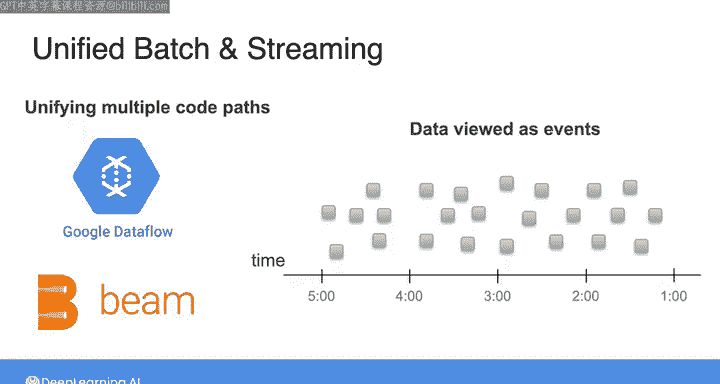
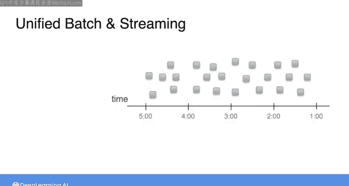
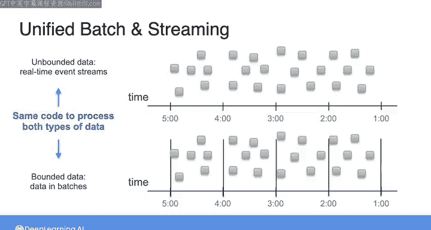
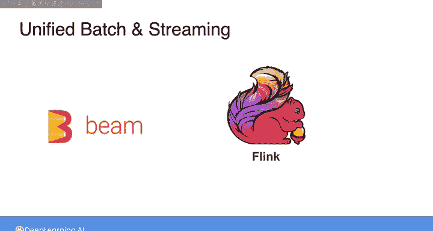

# 吴恩达《数据工程（导论，源系统、数据摄取和管道，数据存储和查询｜1-2-3课）｜DeepLearning.AI Data Engineering》 - P46：48_流处理架构.zh_en - GPT中英字幕课程资源 - BV1wTtWeeEH5

As I mentioned last week， you can think of data as being produced in a series of events and these events might be clicks on a website or sensor measurements or something else。

In this sense， at its source， nearly all data could be characterized as a continuous stream of such events。

That is data is generally produced and updated in a continuous fashion with batch data pipelines which we looked at in the last video。

 you're waiting for data to accumulate， then at a predefined time interval or once the data reaches a certain size threshold。

You could process a batch of data so you're just processing a stream of data in a series of chunks with a streaming data pipeline on the other hand。

 you're ingesting and providing data to downstream systems in a continuous near real-time fashion and when I say near real-time I mean you're making data available to downstream systems a short time after its's produced possibly less than a second later and the simplest sentence you can think of a streaming system as being composed of a producer a consumer in a streaming broker the producer is the data source and this might be clickstream data coming from an application or measurements coming from an IO device and then there's a consumer this could be for example。

 a service or an application that will process a data or it could be a data lake or a warehouse in between the producer and consumer is your streaming broker that coordinates data between producers and consumers and then downstream of the consumer might be some realtime analytics or machine learning。

And use case in the early to mid-2010s， the popularity of working with streaming data exploded with the emergence of Kafka as a highly scalable event streaming platform and other stream processing frameworks such as Apache storm and SAMza for streaming and real-time analytics these technologies allowed companies to perform new types of analytics and modeling on large amounts of data like user aggregation and ranking and product recommendations This new demand for streaming data solutions didn't mean that batch processing went away instead it meant that data engineers needed to figure out how to reconcile batch and streaming data into a single architecture what's known as a Lambda architecture was one of the popular early responses to this problem in the Lambda architecture batch streaming and serving systems operating independently of each other and the source system simultaneously streaming data to two destinations say one for stream processing worthy the process data might be sort in a nosQL。

Database and one for batch processing， which might use a data warehouse to transform and store the processed and aggregated data for analytical purposes The serving layer in this architecture then provides a combined view by aggregating query results from the batch and streaming layers I wanted to mention the Lambda architecture here just so you're aware of it。

 but this architecture comes with various challenges and issues like managing parallel systems with different code bases among other things In many ways technology and practices have moved beyond the Lambda architecture but the Lambda architecture is still a good reference point for these streaming architecture designs and tools that came later。

As a response to the shortcomings of the Lambda architecture。

 actually one of the original authors of Apache Kafka J Kreps proposed an alternative called Kappa Arch。

 the central idea for Kappa architecture is to use a stream processing platform as the backbone for all data handling ingestion storage and serving this facilitates a true event-based architecture meaning that rather than waiting for systems to periodically check for updates when things happen and when data is produced information is automatically sent to relevant consumers that need the update so that these consumers can react more immediately to this information with the stream processing platform as the backbone you can apply real-time processing by reading the live event stream at the same time you can configure the stream processor to retain a certain amount of historical data as it reads from the live stream this effectively allows you to apply batch processing when you want to by replaying large chunks of the retained data。

From the same data stream while Lambda has fallen out of favor and Kappa was never widely adopted。

 both of these architectures provided inspiration and groundwork for overcoming the central challenge of unifying batch and streaming data processing one of the central problems of managing batch and streaming processing is unifying multiple code paths。

Today， engineers seek to solve this in several ways Google developed the data flow model and the Apache Beaam framework that implements this model。

 The core idea in the data flow model is to view all data as events ongoing realtime event streams contain unbounded data data batches are simply bounded event streams and the boundaries provide a natural window and so real-time and batch processing can happen in the same system using nearly identical code Apache Flink and other stream processing tools are widely used these days and we'll take a look at these and similar tools in this course and data engineering today the philosophy of batch as a special case of streaming is now more pervasive than ever。

And in your work as a data engineer， you can expect to be confronted with the challenges of managing both batch and streaming pipelines as you face these challenges。

 you'll need to keep the principles of good data architecture top of mind as you choose the components of your systems。

Build for flexibility and scalability and anticipate potential failure modes。

 one thing you need to be thinking about no matter what kind of system you're building is compliance in short compliance means ensuring your data systems are in compliance with laws。

 regulations and your own organizations's privacy agreements and terms of service policies。

Join me in the next video to talk about architecting for compliance。

