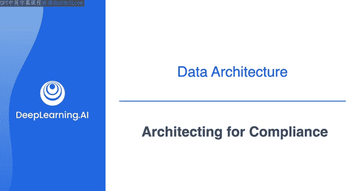
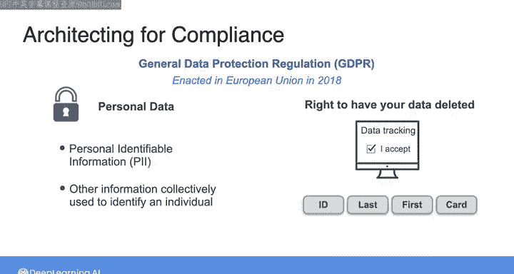
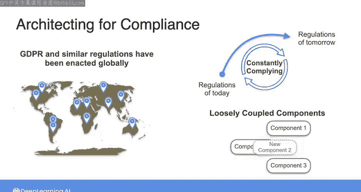
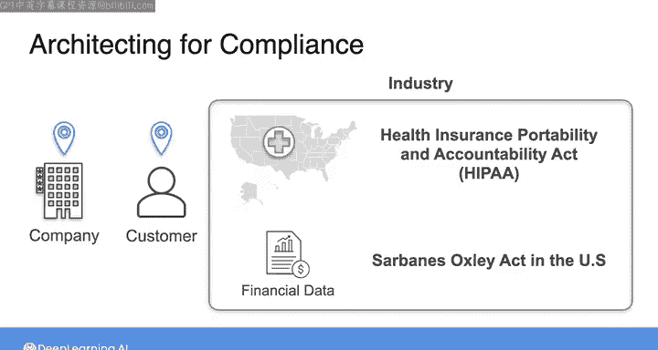

# 吴恩达《数据工程（导论，源系统、数据摄取和管道，数据存储和查询｜1-2-3课）｜DeepLearning.AI Data Engineering》 - P47：49_合规性架构.zh_en - GPT中英字幕课程资源 - BV1wTtWeeEH5

Okay， before we get started here， I just want to come out and say it regulatory compliance is probably the most boring topic in these courses。

诶。I don't think anyone really wants to talk about laws and regulations。

 especially when we could be talking about working with data and working with cool technologies。

 right？I agree and I also feel I'd be letting you down if I didn't spend at least some time talking about how regulatory compliance fits into your role as a data engineer and this is primarily because one of the most spectacular ways your data systems can fail is to run a of regulations and cause your organization to get sued and incur large fines this does happen so what kind of regulations am I talking about regard data one big regulation is the general data protection regulation or GDPR that was enacted in the European Union in 2018 in short。

 the GDPR is all about the protection of privacy and personal data for individuals but what constitutes personal data under the GDPR is relatively broad including not only personal identifiable information or PII。

 but also other information that could collectively be used to identify an individual to be in。

with a GDPRYou need to ensure that you have the appropriate consent from the individuals you're collecting data from。

 as well as the ability to delete the data in a timely manner if an individual wants to have their data removed from your systems。

Now， you might be thinking， what if my company isn't based in the EU or what if we don't serve customers in the EU？

Well， technically， yes， the location of your company and your customers will at least play some part in determining whether the regulations apply to you。

 however， since the enactment of the GDPR， dozens of countries around the world as well as individual states within the US have adopted similar regulations as a data engineer you'll be responsible for building systems that not only comply with today's regulations but also those of tomorrow。

 and those could be new laws that are enacted where you currently operate or regulations already in place in the areas your company expands to you in the future。

 it'll be your responsibility to keep your systems up to date to stay in compliance with the set of regulations that apply to your business。

 the smart approach is to build systems that are in compliance with modern data protection regulations like GDPR even if your local regulations are less stringent and to build flexible loosely coupled systems that allow you to adapt with regulatory changes。

Apart from the location of your company and your customers the industry you operate in might also come with its own set of regulations。

 if you work with healthcare data in the US for example。

 you'll be required to adhere to the health insurance Portability and Accountability Act or the HIPAA Law which regarding sensitive patientient data similar laws have been enacted regarding medical data in many countries around the world。

 or if you work with financial data in organization。

 you would need to adhere to the Surveys Oxley Act in the US or similar laws elsewhere that mandates certain financial reporting and record keepingeping practices。

So the main takeaway here is that no matter where you're located in the world or what industry you're in。

 there are laws and regulations that will apply to the systems that you build as a data engineer。

 one way you can deliver value for your organization is to avoid the lawsuits and fines that come with failing to adhere to the necessary regulations。

We won't be spending much time on the details of regulatory compliance and the rest of these courses。

 but I wanted to at least make you aware of this aspect in your role as a data engineer so you can keep it in mind along with the other principles of good data architecture in the next lesson we'll look at choosing the right technologies for your architecture I'll see you there。

