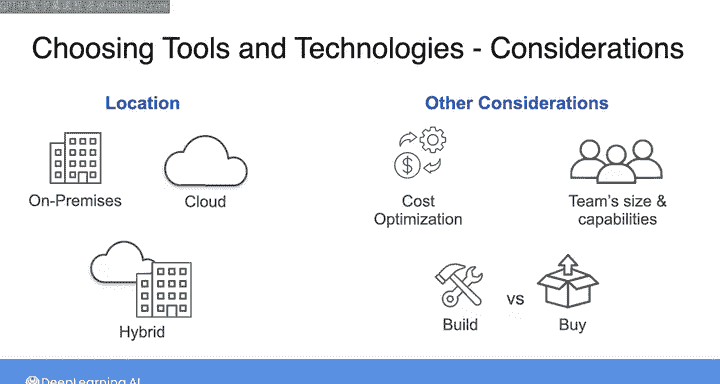

# 吴恩达《数据工程（导论，源系统、数据摄取和管道，数据存储和查询｜1-2-3课）｜DeepLearning.AI Data Engineering》 - P48：50_选择工具和技术.zh_en - GPT中英字幕课程资源 - BV1wTtWeeEH5

In the previous lesson， we looked at what it means to design good data architecture and why it matters I emphasize that you need to consider the trade offs between different design choices and build loosely coupled flexible systems that will be able to accommodate the evolving data needs of your organization。

In this lesson， I'll focus on how to choose the right tools and technologies to build this kind of architecture in the field of data engineering。

 there's no shortage of options when it comes to tools and technologies to get the job done。

Quite the opposite in fact as data engineers we suffer instead from an embarrassment of bridgees so whether you're considering solutions for ingestion。

 storage transformation or serving you'll be faced with options including open source manage open source proprietary software services and much more as you face these decisions it's important to keep your end goal in mind namely delivering high quality data products that meet the requirements of your end users So in other words。

 your data architecture is the what the why and the when of achieving the data needs of the business。

 the tools and technologies you choose to make that architecture reality or the how at this point you might be thinking well sure that sounds logical choose the tools that will make for a successful outcome that's great thanks Joe well unfortunately there are a number of ways that this can go wrong and that's what we're going to talk about in this lesson so that you're set up for success。

We'll be looking first at location namely the tradeoffs between building your systems on premises on the cloud or some sort of hybrid of the two。

 then we'll look at cost optimization and how you can think about whether to build your own tools for certain things or purchase off the shelf solutions considering things like your team's size and capabilities and what sorts of activities that really drive value in your business。

 We'll talk about building for the needs of today while also having an eye towards the potential future needs of your organization and we'll be discussing all these things in the context of the principles of good data architecture that you saw in the previous lesson and the undercurrents of the data engineering life cycle that you saw last week。

So join me in the next video to get started。

