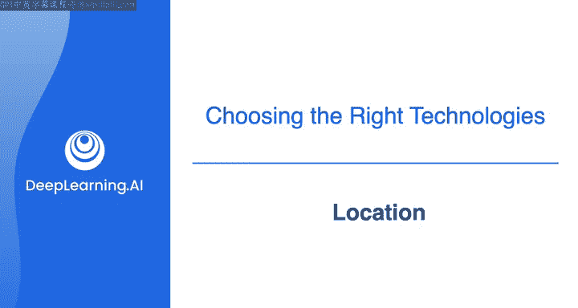
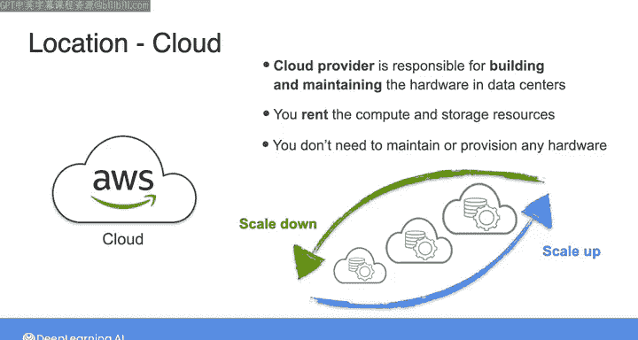
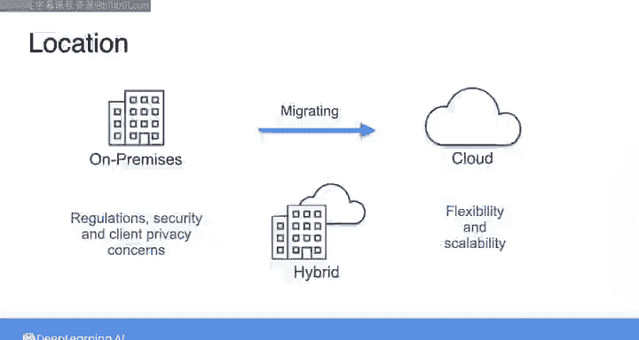

# 吴恩达《数据工程（导论，源系统、数据摄取和管道，数据存储和查询｜1-2-3课）｜DeepLearning.AI Data Engineering》 - P49：51_位置.zh_en - GPT中英字幕课程资源 - BV1wTtWeeEH5

Not that long ago， maybe just two decades or so in the past。

Building on premises data systems was really your only choice for any kind of data storage or processing needs。

And this was simply because modern cloud data platforms didn't exist yet an on-prems system is one where the company owns and maintains the hardware and software for the entire data stack。

 This means that a company is operationally responsible for provisioning maintaining and updating and scaling the hardware and the software that runs on it Nowadays many companies build their entire data systems on the cloud with cloud data systems the cloud provider like AWS for example。

 is responsible for building and maintaining the hardware and data centers to serve client needs if you're building your data systems on the cloud。

 you are essentially renting the compute and storage resources needed for your system the nice thing about cloud computing and storage is that you can easily scale up to meet demand or scale back down to save on costs when you don't need it you don't need to maintain or provision any hardware and you can change your mind relatively easily about exactly what kind of tools or technologies you want to use in your system Well many companies。

are now choosing to build data systems entirely on the cloud others still maintain onprems systems or some kind of hybrid system with some components on premises and others on the cloud The momentum in the industry is definitely in the direction of more companies choosing cloud over onprems data systems or migrating from onpres to the cloud and this is because of all the obvious advantages the cloud offers in terms of flexibility and scalability。

 However， there are some companies that either choose to or are required to keep some or all their data systems on premises due to the nature of their business or regulations or security and client privacy concerns As a data engineer today。

 it's possible that you'll work at a company that has some onpres systems or one that is in the process of migrating from onprems to the cloud in these courses will be focused exclusively on building data systems on the cloud。

This is because for the vast majority of business use cases today。

 building your data systems on the cloud is the best choice。

The industry is moving in the direction of more cloud and less on premises and as an aspiring data engineer。

 I believe your time will be best spent learning about building data systems on the cloud。

 join me in the next video to learn more about another trend in software and data engineering to move from monolithic to modular systems。

