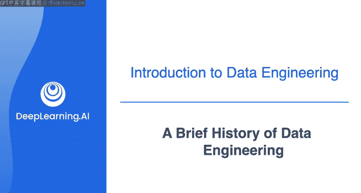
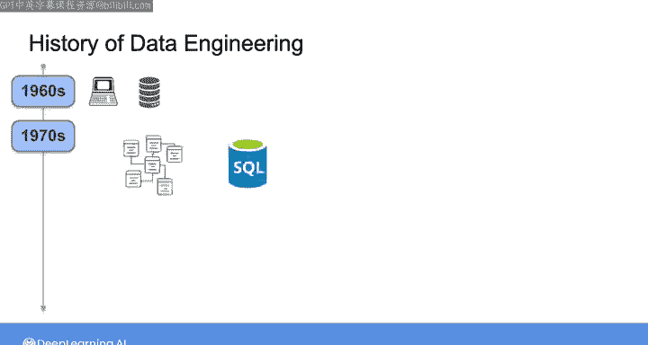
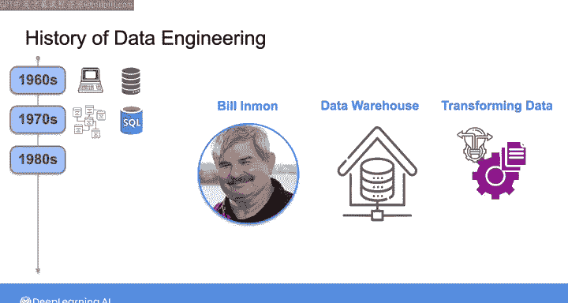
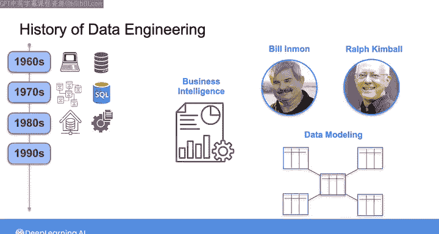
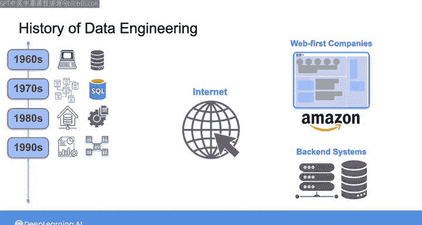
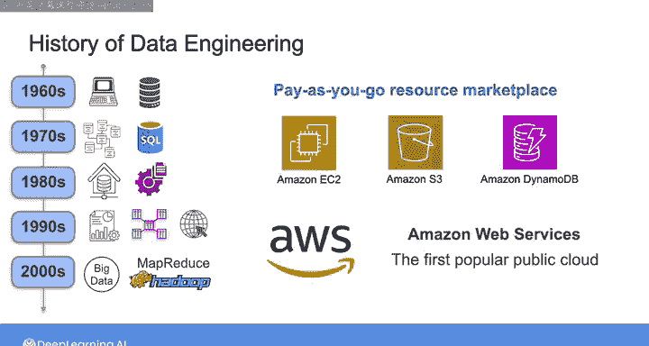
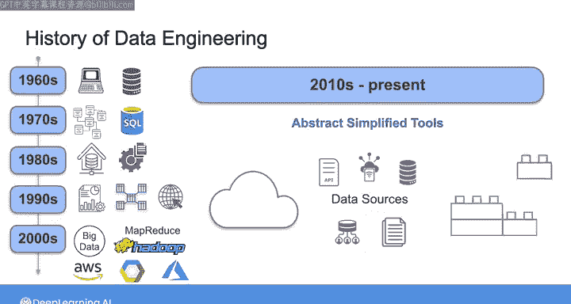

# 吴恩达《数据工程（导论，源系统、数据摄取和管道，数据存储和查询｜1-2-3课）｜DeepLearning.AI Data Engineering》 - P4：3_可选：数据工程简史.zh_en - GPT中英字幕课程资源 - BV1wTtWeeEH5

Okay， first off I just want to emphasize one thing data is everywhere。

 It comprises the building blocks of information and data could come in the form of words or numbers or something more ephemeral like photons coming from a distant star or maybe the wind blowing in your face。

 these various forms of data can be recorded for example。

 as memories in your brain or writings on a piece of paper or in digital form。

 like the recording of this video I'm making for you right now， so in some sense。

 you could say that data has existed in one form or another since the beginning of time， however。

 when I talk about data in these courses， I'm referring to digitally recorded data。

The kind of data that can be stored on a computer or sent through the internet。

 the story of digital data begins in earnest in the 1960s。

With the advent of computers it was then that the first computerized databases were introduced then in the 1970s Regal databases emerged which led engineers at IBM to develop the structured query language or SQL for short in the 1980s my friend Bill Inman developed the first data warehouse for the purpose of transforming data and to a form that could support analytical decision making in the 1990s as data systems grew businesses needed dedicated tools and data pipelines for reporting and business intelligence It was in this context that Ralph Kimball and Bill Inman developed their respective data modeling approaches for analytics The Internet went mainstream in the mid-1990s creating a whole new generation of web first companies such as Amazon the subsequent co boom led to rapid growth in web applications and to the emergence of backend systems to support them namely server databases and storage solutions Fast forward to the early 200。

Following the boom， the docom bust left behindhi a few survivors such as Yahoo， Google and Amazon。

 who grew into powerful tech companies initially these companies continued to rely on the traditional relational datas and data warehouses of the 1990s but the systems were not able to handle the explosion of data they are now faced with and with that the big data era had begun The Oxford dictionary defines big data as extremely large data sets that may be analyzed computationally to reveal patterns。

 trends and associations， especially related to human behavior and interactions another famous and succinct description of big data is the three Vs of data velocity。

 variety and volume， which is to say that big data comes at high velocity in wide variety in large volume in 2004 Google published a paper on mapre and ultra scalable data processing paradigm This publication constituted a big bang moment。

For data technologies and the cultural roots of data engineering， as we know it today。

 the Google Mapreuce paper and related publications inspired engineers at Yahoo to develop and later open source Apache Hadoop and 2006 It's hard to overstate the impact of Hadoop So engineers interested in large scale data problems were drawn to the possibilities of this new open source technology ecosystem as companies of all sizes and types。

 So data grow into many terabytes and even petabytes。

 the era of the big data engineer was born aroundund the same time。

 Amazon had to keep up with its own exploding data needs and created a scalable and flexible computing environment known as Amazon Elic cloud compute or EC2 for short。

 they also created infinitely scalable storage systems including Amazon's simple storage service。

 also known as S3 they developed a highly scalable NosQL database as well Amazon's dynamo DV and many of the core data building。

Amazon elected to offer these services for internal and external consumption through Amazon Web services。

 also known as AWS which became the first popular public cloud AWS developed into an ultraflexible payas you go resource marketplace now instead of purchasing hardware for a data center developers could simply rent compute and storage from AWS as AWS became a highly profitable growth engine for Amazon other public clouds would soon follow including the Google Cloud platform and Microsoft Azure the public cloud as a medium for building data systems is arguably one of the most significant innovations of the 21st century and spawn a revolution in the way software and data applications are developed and deployed the early big data tools and public cloud laid the foundation for today's data ecosystem the data landscape of today and data engineering as we know it now would not exist without these innovations At this point in the late 2000s and early 2010s for the first time ever。

Small startups had access to the same bleeding edge data tools used by the top tech companies。

 Another revolution occurred at that time with the transition from batch computing。

 which is to say processing and analyzing data and chunks or batches to events streaming where it became possible to handle data as a continuous flow of individual events and with the transition came a new era of big realtime data。

 despite the terms previous popularity， so-called big data as a thing has lost momentum。

 even with the power and sophistication of open source big data tools。

 managing them was a lot of work and required constant attention。

Often companies employed entire teams of big data engineers。

 costing millions of dollars to babysitity systems。

Big data engineers often spend excessive time maintaining complicated tooling and arguably not as much time delivering business insights and value Today。

 data is moving faster than ever and growing ever larger。

 but big data processing has become so accessible that it no longer merits a separate term。

Every company aims to work with and derive value from its data regardless of actual data size。

In other words。Big data engineers are now simply data engineers The 2010s saw the emergence of cloud first open source and thirdpart products。

 This made working with data at scale far simpler than in the big data era At the same time。

 data sources and data formats continue to grow both in variety and size data engineering is increasingly a discipline of interoperation and connecting various technologies like Lego bricks to serve ultimate business goals and that brings us to today the role of the data engineer today is further up the value chain than it's ever been in the past and continues to rise。

And what I mean by that is as a data engineer today。

 you have the opportunity to stand on the shoulders of giants and build powerful scalable data systems using tools and technologies that have been developed by those who came before you you also have the opportunity to contribute to the development of many of these tools and technologies and build the data solutions of tomorrow building robust data systems is now at the center of business strategy across a wide range of industries and so as a data engineering。

 you can directly be a part of achieving business goals and delivering value for your organization and the next few videos will start to explore how this looks in practice things like where data engineering fits in with other roles and stakeholders in your organization。

 how to identify your end users and what their needs are。

 how this relates to business value and how to translate stakeholder needs and requirements for your systems join me in the next video to take a look at how data engineering fits into the rest of your organization。

