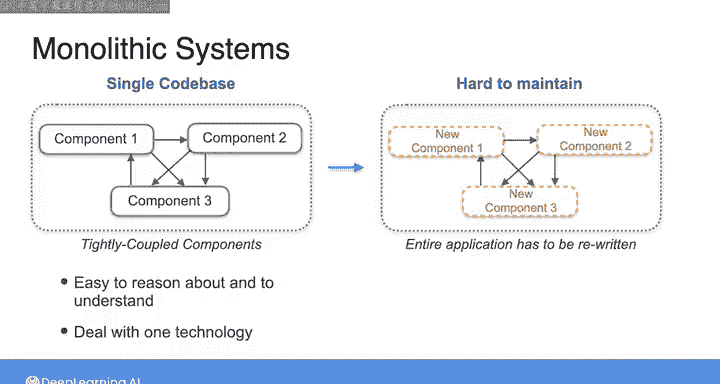
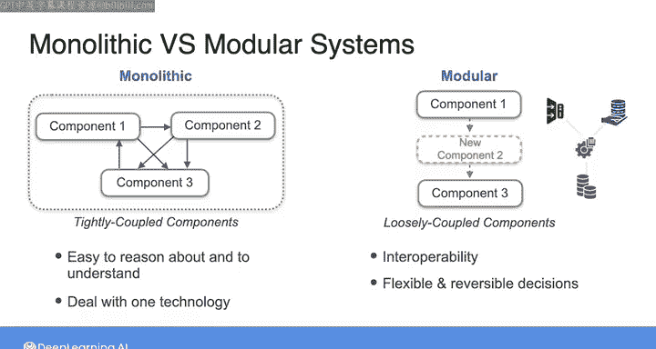

# 吴恩达《数据工程（导论，源系统、数据摄取和管道，数据存储和查询｜1-2-3课）｜DeepLearning.AI Data Engineering》 - P50：52_单体vs模块化系统.zh_en - GPT中英字幕课程资源 - BV1wTtWeeEH5

Another concept in data engineering that I want to touch on briefly here while we're talking about systems that contain hard dependencies and limited flexibility versus those that are loosely coupled and flexible。

 is the idea of monolithic versus modular architecture monolithic systems are a self-contained systems that are made up of tightly coupled components and software development。

 monolithic architectures have been a technology mainstay for decades where large teams work together to deliver a single working code base all the components of that software product codeb would be built and deployed as a single application。

 One advantage of a monolithic system is simplicityimpities instead as all the functionality in one place。

 This means that it's easy to understand a monolithic system So instead of dealing with dozens or hundreds of technologies you have just one technology and typically one principal programming language So monoliths are an excellent option if you want simplicity and reasoning。

Your architecture and your processes， however， monoliths are also very hard to maintain as they grow since a monolith consists of tightly coupled components if you need to update one component。

 you may have to update other components as well and oftentimes the whole application has to be rewritten for example。

 I oncefor that a company that had a monolithic ETL pipeline that took at least 48 hours to run now if anything broke anywhere in this pipeline。

 the entire pipeline process had to be restarted meanwhile anxious business users downstream or waiting for the reports which were already two days late by default and often arrived much。

 much later， the team responsible for this pipeline desperately wanted to replace this pipeline but it would have required weeks of downtime for the entire system so they limped along and accepted suboptimal performance because updating the system was just too daunting and expensive of a task。

By contrast， modular systems consists of loosely coupled components。

 so instead of relying on a massive monolith that combines all the functionalities of an application。

 modular systems rely on breaking the application into self containedtained areas of concern in software development。

 truly modular systems emerge with the rise of microservices。

With microservices instead of combining the components that correspond to multiple services into a single deployable entity。

 each service is deployed as a single unit and modern data engineering data processing technologies have shifted toward a modular model by providing strong support for interoperability this means that most data processing tools available today can be easily integrated with tools that support the other stages of the data engineering lifecycl for example。

 data storage and object storage in a standard format such as parquet can be paired with any processing tool that supports the parquet format the ability to swap out tools as technology changes is invaluable It helps you build good data architecture by enabling flexible and reversible decisions and continuous improvement through the rest of this lesson we'll talk through the details of the various choices you'll make to implement your architecture So things like cost optimization whether。

go with open source or Man solutions and everything else again。

 I'll be presenting these ideas from a cloud first and modular perspective because these are the directions that data engineering as I feel is going。

Join me in the next video to take a look at cost optimization。

