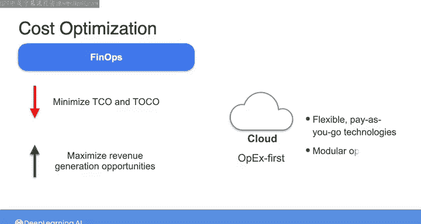

# 吴恩达《数据工程（导论，源系统、数据摄取和管道，数据存储和查询｜1-2-3课）｜DeepLearning.AI Data Engineering》 - P51：53_成本优化和商业价值.zh_en - GPT中英字幕课程资源 - BV1wTtWeeEH5

As I said before， at every stage of the data engineering lifecycle。

 youll have multiple tools and technologies to choose from in order to get the job done。

Each of these choices comes at a cost， and I'm not just talking about the price tag and the software or service you're subscribing to。

There's also a cost associated with implementation。

 namely paying a team to spend the time it takes a stand up and maintain the system。

 and there's also opportunity costs， meaning in choosing one tool。

 you are at least for a time for going the opportunity to choose another and so your tool and technology choices will significantly impact your budget and as a data engineer your job is to provide a positive return on investment your organization makes in its data systems in this video will look at cost through three main lenses I'll first focus on the total cost of ownership or TCO for short and after that will take a quick look at the total opportunity cost of ownership or Tco or Toco for short and finally will revisit FiOs which we touched on briefly last week the total cost of ownership or TCO is the total estimated cost of a solution project or initiative over its entire lifecycl the term TCO。

Is not specific to data engineering， but rather it's a general business term used to describe the total investment in some project。

 including the direct and indirect costs of the products and services you're using this includes things like the acquisition of hardware and software。

 the cost of management maintenance and repairs， as well as any required training and so when it comes to data systems。

 direct costs or the tangible easy to identify costs that are directly attributed to the development of a data product for example。

 your direct costs include the salaries of the team working on the initiative or the AWS bill for all the services used as well as any fees or licensing costs of software subscriptions。

 your indirect costs almost known as overhead or expenses that are not directly attributed to the development of a data product so for example。

 this could be the costs incurred due to network downtime。

 ongoing IT support or the loss of productivity of certain team members it's important。

include indirect costs when estimating TCO because these costs can be significant when it comes to the cost of hardware and software。

 these expenses generally fall into two big groups the first group is capital expenses or Capex for short Capex is the payment made to purchase longterm fixed assets This type of expense for data systems was common before the existence of cloud platforms companies would make an upfront payment to purchase hardware and software and then install them in data centers these upfront investments commonly hundreds of thousands to millions of dollars or more would be treated as Capex assets that would slowly depreciate over time nowadays with the shift to the cloud Many companies are building data systems with essentially zero Capex the other major type of costs is operational expenses or opex for short Opex is an expense associated with running the day-today operations so it's spread out over time in data systems opex。

often appears as a pay as you go expense in the form of recurring subscription fees or the cost of using a particular cloud service and in the context of building on premises versus cloudbased data systems building on premises generally ins a large capex cost while cloudbased systems can be almost entirely Opex before cloud platforms existed an Opex first approach wasn't really an option for large data projects this is now changed with the advent of the cloud as data platform services allow you to pay on a consumptionbased model。

Longterm hardware investments for data projects will inevitably become obsolete。

 so I suggest that you take a cloudcentric opex first approach by choosing flexible payas yougo technologies for your data pipelines by contrast to TCO what I call the total opportunity cost of ownership or TO CO Toco for short。

 is the cost of lost opportunities that you incur in choosing a particular tool or technology its going be harder to quantify but it essentially means that any choice you make inherently excludes other possibilities if you choose datasack A which includes a certain set of technologies to build your data pipelines。

 then you've chosen the benefits of Datastack A over all the other options effectively excluding Datasax BD and so on so in this case the total opportunity cost of ownership is the cost of being held captive to datat A while no longer benefit。

From other datats in the event that Datasack A turns out to be the best possible choice then congratulations total opportunity cost of ownership is essentially zero In reality。

 however， data engineering tools and technologies are evolving very rapidly so even if you make the best possible choices today you still need to evolve your data systems in the future So if some components of datasac A which were the best choices for yesterday have now become obsolete then there will be a cost associated with switching to a different components or different Sac entirely in order to ensure that your total cost of ownership is minimized you'll need to build flexible and loosely coupled systems that are easy to update as your data needs change and the landscape of tools and technologies evolves the one way to do this is to recognize upfront which components of your data pipelines are most likely to change in other words。

 separate the immutable technologies from the transitory technologies immutable technologies are those that have stood the test of time in cloud storage。

These are things like object storage and networking or as another example。

 SQL as a query language has been around for decades and isn't going away anytime soon Transory technologies or at least those that are most likely to be transitory or those that are new at the cutting edge and in areas of the data stack that are rapidly evolving like stream processing orchestration and AI for example。

 when it comes to thinking about technology choices in the context of cost optimization FinOs as a concept is closely related to TCO and TOCO FinOs is about minimizing the cost associated with your data systems your TCO and your TOCO simultaneously maximizing your opportunity for revenue generation so how do you do that in short you could choose cloudbased services that allow you to take an Opex first approach with flexible pay as you go technologies as well as modular options that allow you to iterate。

 improve and grow。

Next up， we'll zoom in a little closer on the topic of choosing the right tools and technologies while optimizing costs。

Join me in the next video to take a look at the trade offs between building your own data system components versus purchasing off the shelf solutions。

