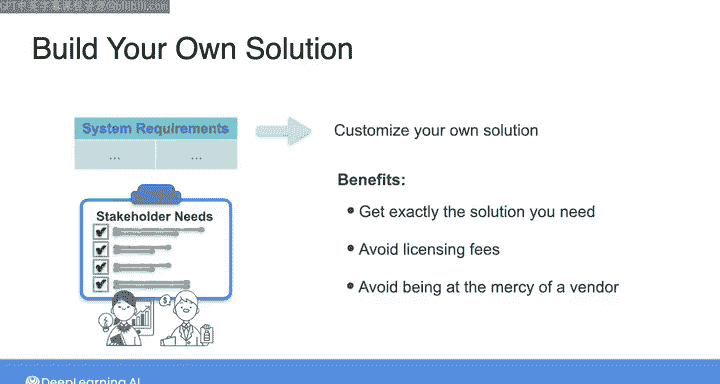
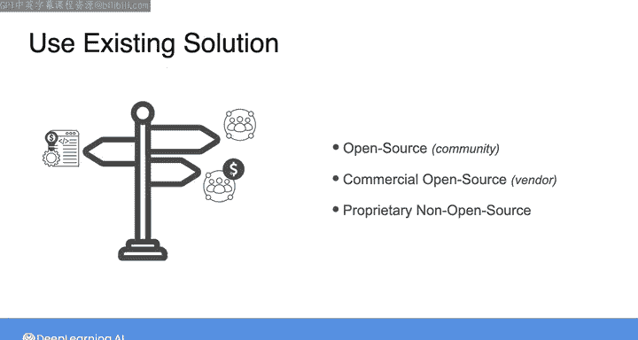
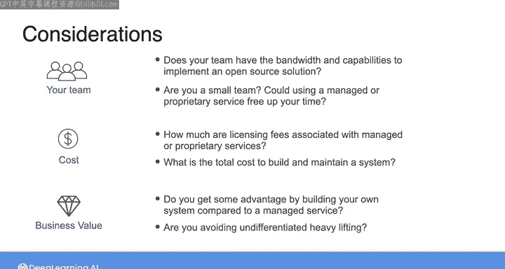

# 吴恩达《数据工程（导论，源系统、数据摄取和管道，数据存储和查询｜1-2-3课）｜DeepLearning.AI Data Engineering》 - P52：54_自建vs购买.zh_en - GPT中英字幕课程资源 - BV1wTtWeeEH5

So far， we've been talking about choosing tools and technologies for your architecture and I've emphasized that in general。

 building on thecloud with flexible pay as yougo services will be your best bet for the vast majority of companies when it comes a common service like say object storage using a cloud service like Amazon's S3 is a much better choice than attempting to build your own custom object storage solution However。

 depending on the requirements of your system there are maybe certain tools or technologies that you need to build out and customize yourself For example。

 many teams elect to build on top of open source frameworks to get exactly the solution they need In other cases。

 a team might choose to build their own solution or customize open source frameworks to avoid licensing fees or simply avoid being at the mercy of a vendor。

In fact， for essentially all stages of the data engineering lifecycle。

 you'll have a range of options when it comes to choosing tools and technologies and of course。

 for any tool you need you could just build something from scratch and in some cases this might be your only option if you're attempting to do something that no one else has done before。

But for most cases， however， this is not recommended unless you are certain there is no existing solution out there for the thing you're trying to do。

And buildinging technologies from scratch when all the shelf solutions already exist can amount of reinventing the wheel so to speak。

 and you'll hear me refer to this sort of activity as undifferentiated heavy lifting。

In the sense that it's hard work and it probably doesn't ultimately add value for your organization when it comes to existing solutions。

 these include fully open source options as well as commercial open source options from vendors which are essentially a managed version of some open source tool and then there may also be proprietary non- open source software and services to choose from So when it comes to choosing between these options or some key parameters you need to consider first off if you elect to go with a fully open source solution。

 does your team have the bandwidth and capabilities to implement and maintain that system。

 Many open source tools have a great community supporting them where you can get help if you need it but if you're part of a small team maybe even a team of one。

 then it's possible that a manage open source or proprietary service will better suit your needs and that's because it can free you up to build and manage your entire data system without getting stuck in the wes deploying and maintaining a single component and beyond。

That even if your team does have the expertise and bandwidth to build from scratch and implement an open source solution I mean is it really worth it on the surface building something yourself or using an open source solution might seem like a cost savings because you're avoiding licensing fees but the total cost of ownership as we talked about in less video it's much more than just licensing costs it also includes the cost of the team required to build and maintain the system in addition to cost the other important point to consider is whether building out and maintaining a custom or open source solution actually provides value for your organization In other words。

 do you get some advantage by building your own system or using open source over what you would get with a managed service or is it just undifferentiated heavy lifting in other words just hard work that doesn't provide any additional value for most teams and particularly small teams building data pipelines and wondering whether to build their own use open source or purchase。

Commercial open source or proprietary tools my suggestion would be to first look at open source or commercial open source solutions and if you can't get what you need look at buying a proprietary solution Plen of great modular services are available to choose from in either case and this will allow your team to focus on the unique opportunities that provide the most value to your organization join me in the next video for a look at the differences between so-called serverless versus server options for tools and technologies。

