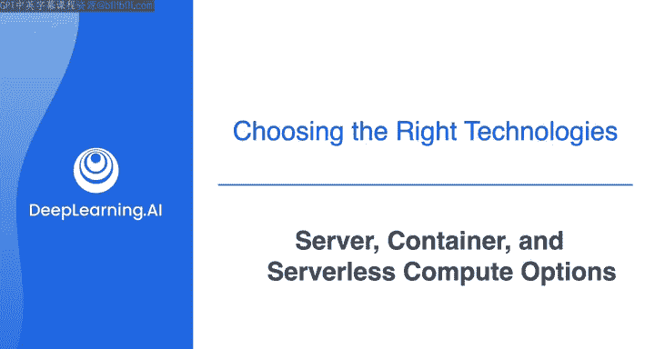
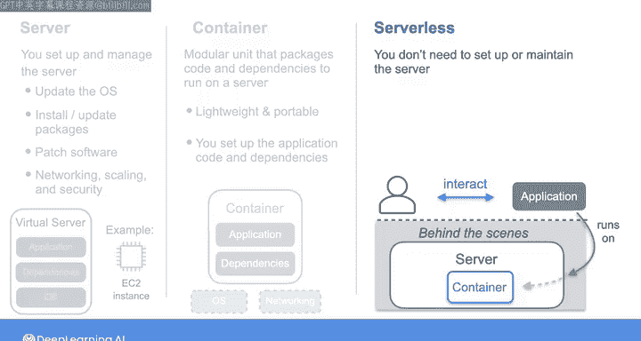
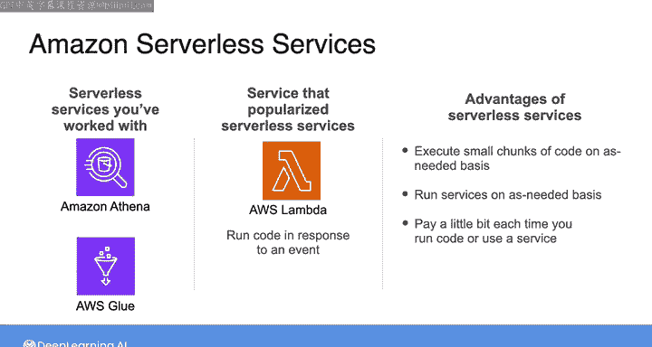
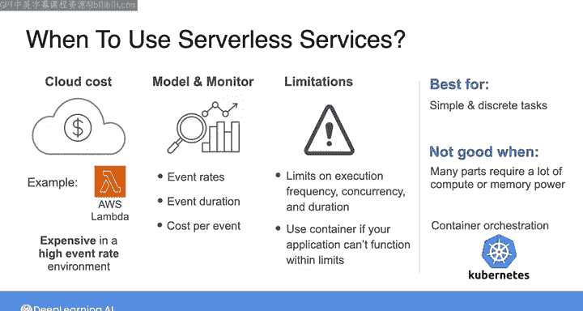

# 吴恩达《数据工程（导论，源系统、数据摄取和管道，数据存储和查询｜1-2-3课）｜DeepLearning.AI Data Engineering》 - P53：55_服务器、容器和无服务器计算选项.zh_en - GPT中英字幕课程资源 - BV1wTtWeeEH5

Toote to any software application， you need a server which is essentially a computer or a collection of computers that powers your application by providing CPU。

 memoryory or RAM as well as disk storage and maybe a GPU and networking servers provide computing resources over a network most often through the internet when it comes to cloud tools depending on the service you're considering you may be required to set up and manage the compute resources required to run the application and in other cases。

 you may be able to choose between one or more of the following three computing options server container or serverless In this video I'll go over the differences in tradeoffs between these three options if you choose to go with the server version of a service you will be responsible for setting up and managing the server such as an Amazon EC2 instance that these server will run on and including updating the operating system installing or updating packages software package。

Neworking， scaling and security in contrast to a server。

 a container is a more modular unit that wraps up your code and all dependencies into a package that can run on a server So whereas a traditional virtual machine wraps entire operating system a container is more lightweight as it just packages up and isolated user space such as a file system and a few processes So for a containerized solution。

 you would still be responsible for setting up the essential elements of the application code and dependencies but the underlying operating system networking and all the rest would be provided apart from server and container options for services it's becoming increasingly common in the world of cloud data tools to encounter the term serverless to describe a particular server if you are familiar with the way computers work a word like serverless might sound a little strange like how do you run software without a server right。

Turns out that the term serverless doesn't actually mean there is no server just means that setting up and maintaining the server is not your responsibility for that particular service。

 you can interact with the application without managing the servers behind the scenes or worrying about package installations and dependencies So the server is essentially hidden from you like I've drawn here typically serverless technologies run on containers so these server can automatically scale they have availability and fault tolerance built in and they offer pay as you go billing but in the case of serverless services the containers they run on war also abstracted away in this way serverless technologies can allow you to spend less time worrying about your compute infrastructure and more time focusing on developing data products in the previous weeks's lab you worked with a number of serverless services such as Amazon Athena and AWS glue the serverless trend kicked off in full force with the launch of AWS。

Lambda in 2014， which is a service that allows you to run code in response to an event。

With the promise of executing small chunks of code on an as needed basis without having to manage a server。

 serverless options have exploded in popularity and diversity and now go far beyond just running code snippets on demand。

The main reasons for this popularity are a cost and convenience instead of paying the cost of a server。

 you can just pay a little bit each time your code is run or when you use a particular service So when does it make sense to use serverless services as with many other cloud services it depends as a data engineer。

 you need to understand the details of cloud pricing to be able to predict the cost of your serverless deployments and decide if it's more cost effective than the server option。

 For example， looking at the pricing for AWS Lada， you'll find that using the service and an environment with high rates of events can be catastrophically extensive as other areas of your data pipelines is critical to model and monitor the services you use serverless or otherwise you may need to monitor directly to determine actual event rates duration and cost per event in a rural worldld environments so you can model the overall cost of a serverless service versus some alternative apart from that cloud。

Serverless platforms have limits on execution frequency。

 concurrency and duration if your application can't function neatly within these limits。

 it's time to consider a containeroriented approach so you can think about it like this serverless works best for simple discrete tasks and workloads it's not going to work as well if you have many moving parts or require a lot of compute or memory horsepower In that case consider using containers and a container workflow orchestration framework like Kubernetes for most modern data engineering applications in the cloud you can get the job done with serverless or containerized tools。

So I would recommend looking at using serverless first and then containers and orchestration if possible。

 and once you've grown these serverless options， join me in the next video to wrap up this lesson with a look at how the undercurrents of the data engineering lifecycle come into play when choosing tools and technologies for your data architecture。

