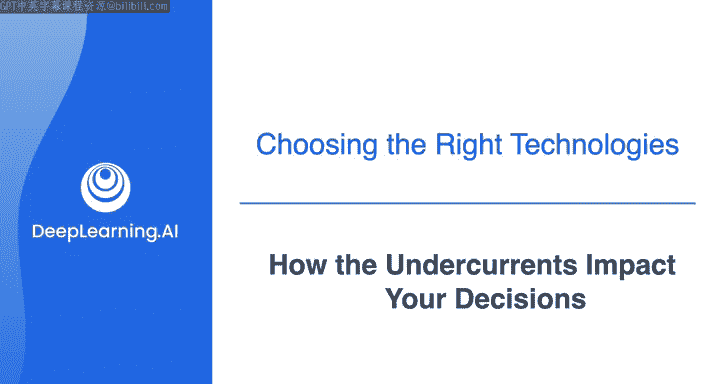
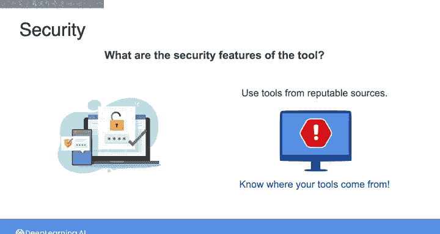
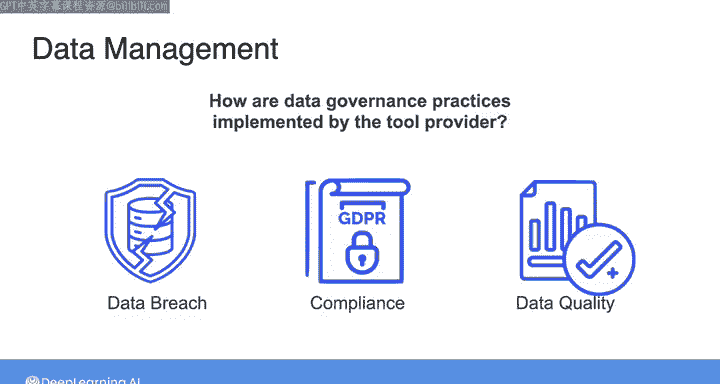
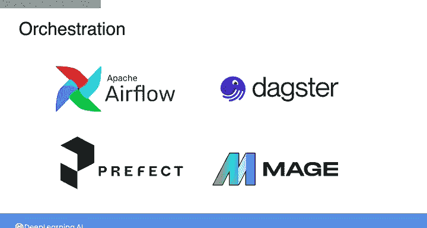
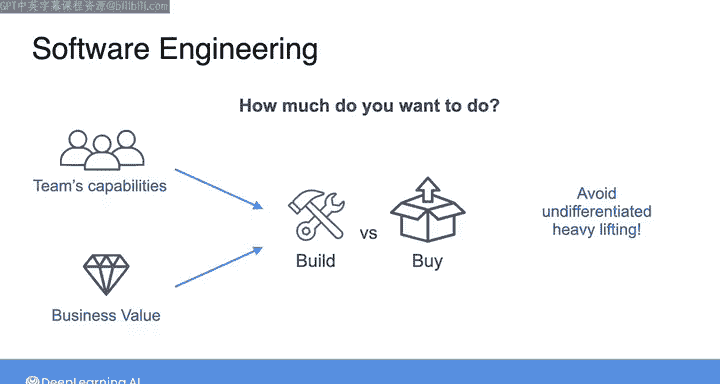

# 吴恩达《数据工程（导论，源系统、数据摄取和管道，数据存储和查询｜1-2-3课）｜DeepLearning.AI Data Engineering》 - P54：56_底层技术如何影响你的决策.zh_en - GPT中英字幕课程资源 - BV1wTtWeeEH5

To wrap up this lesson， I'd like to briefly touch on how each of the undercurrents of the data engineering lifecycl come into play as you choose tools and technologies to build up your data architecture。

Last week we looked at each of these six undercurrents， security， data management， data ops。

Data architecture， orchestration and software engineering as they relate to the data engineering lifecycl Now we will take a closer look at how these undercurrents relate to choosing the individual components for your data architecture when it comes to security different tools have different security features it's important to understand what those features are and make sure that you put the right authentication technology in place as well as other best practices we talked about one big thing to watch out for is to only use software and tooling developed by reputable organizations and trusted open source communities there are known instances of organizations or nation states pushing out data tools that contain suspicious components essentially spyware that compromises your data pipelines and won't say any more about that now but the takeaway is to make sure that you know where your tools come from if it's an open source tool take a look at the code and make sure you understand how it's implemented with data management。

Not always clear how certain data governance practices are implemented and it's a good idea to ask the company or a community providing the tool。

 how governance is handled， for example， how will your data be protected against breaches both from the outside and from within how does the tool comply with GDPR and other data privacy regulations or how does the tool provide for verification of data quality when it comes to data ops choosing the right tools is mostly about understanding what features they offer in terms of automation and monitoring if you're looking at a managed service option be sure to understand the providers service level agreement or SLA that describes their guarantees around reliability and availability with data architecture as we've talked about throughout this week of materials you need to look for how any given tool provides modularity and interoperability with other tools good modularity and interoperability allows for flexibility and loose coupling。

bet components for orchestration the data engineering landscape is currently dominated by Apache Airflow。

 which you can implement as an open source or managed tool There are also other offerings like prefect Bater and Ma that're growing in popularity as well if you're looking at orchestration tools just be aware that the space is rapidly evolving and a deep understanding of your own data architecture goals will help you determine which orchestration tools are best suited to your needs when it comes to software engineering the big question is how much do you want to do What I mean by that is given your evaluation of your team's bandwidth and expertise as well as what kind of development activities really add value in your organization do you want to build your own tool or go with an open source option or sign up for a commercial open source or proprietary solution the main thing to avoid is undifferentiated heavy lifting which is to say hard work that doesn't add value for your。

Check out open source and commercial open source tools first if they can't meet your needs。

 then look at proprietary tools that's it for this brief overview of how each of the undercurrents of the data engineering lifecycle come into play as you're choosing tools and technologies to implement in your data architecture。

Once again we've covered a lot of ground talking about data engineering somewhat in the abstract。

 I know it might seem like we focus a lot on theories so far and you're probably excited to get practicing these concepts that you've learned that's great because there's a lot of hands-on practice coming soon join me in the next lesson to take a look at the AWS will architecture framework and evaluate the architecture choices for your own data architecture on AWS。

