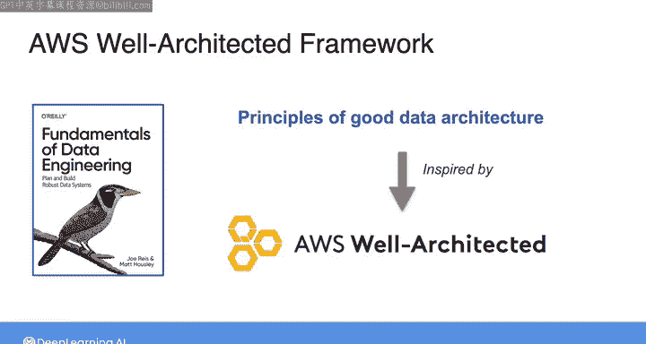

# 吴恩达《数据工程（导论，源系统、数据摄取和管道，数据存储和查询｜1-2-3课）｜DeepLearning.AI Data Engineering》 - P55：57_AWS架构完善框架简介.zh_en - GPT中英字幕课程资源 - BV1wTtWeeEH5

So far in this course， you've been learning about data architecture fundamentals and the many considerations you need to take into account when designing and choosing tools for your own data architecture。

In this lesson we'll start by taking a look at the AWS well architected framework This framework consists of a set of principles and best practices that will help you build scalable and robust architectures on AWS the well architected framework complements the set of principles and practices that we've already been talking about in this course in fact in writing the fundamentals of data engineering book and articulating the key principles we felt were most important for designing good data architecture my co-author Matt Hausey and I took inspiration from the AWS well Arched framework as well as other sources If you do a quick search for the AWS well architected framework you'll find all kinds of great resources including White papers's focus on specific use cases in a tool that AWS provides to help you in applying this framework In fact the framework itself could be the subject of an entire course for the purposes of this course in the next video Morgan will give you an introduction to the six key pillars。

Of this framework and show you where you can go to learn more and get more practice with the framework。

And after that， I'll see you in the following video for a walkthrough of this week's lab exercise。

 we'll get you a chance to apply the principles of good data architecture on the AWS cloud。

