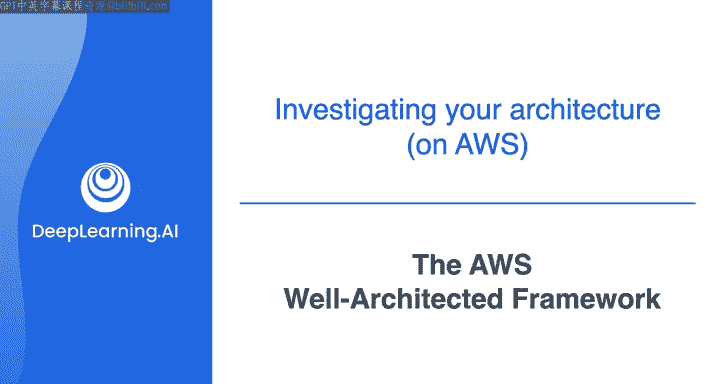
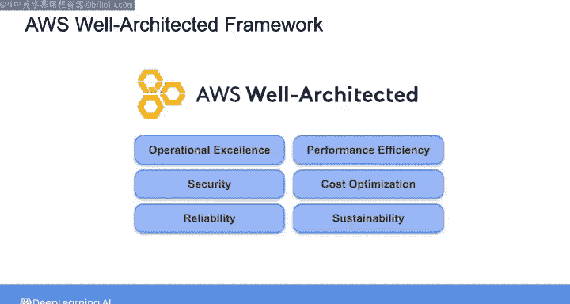
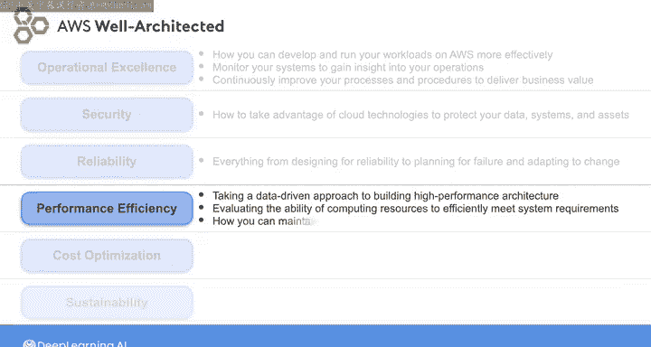
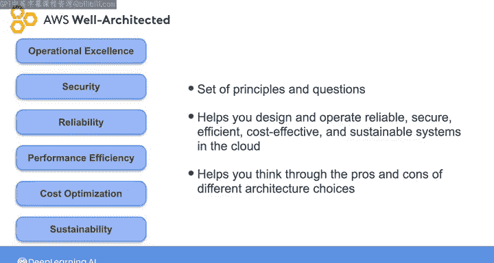
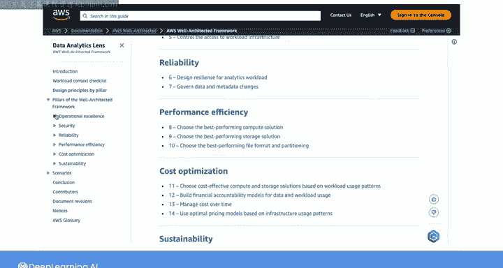

# 吴恩达《数据工程（导论，源系统、数据摄取和管道，数据存储和查询｜1-2-3课）｜DeepLearning.AI Data Engineering》 - P56：58_AWS架构完善框架.zh_en - GPT中英字幕课程资源 - BV1wTtWeeEH5

When you're building systems on AWS， particularly when you're just getting started。

 it can be overwhelming There are just so many options to choose from and different ways you can build out solutions on AWS So how do you know if you're getting it right Well that's what the AWS Well architectected framework is all about evaluating and improving solutions so you can get it right when you're building on AWS。

In this video， I'll give you an overview of the well architectected framework and point you to more resources so you can use this framework to evaluate whatever you build on AWS。

 So let's begin with a little background at AWS。 we don't just provide services for building systems in the cloud。

 We also work closely with thousands of customers around the world to help them build the best cloud solutions to support and run their businesses。

AWS solutions， architects， subject matter experts and other AWS personnel have spent decades working directly with customers across a wide variety of business needs and use cases。

 which has given them a lot of experience with doing things the right way。

 from that collective experience。 AWS has constructed the well architectected framework which comprises a set of best practices and course strategies for architecting systems in the cloud。

 The AWS well architectected framework includes six key pillars。 Opera excellence。

 security reliability performance efficiency。 cost optimization and sustainability here。

 I'll just briefly describe each of these pillars， and you can follow the links in the resources section at the end of this week to learn more if you're interested。

 So the first pillar is operational excellence。 This pillar is focused on how you can develop and run your workloads on AWS more effectively monitor your systems to gain insight into your operations and continuously improve your processes and procedures。

To deliver business value。 Next is the security pillar。

 which is focused on how to take advantage of cloud technologies to protect your data。

 systems and assets。 You've already looked at the security undercurrent of the data engineering lifecycl with Joe。

 And the idea here is the same。 You need to employ proper tools to secure your systems。

 as well as encourage a culture of security on your team。 Next up is the reliability pillar。

 Reable systems are those that perform their intended function correctly。

 consistently and can recover quickly from a failure。

 So this pillar is about everything from designing for reliability to planning for failure and adapting to change。

The performance efficiency pillar is focused on taking a datadriven approach to building high performance architectures。

 when it comes to your systems' performance efficiency。

 you'll be evaluating the ability of a set of computing resources to efficiently meet your system requirements。

 as well as how you can maintain that efficiency as demand changes and technologies evolve。

 The next pillar is cost optimization。 This one is pretty straightforward and closely related to the points Joe made earlier this week about embracing Finops。

 simply put cost optimization means building systems to deliver maximum business value at the lowest possible price point。

 and AWS provides a range of services including the AWs cost Explorer and cost optimization hub。

 where you can make comparisons and get recommendations about how to optimize for cost for your systems。

 And finally， we have the sustainability pillar。 While things like performance scalability security and cost might be top of mind when building out data systems。

 It's also important to。

Consider the environmental impact of your workloads that you're running on the cloud。

 The sustainability pillar is focused on reducing energy consumption and increasing efficiency across all components of your system。

 Now， it's important to keep in mind that these six pillars of the well architectected framework will not provide specific designs for you to just copy and apply to your solutions。

 Instead， you can think of them as a set of principles and questions that will help you have productive conversations about your existing solutions and help you design and operate reliable。

 secure， efficient， costeffect and sustainable systems in the cloud。

 It's almost like having access to your own personal AWs solutions architect who can help you think through the pros and cons of different architecture choices。

 As I mentioned before， you can follow the links in the resources section at the end of this week to learn more about each of the pillars and explore the well architectected tool that allows you to evaluate your own architectures for potential risks。

And opportunities for improvement。 There are also domain specific applications of the well architected framework called lenses that you can explore。

 A lens is essentially an extension of the AWS well architectected framework that focuses on a particular area。

 industry or technology stack and provides guidance specific to those contexts。

Each lens has its own set of questions， best practices。

 notes and improvement plan In particular I'd recommend you to check out the data analytics lens which is focused on dataspecific considerations the data analytics lens will walk you through evaluating your data architectures for scalability。

 security， performance and cost it can help you evaluate your current data architectures identify areas for improvement and implement strategies that align with industry best practices Next up。

 it's your turn to try applying the principles we've been talking about this week to your own data architecture on AWS。

Through the next few videos， Joe will walk you through the lab exercise for this week and I'll see you again next week。

