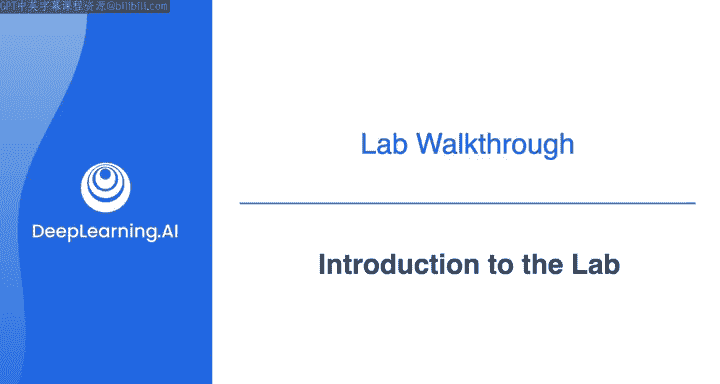
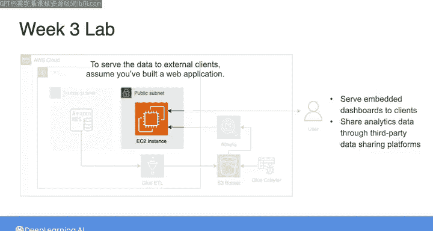
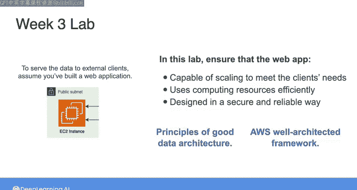
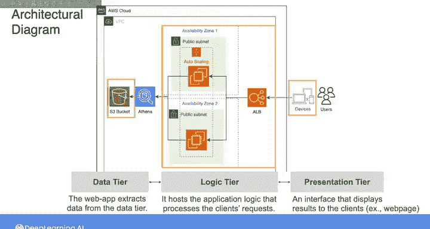
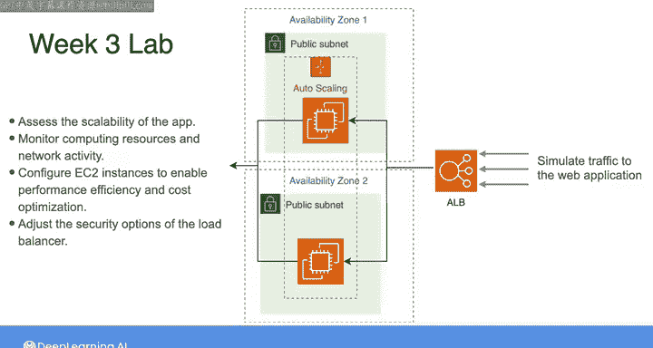
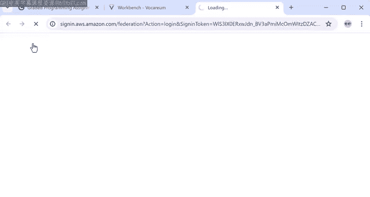

# 吴恩达《数据工程（导论，源系统、数据摄取和管道，数据存储和查询｜1-2-3课）｜DeepLearning.AI Data Engineering》 - P57：59_实验演练：实验介绍.zh_en - GPT中英字幕课程资源 - BV1wTtWeeEH5

In last week's lab， you built this data pipeline to ingest。

 transform and serve data to the data analyst in your company。

 Now your company wants to serve some embedded dashboards to its clients and share some analytical data through thirdparty data sharing platforms。

 So you've been tasked with sharing this transform data to a broader public audience to serve this data to external clients。

 Let's assume you've built a web application that is running on these EC C2 instances In this lab you will work with this web application to ensure that it's capable of scaling to meet your clients' needs uses computing resources efficiently and is designed in a secure and reliable way。

He'll also monitor the performance of this application using Amazon Cloudwach while applying the principles of good data architecture and following the AWS well architected framework。

 Before we start with a lab， let's take a closer look at these E C2 instances to understand the underlying architecture of the web application。

 Here's the architectural diagram of the web application。

 This web app is designed based on a three tier architecture that consists of a data tier。

 a logic tier and a presentation tier。 This type of three tier architecture is a common way of deploy web application solutions。

The S3 bucket you see here on the left represents a data tier from which your web application extracts data。

 The EC2 instances and the load balancer in the middle represent the logic tier。

 which hosts the application logic that processes the clients' requests the logic tier queries data from the data tier and returns the results to the presentation tier here on the right。

 which consists of an interface that displays the results to the clients who interact with the web application through their devices。

 In this example， you can think of the web page that shows the analytical dashboards of clients as the presentation layer。

 Let's zoom in on the logic tier in the middle。

There are two main components here。The Amazon E C2 auto scaling group and the application load balancer or AB。

 The auto scaling group consists of a collection of E C2 instances that run the same application logic。

 They are used to increase the computing capabilities of the application。

 So instead of having a single E C2 instance that processes all requests from clients。

 these requests are distributed across the E C2 instances。

 Auto scaling means that the number of E2 instances can increase or decrease based on the number of client requests to the web app。

 The group is configured to start with two instances each launched in a different availability zone to enhance the availability and reliability of the application。

 The auto scaling group needs to be associated with an application load balancer that helps distribute the incoming traffic across the E2 instances and serves as a single point of contact for the clients In this lab mainly interact the computing resources on which the application logic is run。

 Youll simulate traffic to the web application to assess its scalability。

 Then monitor computing resources and network activity on the application using Amazon cloud。

You will configure the EC C2 instances to enable performance efficiency and cost optimization and adjust the security options of the load balancer to control the inbound traffic to the application to begin the lab。

 you will open the lab item on Coursera and see this page that contains all the lab instructions for this lab rather than working in cloud 9 or a Jupyter lab like you did in last week's lab。

 you will use the AWS management console to monitor and update the settings of the web application。

 Now to access the console， let's start the lab then wait for this icon to turn green。

Once it's green， you can click on it and go to the console。

The first few sections of the instructions here go through the instruction that I presented in this video in the next video I'll walk you through sections 3 and 4 of the lab where you'll explore and monitor the computing resources of your application I'll see you there。

