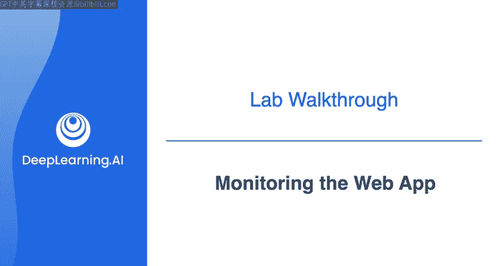
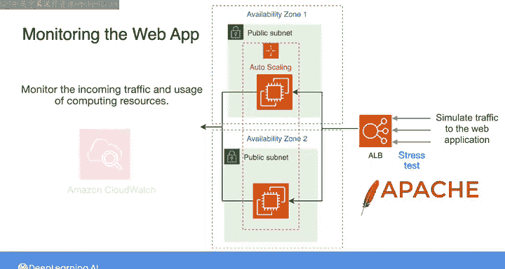
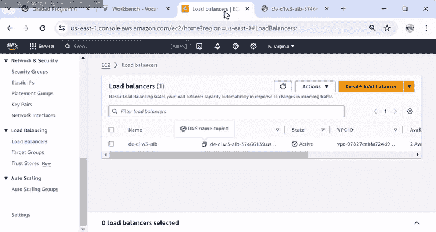
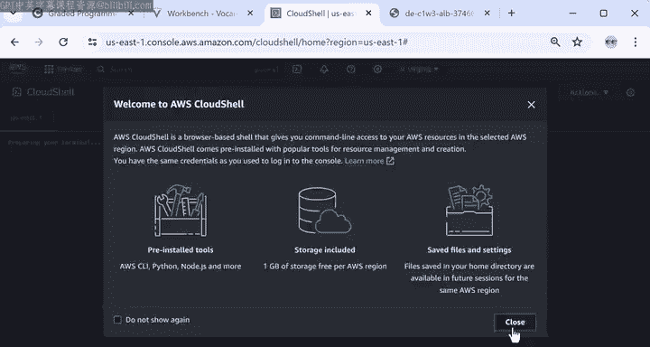
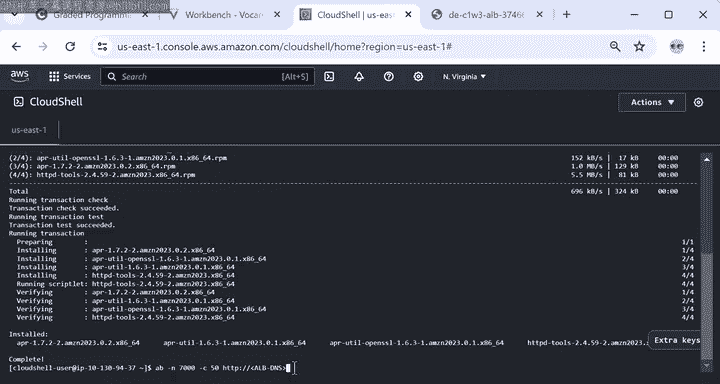
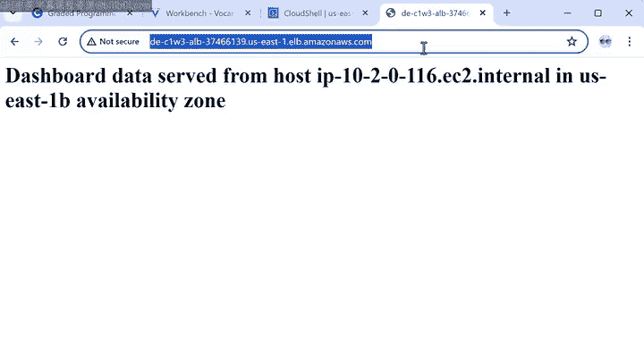
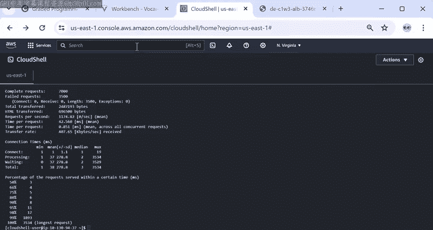
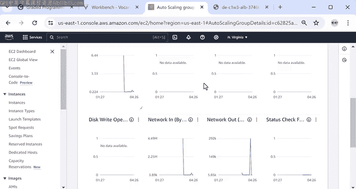

# 吴恩达《数据工程（导论，源系统、数据摄取和管道，数据存储和查询｜1-2-3课）｜DeepLearning.AI Data Engineering》 - P58：60_实验演练：监控Web应用.zh_en - GPT中英字幕课程资源 - BV1wTtWeeEH5

In this video， I'll give you a preview of the task outlined in sections 3 and 4 of the lab instructions。

 where you'll focus on monitoring the EC2 instances of the auto scalinging group and the networking activities through the application load balancer the auto scaling group and application load balancer are provided to you so you don't need to create them to access them from the console you can type E2 here in the search bar and then click on that service in the left panel here。

 you can find a section for the actual E2 instances and at the bottom of the panel。

 you can find the sections for load balancing and auto scaling for the first task in this lab which corresponds to section 3 in the lab instructions。

 you'll need to find the address of the application web page for that。

 you need to check the load balancer because it serves as the main point of contact for clients。

So under load balancing， you'll click on the load balancers to see the load balancer of your application。

Under the DNS name， you will copy the address of the webpage and paste a link in another tab。

This page represents the interface through which the clients interact with the application。

 and it's supposed to display a dashboard for clients， but to keep things simple。

 you are showing a simple message that displays some details of the EC2 instance that is hosting the application logic。

I'll keep this tab open because we'll need this information later on in the lab。

Now when clients use your web application， you'll receive some requests and incoming traffic that needs to be processed。

For example， opening the application webp page is an HTTP request that the load balancer receives and then hands over to an EC2 instance for processing to ensure the application can support the incoming demands you will need to monitor the incoming traffic and the usage of computing resources of your web app。

Observability and monitoring is an important practice within data ops。

 and it falls under the operational excellence pillar of the AWS Well Architects frameworkwork。

 so in Section 4 of this lab， we'll use Amazon CloudWatch to track performance metrics of your web app。

First， you'll need to simulate some incoming traffic to the website using an open source tool called Apache Benchmark。

You can use this tool to perform a stress test， which involves sending a large number of requests to your web app。

 then you will monitor the CPU usage of your EC2 instances and networking activity and Amazon CloudWatch。

Let's first install the Apache benchmarkch tool using AWS CloudShell。

 which is a command line service that is directly available from the AWS console。

 so from the console you can find and open up Cloud Shell。

 then you'll copy the installation command from the lab instructions and run it in the terminal。

 the next command from the lab instructions will generate the stress test by sending multiple HTTP requests。

In this command， you can use the dashN option to specify the total number of HTP requests and the dash C option to specify the number of concurrent requests。

So here we're sending 7，000 requests in total， and those will be sent 50 at a time。

For the last argument in this command， you need to replace it with the actual address of your web page。

I'll go back to the tab that shows the application webpage， copy the address。

 and paste it here to replace the last argument。

The requests are now being sent， and so I can check the CPU usage and networking activities for the EC2 instances of the auto scaling group from the console。

 I'll search for EC2。 Then on the left side here， I'll scroll down to the auto scaling group section。

 then open up the provided group。

And go to the monitoring tab。And choose easy to。Here I'll focus on these three graphs。

The first one shows the CPU utilization for processing the 7000 requests。

You can see the increase in computing resources needed to process the incoming traffic。

You can also see a similar pattern in these two groups that monitor the inbound and outbound networking activities and bytes After a few minutes。

 once all 7000 requests have been processed， if you refresh the UI。

 you should see a decrease in CPU utilization and networking activities。In this video。

 we walked through sections 3 and 4 of the lab to get the address rest of your web application。

 simulate incoming traffic， and monitor the CPU usage and network activities。

Join me in the next video to explore the security， availability， scalability。

 and cost aspects of your web application。

