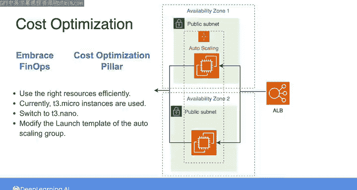
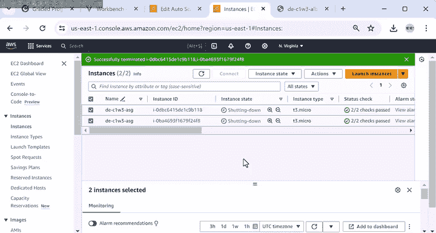
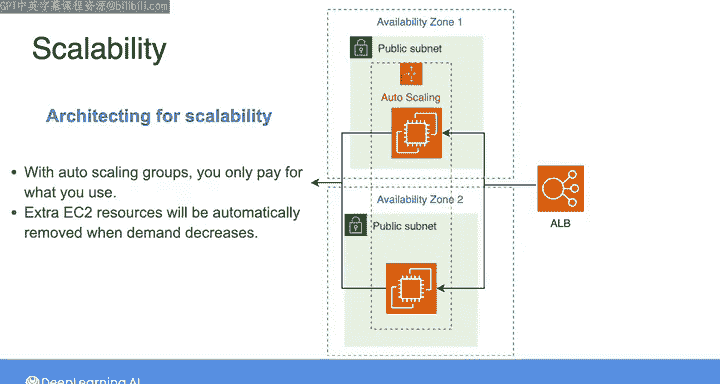
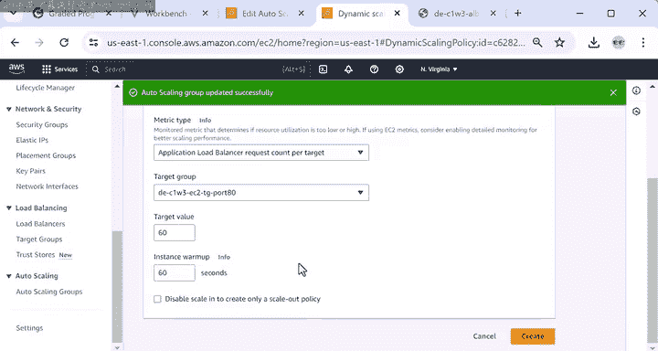
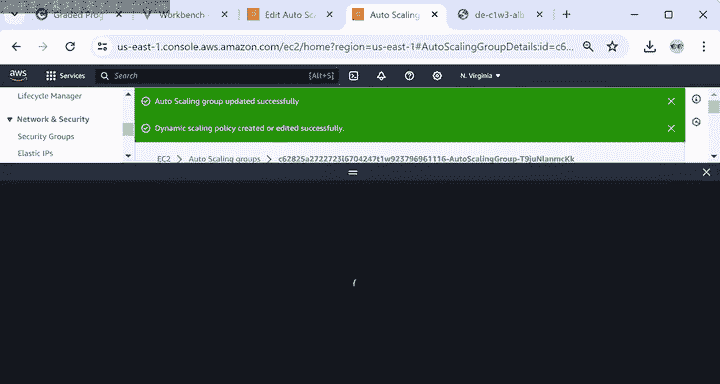
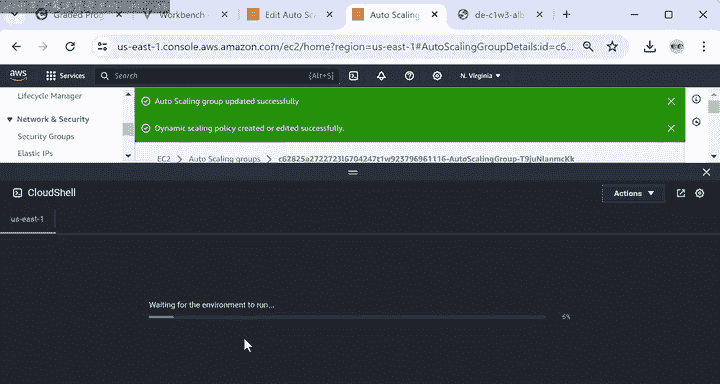
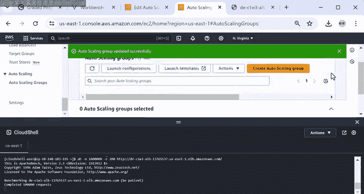
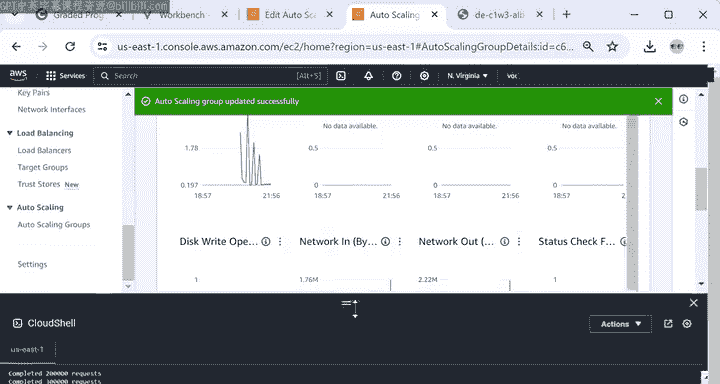
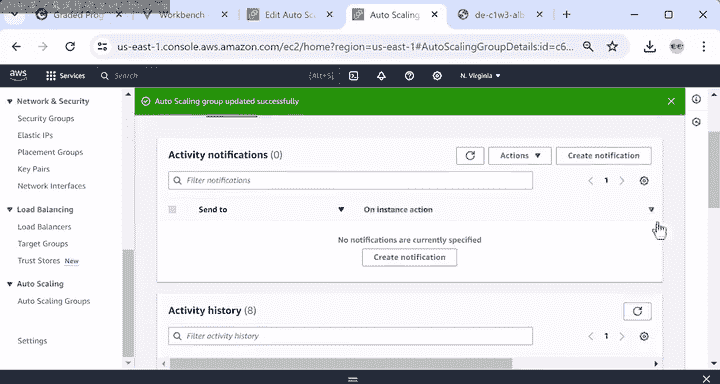
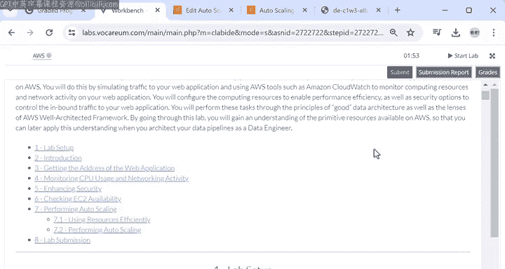

# 吴恩达《数据工程（导论，源系统、数据摄取和管道，数据存储和查询｜1-2-3课）｜DeepLearning.AI Data Engineering》 - P59：61_实验演练：应用良好数据架构原则.zh_en - GPT中英字幕课程资源 - BV1wTtWeeEH5

As a reminder in the previous video， we simulated some traffic for your Web app and monitored the CPU usage and network activities。

 In this video， I'll give you a preview of the tasks outlined in sections 5 to 7 of the lab instructions so you can start thinking about how to apply the principles of good data architecture to ensure the security availability and scalability of the applications while optimizing for cost。

 Let's start with security。😊，As stated in the prioritize security architectureecture principle and the security pillar of the AWS Will Archected framework。

 you should always prioritize security when building any application or data system。

To control access to the web application in this lab。

 you can configure the load balancer to only receive certain types of requests while blocking others and networking when a client sends a request to the web server。

 they need the address and the port number。 A port number is a virtual identifier that applications use to differentiate between types of traffic so that each port can be associated with a specific process to make it easier for programmers。

 specific port numbers are assigned to popular requests by default。 So， for example。

 port 80 is assigned to HttP requests。 However， if the security rules of the load balancer are not appropriately configured。

 Other ports can still be accessible by external clients。 for the web app used in this lab。

 the lab instructions indicated that some private data may be leaked through port 90 of the load balancer due to incorrect configurations to verify this。

 I'll go into the tab that displays the web page copy the address and paste it in another tab。

 but now I'll append colon 90 to specify port 90。The message here shows that there are some private data that is displayed through this port and it can be easily accessed by external parties to fix this issue。

 you need to adjust the security rules known as the security groups of the load balancer let's open up EC2 from the console navigate to the network and security section in the left panel and then click on security groups。

 you can see two security groups here。 the first one is associated with the EC2 instances of the auto scalinging group and the second one is associated with the load balancer As I mentioned before。

 the load balancer acts as the main point of contact for clients and it should be configured to receive traffic from the outside internet which is what you'll be adjusting in the section of the lab but before adjusting those let's verify that the security groups of the EC2 instances or are configured to only receive traffic from the load balancer If you click on the ID of the EC2 security group and scroll down to check the inbound rules you'll find this rule that has the idea of the load balancer security group listed as a source which means that the EC2 instances can only receive。

From the load balancer as intended Allright so let's go back and adjust the configurations of the load balancer security group Once you open the security group with the load balancer。

 you'll find this rule that specifies a bunch of zeros as a source which means that accepts requests from all IP addresses and it also accepts all possible port numbers for the port range this means that any source can access a load balancer using any port which is a very open rule in other words。

 with a configuration like this your web app is open to any IP address and any port number for the public internet and that's not what you want。

Let's fix this by restricting the HtTP request to Port 80 only I'll click on Ed inbound rules。

Then on add rules。Under port range， I'll specify port 80。And for source。

 I'll choose all IP addresses by specifying this block。

Then I'll delete the first rule and then click on saveve ruless。

Now you can see the updated rule with 80 as the port range。

Let's verify that port 90 is no longer accessible from the public internet。

 I'll open a tab and for the address of the application and append colon 90。

 you might still see the old result because web browsers can cast results。

But if you keep on refreshing the web page， you'll notice that you cannot access the page with the private data anymore。

 and if you wait long enough， you'll receive this error message that says the site can't be reached。

 So that's how you can adjust the security controls for your web app。 Next。

 let's move on to section 6 of the lab instructions and explore the reliability aspect of the application。

 The architecture diagram tells us that the auto scaling group is configured to start with two E2 instances。

 Each launched in a different availability zone to verify this。

 I'll go to the tab that shows the web page of the application。

The displayed message shows the internal IP address of the E2 instance that process the HTP request。

 as well as its availability zone。 I'll refresh this page。

 and now you see the IP and availability zone of the second EC2 instance。

 This means that the request is processed by a different EC2 instance each time。

Designing applications to span multiple availability zones is related to the reliability pillar of cloud based solutions and the principle of plan for failure that we discussed this week。

 And this way， if something goes wrong with one of the availability zones。

 the request can still be processed by the E C2 hosted in another zone。Finally。

 let's explore two aspects of the application， cost optimization and scalability。

 which are covered in section 7 of the lab instructions to embrace Finops。

 you need to make sure you're using the right resources efficiently。

 remember from last week that there are different types of EC2 instances each with different processing power and memory capacity and of course the more powerful the EC2 instance。

 the more you need to pay for the hourly usage Currently we're using t3 micro instances。

 but if they're a bit too powerful and costly for your application。

 you can switch to the t3 nano instances to reduce cost to do this you need to go to the auto scalinging group and modify the launch template which holds the configuration information for launching the EC2 instances and the AWS console I'll search for EC2 then scroll to find the auto scalinging groups in the left panel I'll click on the name of the group and find the launch template section。

 This section contains the configuration information of the current EC2 instances so you can see that the current instance type is T3 micro Let's edit the template。

Here I'll click on createre a launch template version to create a new version of the existing launch template。

I want to leave everything the same except for the Insense type。

 so I'll scroll down to the Insense type section and search for T3 nano。

You'll notice the difference between nano and micro instances is their memory capacity and of course。

 pricing。I'll select T3 Na and then click on create template version。

 Once a template has been created successfully， let's go back to the auto scaling groups。

And then again， click on the name of the group。In the Laun T section， I'll click on Edit。

Then in the version drop down menu， I'll select the latest option。

Don't forget to click updatedate at the bottom。So I just updated the launch template configurations for all future EC2 instances that will be created as part of this group。

 but we also want to terminate the current T3 micro EC2 instances that are still running to do that I'll navigate to the instances section and the left panel。

And select all the EC2 instances that are currently running。

 then I'll right click on any one of them and click on Terinate instances。

The status of the EC2 instances is now shutting down。 After a few minutes。

 once you to refresh the UI， the status of the EC2 instances should show terminated。

You'll also notice that one or two new T3 and nanoins have been created。

This is because the auto scalinging group has a desired capacity of two instances。

 meaning that it will always start two instances。So if you only see one instance running now after a while。

 if you refresh the UI， you'll see two T3 nano instances running。

For the last task in Section 7 of the lab instructions。

 he will apply the principle of architecting for scalability by scaling up and down your resources using the automatic scaling property of the auto scaling groups。

With auto scaling groups， you only pay for what you use。

 so when demand decreases AWS auto scaling will automatically remove any extra easy2 resources to help you avoid overspending Right now the auto scaling feature is not enabled to enable auto scaling you' will need to create a scaling policy where you specify metrics and threshold values that trigger the automatic scaling process。

So in the left panel of the EC2 instance， let's navigate through the auto scaling group section。

 then click on the group name and go to the automatic scalinging tab。Here。

 I'll click on the Create dynamicy scaling policy and give the policy the name found in the lab instructions。

For metric type， I'll pick application load balance or request count per target and for target group。

 I'll choose the port 80 group， then I'll choose 60 for the target value。

 meaning that when there's more than 60 Htp requests。

 the auto scaling group may scale out to add more instances to handle the increased load and when there's fewerer than 60 requests。

 The auto scalinging group will scale down by reducing the number of instances。 and finally。

 I'll set the instance warm up to 60 seconds。 This warm up time refers the period during which newly launched instances are allowed to fully initialize before being considered in service for the auto scaling evaluation metrics。

 Don't forget to click create at the bottom。

Now let's perform a more intense stress test with Apache benchmark by sending 1 million requests instead of 7。

000 I'll click on the Cloudhe icon you see here at the bottom so I can use the command line to make the request and check the status of the request while monitoring the performance metrics of the application。

I'll type this command and replace the last argument with the address of the application。

The test will take a few minutes to run。In the meantime。

 let's go to the auto scalinging group service。

And click on Mon。And then EC2。Here you can see some activity in the CPU usage and also in the network metrics。

After a few minutes， you can switch the activity tab and see that additional instances were launched to handle the increased traffic。

So that was a preview of what you can expect from this week's lap。

When you go through the lab yourself， make sure to follow the lab instructions carefully and you can revisit these lab walk through videos if needed。

 once you've completed all the tasks in the lab， don't forget to submit the lab on the lab instructions page so that it counts towards a completion of this course。

Keep in mind that the lab environment will expire after two hours。

 so make sure to submit before your time runs out After that I'll see you back here to wrap up this week's content。

