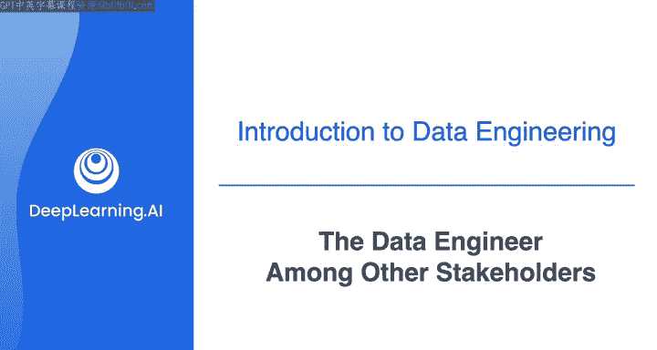
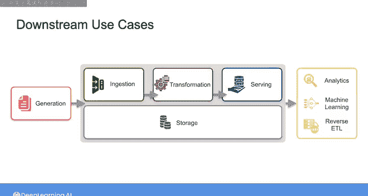
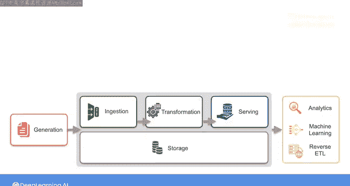
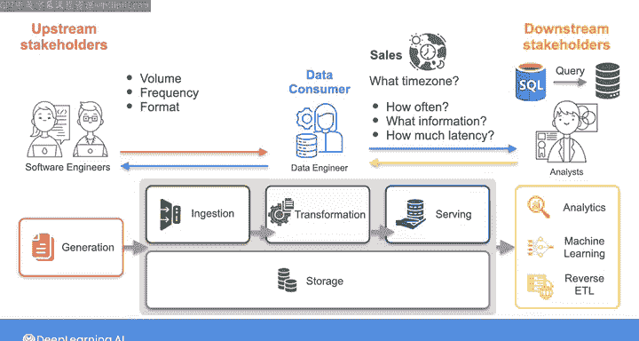

# 吴恩达《数据工程（导论，源系统、数据摄取和管道，数据存储和查询｜1-2-3课）｜DeepLearning.AI Data Engineering》 - P5：4_数据工程师与其他利益相关者.zh_en - GPT中英字幕课程资源 - BV1wTtWeeEH5

As I said previously in your role as a data engineer， your job is to get raw data from somewhere。

 turn it into something useful， and make it available for downstream use cases。

 but this can't happen in a vacuum。In order to know exactly how to turn raw data into something that is useful for downstream consumers。

 you have to deeply understand their needs。 if you're successful as a data engineer。

 you'll be serving data to downstream users in a way that adds value for them and helps them achieve their goals we've already mentioned some of these potential end use cases。

 namely analytics and machine learning when it comes to who are the downstream data consumers are in each of these cases these could be analysts。

 data scientists， machine learning engineers or others in your organization who need to make data drivenrin decisions like salespeople。

 product or marketing professionals or executives For example。

 let's say your downstream data consumer is a business analyst and they need to be able to run SQL queries against a database in order to generate data for various types of analysis theyll use this data to put together dashboards。

 analyze trends and make predictions about the direction of certain metrics to serve this analyst successfully you would need to discuss with them things like how often would they need to query。

the database to refresh to the dashboards what information do they need to retrieve with each query with this you could be thinking about whether there are certain joins between data tables or other aggregations that would be helpful for you to run ahead of their queries to make things run faster for them you'll also need to know how much latency they can tolerate in their metrics like is it acceptable to be looking at data that is now old or a day old or do they need something closer to real time in addition to these requirements you would need to make sure you're aligned with this analyst on the definition of the data they need for their work for example if they're looking for something like the total dollar amount for all sales in a given day that might sound straightforward but suppose you're at a company that serves customers globally it would be important to align with your analyst on what time zone and exactly what start and end time they would use to delineate each day So that's just one example but as you can imagine depending on your end user and their use case。

The considerations you need to keep in mind can vary widely as a data engineer。

 It's important to be engaged in understanding the overall strategy of your company so you can better understand what business value could be extracted from the data you'll serve as well as what business metrics or downstream stakeholders care about In addition to downstream stakeholders you'll also have upstream stakeholders to take into consideration upstream stakeholders are those people responsible for the development maintenance of the source systems you ingest raw data from your upstream stakeholders or often the software engineers who build the source system you're working with and these might be software engineers within your company or they could be the developers responsible for a thirdparty source you're ingesting data from Now the tables are churn where you are the data consumer and the source system owners are serving you just like you saw at the example where you are serving the needs of the business analyst In this case。

 you would need to communicate with the source system owners to understand what you can expect in terms of volume frequency。

and format of the generator data and anything else that will impact the data engineering lifecycle such as data security and regulatory compliance if you can develop the right kind of relationship with these So system owners。

 it's often the case you can work with them to influence how raw data is served to you from those source systems with open lines of communication。

 they can also let you know in advance when you can expect disruptions to the flow of data or other changes like a schema change in the data。

In some cases， source systems will be external to your organization and essentially out of your control even so。

 if you can connect with the owners of those systems。

 you can develop a better understanding of the applications that generate the data you consume so to recap and your efforts to get raw data and turn it into something useful and serve it and use cases。

 you'll have stakeholders both downstream and upstream of the systems you build。

 take the time to connect with those upstream source system owners to better understand the data you're ingesting as well as anything that might disrupt your data pipelines like outages or changes in the data and when it comes to downstream stakeholders。

 take the time to understand how the data you're serving adds value for your organization and how that relates to the individual goals of the stakeholders you serve。

Speaking of business value， it's actually kind of a vague concept。

 so before we jump into requirements gathering for your system。

 I'd like to say a bit more about business value as it relates to your role as a data engineer and just like the little history lesson I offered earlier this week。

 this next video is optional so feel free to skip ahead if you'd rather jump right into gathering requirements for your system。

