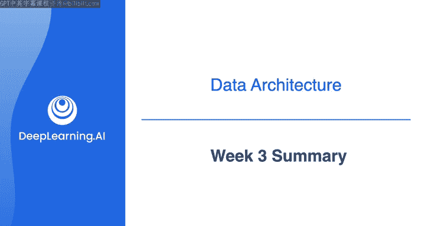
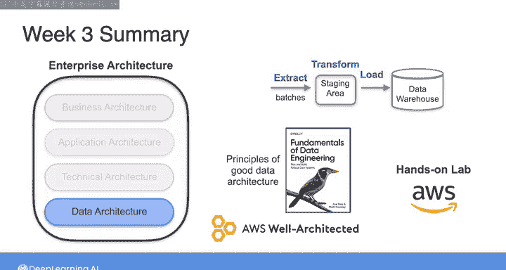

# 吴恩达《数据工程（导论，源系统、数据摄取和管道，数据存储和查询｜1-2-3课）｜DeepLearning.AI Data Engineering》 - P60：62_第3周总结.zh_en - GPT中英字幕课程资源 - BV1wTtWeeEH5

Nice work in completing week three of this course This week has been a deep dive into data architecture and what it means to build good data architecture。

 We took a look at how data architecture fits within the broader context of enterprise architecture After that we looked at some specific architecture examples and how you can start to think about translating stakeholder needs into technology choices for your data systems we reviewed the principles of good data architecture in detail and you also got a chance to explore the AWS well architected framework。

 which is a complementary set of principles that can help you design robust and effective data systems on AWS and in the lab this week。

 your task was to evaluate tradeoffs when it comes to things like cost performance。

 scalability and security for a data architecture on the AWS cloud。

 So that's it for this week I'll see you in the next week of materials where we'll bring together all the concepts you've been learning about in this course and build out another。

Data architecture on the AWS cloud。