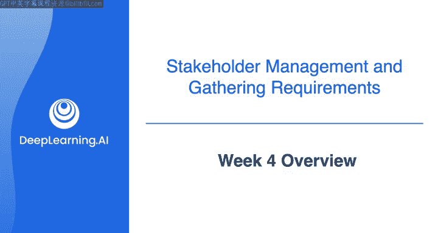
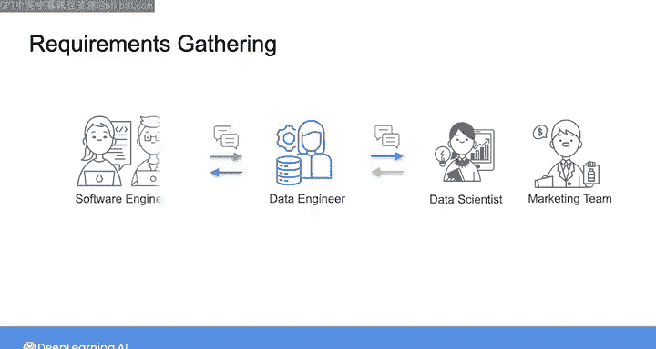
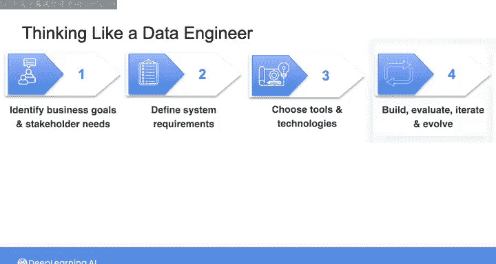
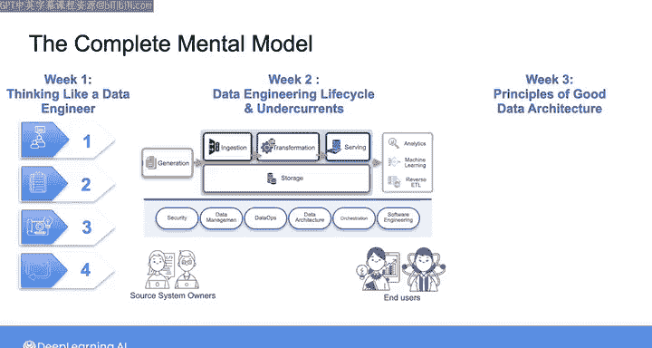
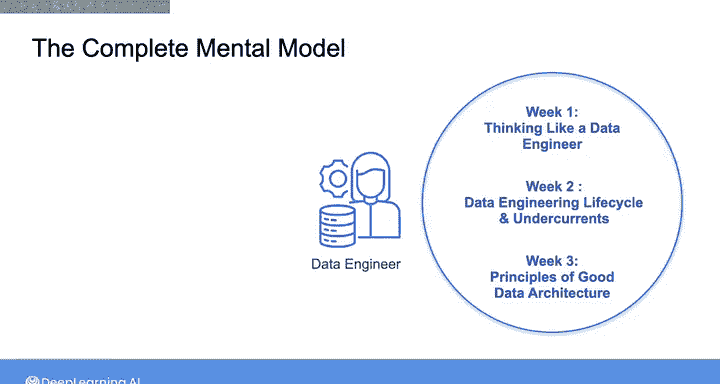
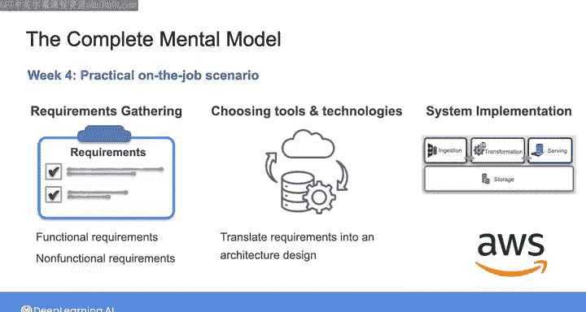

# 吴恩达《数据工程（导论，源系统、数据摄取和管道，数据存储和查询｜1-2-3课）｜DeepLearning.AI Data Engineering》 - P61：63_第4周概览.zh_en - GPT中英字幕课程资源 - BV1wTtWeeEH5

In the first week of this course we took a brief look at requirements gathering as it relates to your work as a data engineer。

 we looked at how a conversation might go between you and a data scientist at your company about their needs for the analytics and machine learning projects they're working on you saw how a conversation like this could quickly reveal the need for you to talk to other stakeholders in this case the marketing team and software engineers。

We also took a look at a framework for thinking like a data engineer where you first identify business goals and stakeholder needs。

 then define requirements for your system based on those needs。

 then choose tools and technologies that meet your requirements and then finally build and deploy your system Now there is a lot pack into this little framework and even when I add in the details of what occurs during each step。

 things like asking what action your stakeholders will take in the first step。

 translating stakeholder needs into system requirements and the second step prototyping and testing in the third or evolving your system in the last step。

You can see that there are still many things that are either left unsaid or unwritten here。

 Week two and three of this course were designed to fill in many of those details so that you can form a more complete mental model of the framework。

 the field of data engineering and what your role as a data engineer will look and feel like in practice。

In week two， you looked at the stages and undercurrents of the data engineering lifecycle there we focused not only on the components that make up your data systems。

 but also on the people involved， including source system owners and downstream end users that you'll work with in week three。

 we took a deep dive into the principles of good data architecture。

where you saw that things like planning for failure and choosing common components or elements。

 your system design that you should be thinking about right from the start。

 and so now you have all the pieces of that mental model that will be critical in your work as a data engineer。

This week we're going to pull all those pieces together in the context of a practical omni job scenario we'll start with requirements gathering then choosing tools and technologies and finally implementation of your system so what I would like to do next is pick up where we left off with those requirements gathering conversations in the first week of this course and follow through to defining and documenting your functional and non-functional requirements as well as the tools and technologies you could use to build a system that meets those requirements and throughout the week we'll be pausing along the way to talk about some concepts and best practices to keep in mind when you encounter new and different scenarios out in the wild as a data engineer at the end of this week you'll translate the requirements into an architecture design and then build your system on the AWS cloud join me in the next video to get started。

