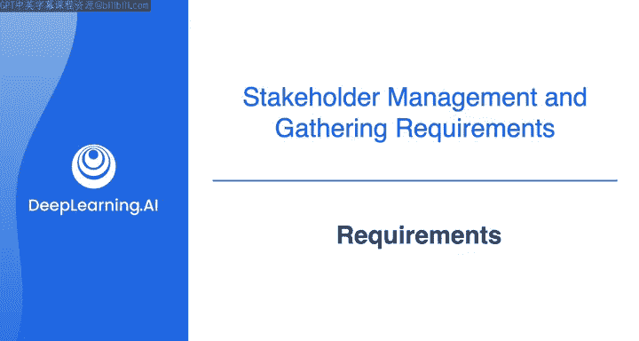
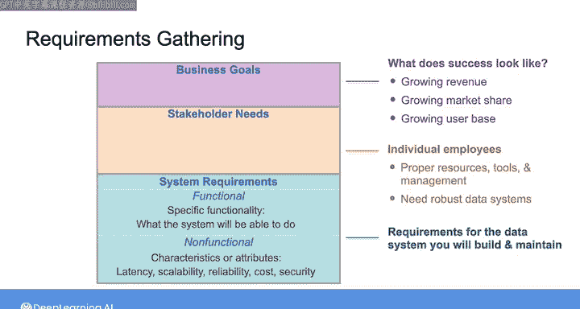
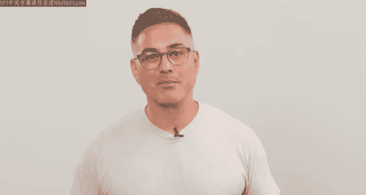

# 吴恩达《数据工程（导论，源系统、数据摄取和管道，数据存储和查询｜1-2-3课）｜DeepLearning.AI Data Engineering》 - P62：64_需求.zh_en - GPT中英字幕课程资源 - BV1wTtWeeEH5

All right， so like I said in the previous video this week is all about pulling together the various aspects of the thinking like a data engineer framework that we've been exploring throughout this course so far now remember that framework begins with identifying business goals and stakeholder needs through the process of requirements gathering。

At this point， I'd like you to start thinking about requirements as a sort of hierarchy of needs at the top of this hierarchy。

 you have the goals and objectives of the business。

 These are the things that describe what success looks like for the business as a whole these might be objectives around growing revenue or market share or user base or something else that represents an optimal outcome for the business The next thing downruns hierarchy as stakeholder needs Now you'll hear me say stakeholders a lot in these courses but in this case。

 you can think of these stakeholders as the individual employees of a business and each of them plays a role in delivering on the highlel business objectives to do the work successfully stakeholders have needs they need things like proper resources。

 tools and management among other things And for the purposes of these courses you can assume that they also have a need for robust data systems below stakeholder needs in this hierarchy you have system requirements In principle this could be any system but here we're。

Talking about the data systems you will build to maintain and so this is a set of requirements that your data systems must satisfy in order to serve stakeholder needs well then separate system requirements and the functional and non functional requirements。

Functional requirements are those system requirements that can be expressed in terms of a specific functionality。

 namely what the system will be able to do to meet the needs of stakeholders， for example。

 a functional requirement for a data system that monitors bank transactions for fraudulent behavior might be the system is able to immediately report potentially fraudulent transactions。

Nonfunctional requirements， on the other hand， are those system requirements you could think of as characteristics or attributes of the system that allow it to function properly。

These could be characteristics or attributes related to things like latency， scalability。

 reliability， cost or security， for example， a nonfunctional requirement in terms of scalability for a streaming pipeline ingesting data from an ecommerce-merce platform might be the system must be able to scale up to ingest data from 10。

000 users shopping at the same time and there you have it this is a hierarchy of needs for business as it relates to your work as a data engineer。

 the main takeaway here is that like we've been talking about all along your work building data systems is directly connected to the work of others the organization and to the overall goals of the business this is why it's so important to understand the needs of your stakeholders and the objectives of the business for the work that you do and that brings us back to requirements gathering。

In the first week of this course， we started by having a conversation with the data scientist to understand their needs。

 and you could think of that exercise as requirements gathering that started somewhere in the middle of this hierarchy。

 ideally though you'd like to start at the top， and that means talking to leadership about the goals of the company。

If you work at a small company， you might even be able to have a conversation with the CEO and I would definitely recommend that if you're at a bigger organization。

 you just need to go up as far as you can at the Cha of Command to get oriented with the goals of the business in the first week of the course you saw a conversation I had with Seul who's been the chief data officer at many large organizations now not all organizations are going to have a CTO but most will have a chief technology officer or CTO who is the technology executive in a company the CTO is responsible for leading the engineering department to use technology to improve products and services with a goal of growing the business in the next video I'll introduce you to a friend of mine Matt Hsley who has a lot of experience interfacing with C Su Execs including CTOs and he's also my co-author for the book Fundmentals of data engineering he'll share some advice on how to get started in data engineering and how to engage with business leaders to come up。

Sos to business problems and then we'll see if we can get him to join our requirements gathering game this week where he plays the role of CTtoO at the company you've just been hired at as a data engineer join me in the next video to meet Matt。

