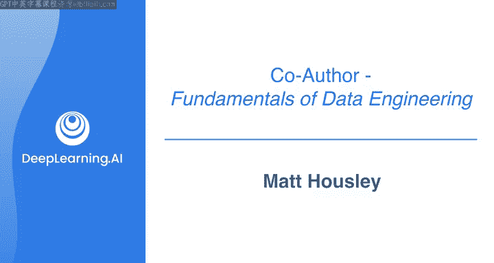

# 吴恩达《数据工程（导论，源系统、数据摄取和管道，数据存储和查询｜1-2-3课）｜DeepLearning.AI Data Engineering》 - P63：65_与Matt Housley的对话.zh_en - GPT中英字幕课程资源 - BV1wTtWeeEH5

So I've got a very special guest for you， my co-author and best friend Matt Hsley。

 it's good to see him。 It's great to be here， Joe， thank you thank you for the invitation。

 absolutelyutely So yeah， we wrote this book together and that was kind of the starting point ultimately for this course。

 Maybe you can talk a bit about what motivated us on the book。 Yeah。

 so fundamentals of data engineering was written from a place。😊。

Of。Noticing a gap in。The bookspace and the education of data engineering。

 the materials were largely focused on tools and technologies and didn't really take a step back and attempt to define the field of data engineering itself more provide a mental framework for how to operate and think like a data engineering。

 And so really that's the perspective that we entered into writing the book from is that we didn't really want to write a tutorial on technology X Y or Z or cloud provider a B or whatever。

 but really provide you know a first principles look at the field of data engineering。 Yeah。

 fundamentally I think our starting an audience， our core audience for the book was people who had a technical background but wanted to move into data engineering。

 we also kind of had various secondary audiences。 So for example。

 if you were a product manager who was somewhat technical and they needed to work a lot with data engineers on data products or data that was。

Embbedded into your application we also thought this book would help you a lot maybe not every piece of it but you would have a lot to learn there and I think the idea that the audience for this course is very similar people moving into data engineering。

 but also people who can benefit just from a better understanding of the concepts and a little bit of hands-on exposure so we talk about the book and the learners taking the course obviously so how do these things tie together I think that fundamentally the book and this course complement each other you've already learned about the data engineering lifecycle and the undercurrents what this course allows you to apply that mental framework with hands-on examples that you're likely to encounter in the real world and so for this course we're using tools and technologies and a very popular cloud AWS and thatll give you the hands-on experience to really tie again the concepts that you've learned in the book with the practical know how of hands-on labs。

Practice so we often get questions about how to get into data engineering。

 maybe you can talk a little bit about some of advice for people who want to get into data engineering Yeah so I think first of all it's very helpful to learn just core data concepts I think we frequently find that even if you're coming from like a software development background you may not have enough experience with kind of how analytics data is used to immediately jump into it and so it's helpful to start with just playing around with data even in something like Microsoft Excel so you know what tabular data looks like and what kinds of things you consume with data and then you can sort of expand the circle from there I think one thing we always want to emphasize is that getting into data engineering。

 getting your first job is not just about learning a particular stack of tools rather in those early stages it's good to get experience with a lot of different tools to develop general competence and then when you start getting into roles。

You're going really focus down on the tech stack within the company where you're working right Yeah and I think that that's where a book like Fundamentals of data Engineer really helps is provides you with the mental framework to start thinking like a data engineer and when you have that mental framework then you can know basically put whatever tools into the proper buckets and you'll build a function as a data engineer well Matt this has been a great discussion about the book and in the course。

 maybe if you're up for it， we can do a mock conversation where I will be a data engineer and we're going to talk to you who is going to play the role of a chief technology officer at this fictitious C commerce company that I've been hired to work at Yeah running Joe and I running ternary data together and doing consulting had the privilege of working with a lot of different companies from various domainomas ranging from technology companies to operational and logistics companies in。

scale all the way down to 10 person startups all the way up to like big multinational enterprises and so in that process we learned a lot about the kinds of things that sea level executives in general and chief technology officers specifically care about when it comes to engineering and when it comes to data Well thanks Matt。

 why don't we jump into the mock conversation with the chief technology officer and the data engineer？

