# 吴恩达《数据工程（导论，源系统、数据摄取和管道，数据存储和查询｜1-2-3课）｜DeepLearning.AI Data Engineering》 - P64：66_与CTO的对话.zh_en - GPT中英字幕课程资源 - BV1wTtWeeEH5

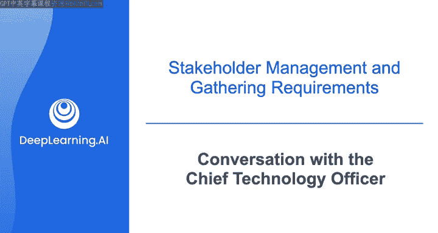

Okay， so in this video I'm going to be playing the role of the newly hired data engineer at an E-commerce company and I'll be asking some questions of the chief technology officer or CTO played by Matt Howsley about the overall goals of the business and technology initiatives Hi Matt。

 thanks for taking the time to chat with me today I'm very excited to be starting at this company and one of the things I'd like to do is get a better understanding of the business goals and technology efforts that you're working on。

Great to have you on board Joe。 I' like to talk to all the new hires within technology to make sure our goals are aligned。

 I know that you probably won't be able to talk to me all the times you'd like to。

 but it's kind of my version of walking this shop floor to see what's going on in the world So for the coming year and beyond your work as a data engineer is going to play a key role in our success。

 so I'd like to explain how that's going to tie into our larger initiatives sounds good。

 so far our company has been relatively successful as an ecommerce-commerce platform across a limited number of product lines。

 we've done great marketing and as one of the companies that was first the market。

 we had the first mover advantage。 The challenge， however， is that as the market evolves。

 we're getting a lot of smaller brands coming up and sort of grabbing market share Another major concern that I have right now with technology within the company and I'll explain how this ties in with the market share issues in such in a second is that we actually weren'。

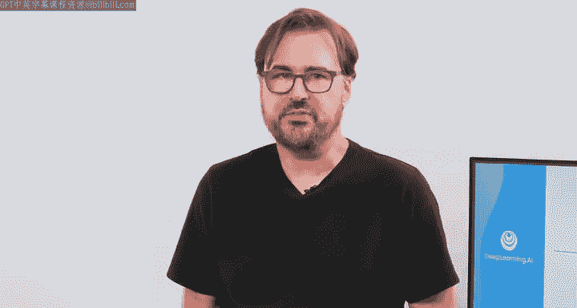

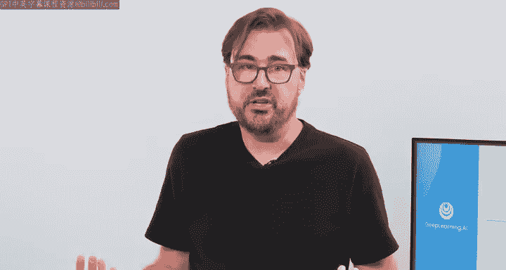

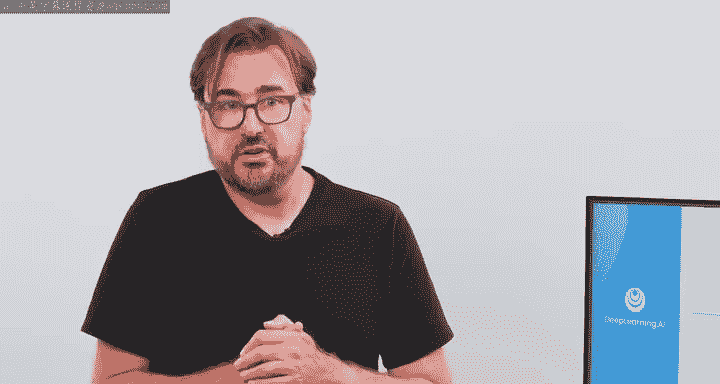

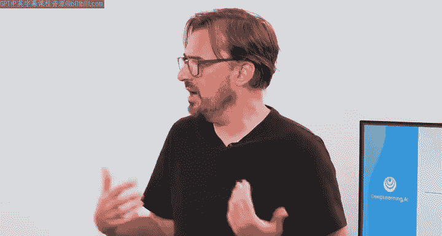

Ecommerce platform now， but we inherited some old technology before even co and so there's concern that some of that old code running could cause outages that could be very costly to the company and also damaging to our customer brand and so you're probably aware of some of the outages that have been in the news in various ways and so we feel like we might have some exposure there so the big initiatives again are we're expanding market share new product offerings and we're also looking to go more international the thing to understand is that involves a lot of scale so fundamentally what we're going to try to do from the software side is refactor so that first of all we can get rid of that old code that's kind of back in the systems that puts us at risk and then also make everything much more scalable in the process now let me ask you like from your perspective as a data engineer how would that affect you。

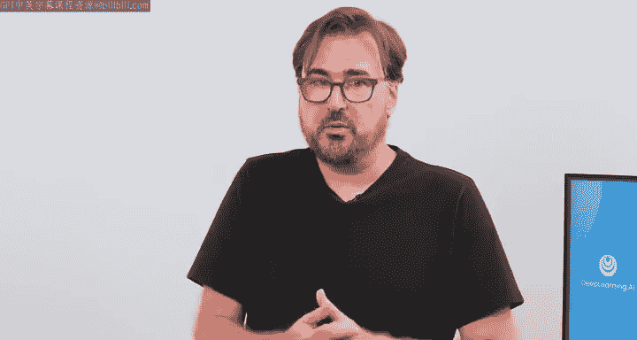

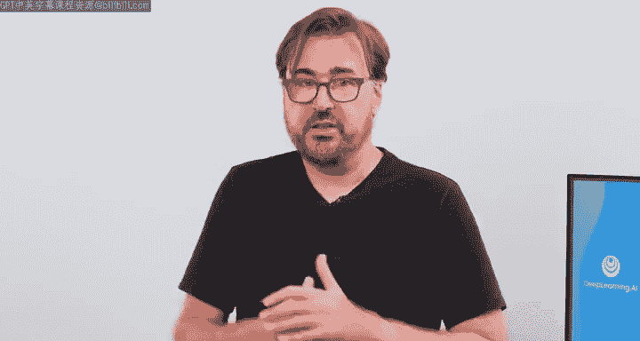

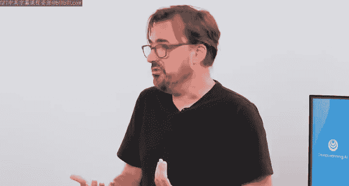

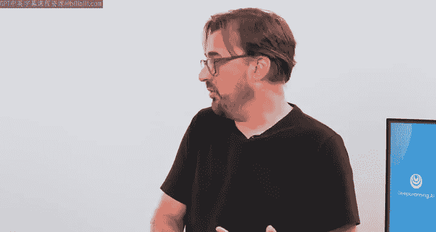

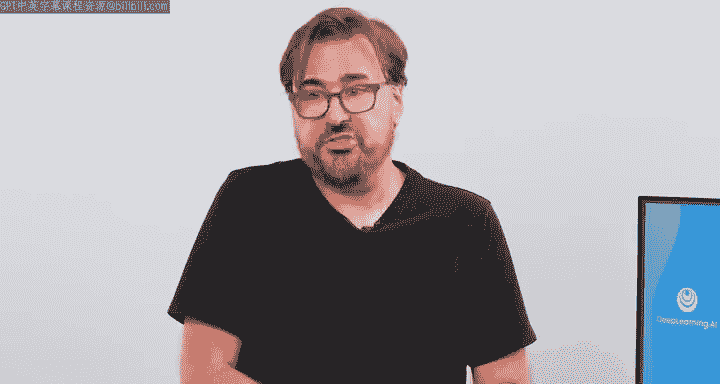

Well， that could affect me greatly， so I can think of a number of ways and I know。

It sounds like working with legacy tools is not a lot of fun。

 but I'm also really looking forward to helping modernize the systems exactly and that that's exactly the attitude that I'm looking for one of my major concerns with my CTO experience is that quite often we have this software I'll call it the software data divide and the software data divide you probably already know about this but the basic idea is that people write code kind of in a vacuum and then the data engineers just have to consume whatever comes out and that's been a big problem for us because this legacy code generates a schema that's very。

 very hard to use for analytics so fundamentally is part of the team what I want you to assist with is consulting with the software side as we refactor our code to make sure that the output of that code is suitable for analytics with minimal post-proces so it's not that we're going to be able to get away with removing all ETL but we feel。

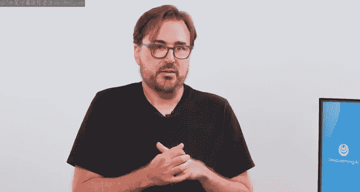

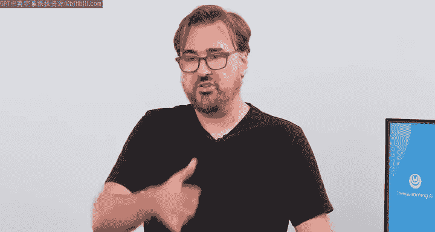

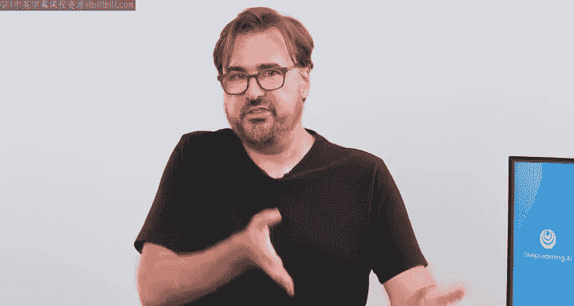

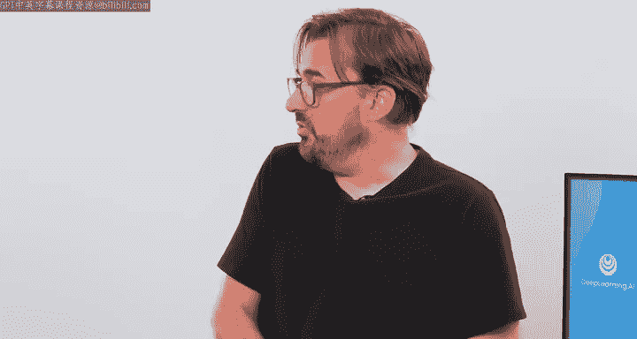

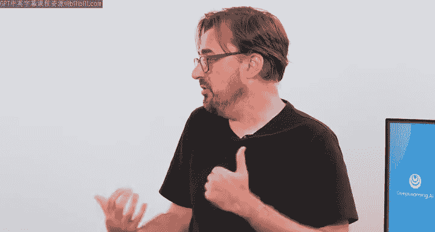

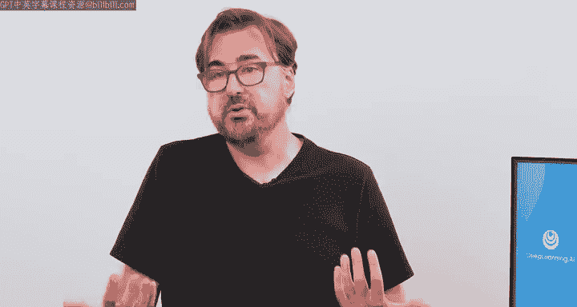

If we generate the data in the right way with the right schema。

 then it's going be much cleaner going into our analytics What tools can I expect to be working with That's a good question。

 so part of what we want to do within this initiative as we refactor is convert more from a batch-based approach to a streaming basedbased approach and so the technologies we're looking at at the moment on AWS are kinesis。

 which is kind of the Amazon native version of streaming and then Kafka potentially as we scale up and for certain pipelines do you have experience with those I don't but I took a course on data engineering and I am really excited to apply some of the things they've learned in the labs about kin and Kafka to real world scenarios that's great and I think at this stage again you're going to work as a consultant with the software side to understand the data they're producing and then help them to produce better quality data and in the meantime。

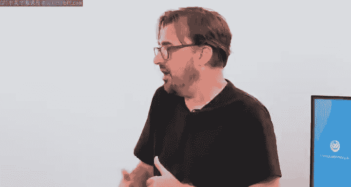

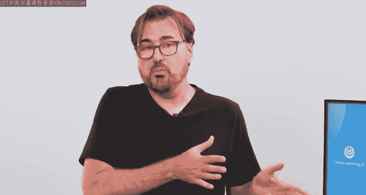

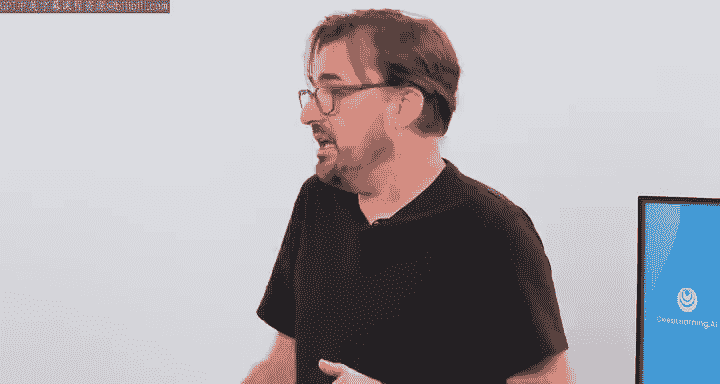

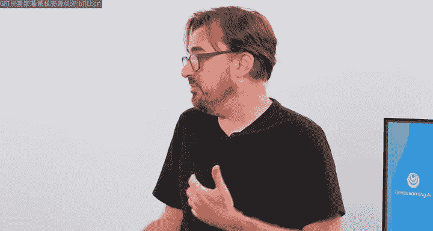

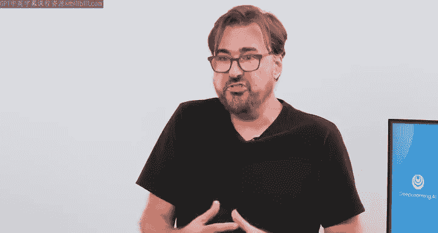

Can spin up proof of concept demonstrations of these technologies。

 Kaesis and Kafka experiment with their scalability。

 make sure that you build really strong ground skills in those because I see that being one of your key responsibilities in the future is to manage and expand our streaming capabilities you're going to be doing that under the direction of the head of data of course but we expect you to really take the skills that you have now and then expand those to be really strong in this area Now I know that AI is a very hot topic these days does the company have any goals with respect to machine learning or AI okay another one of our major goals within our technology initiatives is improving customer retention and so the core software refactor that I mentioned will help to support that because it means a more responsive website and less downtime avoiding downtime in general so customers are pleased with the experience in addition we're working on a recommendation engine and so your pardon。

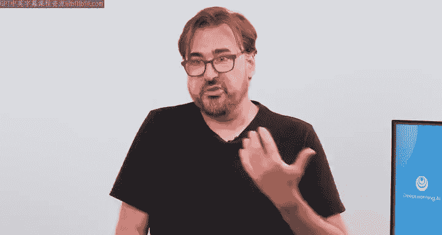

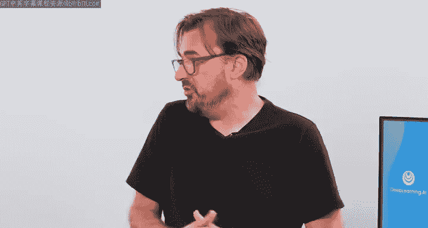

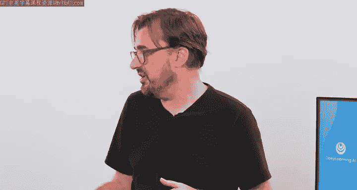

Working within the data engineering team is going to be developing data pipelines that feed that recommendation engine。

 and so this involves essentially looking at our data within our product taxonomy。

 but also looking at how customers behave on the site， so looking at the click stream。

 looking at order behavior and working with the data scientists to engineer the pipelines that support that process。

 that sounds great。

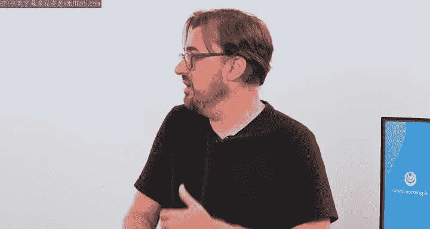

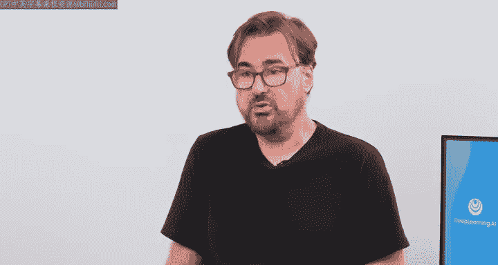

It's really great to have you on board I'm excited to work with you and hopefully we'll get to connect in the future as these initiatives progress well thanks。

