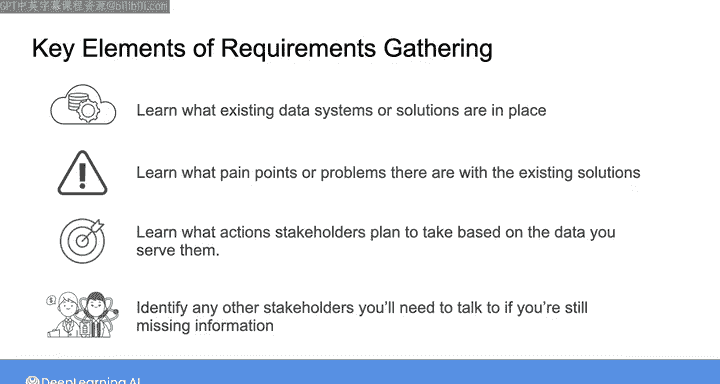

# 吴恩达《数据工程（导论，源系统、数据摄取和管道，数据存储和查询｜1-2-3课）｜DeepLearning.AI Data Engineering》 - P65：67_与市场营销部门的对话.zh_en - GPT中英字幕课程资源 - BV1wTtWeeEH5

Okay， so now you've got some perspective on the highlevel business goals for the company and it's time to get back to gathering requirements based on stakeholder needs back in the first week of this course you learned from the data scientists that the marketing team has two primary requests。

 one around delivering dashboards with metrics on product sales and another regarding a product recommendation system these two initiatives are in line with the larger business goals of launching new products by better understanding market trends。

AndImproving customer retention by recommending products that are more likely to align with their preferences in this video we're going to have a conversation with a product marketing manager to get more details on their needs and expectations for these projects in week one。

 we looked at four key elements in any requirements gathering process。

First you want to learn about any system or solution that currently exists to deliver data to your stakeholders and then you want to understand any problems with this existing system or the data next you want to understand what actions your stake plans to take with the data you serve them and finally you want to identify other stakeholders to speak with or conversations need to have to gather any missing information so make sure you pay attention to these elements as you watch the conversation unfold。

Hi， Colleen， I'm Joe， the new data engineer has's been hired at the company to。Build things。Hi， Joe。

 I'm so excited to have him here。 Well， awesome。 Great to meet you。

 I've been talking to various people here at the company to try to better understand the data needs and I'm trying to put together a set of requirements for the data systems。

 I'm going to be working on。 Defite， we've been thinking a lot lately about how we can use our data to make more informed decisions and drive the metrics that we care about on the marketing team。

 And we're really looking forward to having you work on this。 Okay， great。

 So in my conversation with the data scientists on our team。

 I learned that they've been working on a couple initiatives with you。

 One around some dashboards for product sales metrics and another around a product recommendation engine。

 Is that right， That's correct。 And I would say that both of these initiatives are in sort of a prototype state。

 and we'd like to work with you on improving both of those。 Okay， sounds good。

 Could you first tell me more about the current state of these systems so I can get a better idea of where we're at now。

😊，For sure。 So with regards to the dashboards， what we have now is essentially what we want in terms of how the various metrics and trends are displayed。

 It's just that there's a lag of usually a couple days between when the data is recorded for new sale。

 And when we can actually see it in the dashboards。

 So our data scientist has created a nice set of dashboards where we can see product sales by category and region with time plots showing daily numbers。

 This helps us broadly see what kinds of trends are happening from region to region。

 we can also double click into any particular region to see the details by individual product or on a more granular time cadence like hourly instead of daily。

 So this is all great， but we want to see all of this stuff in real time rather than when the data is already two days old。

 I see。 So it sounds like the dashboards might already be delivering some value。

 when it comes to allowing you to monitor longter trends。

 But there are things you'd like to do with that that might require。

More recent data I that is that correct， That's right。

 In addition to monitoring longterm metrics we'd like to be able to see in real time when a particular product is trending so we can try to capture that momentum and push out more targeted promotional campaigns focusing on a specific region and product right now we occasionally see really interesting regional spikes and demand for particular products and we would like to know about that when it's actually happening rather than when the demand has subsided Go it so tell me more about these demand spikes what do they look like how long do they typically last Sure so what we see is in many cases is that demand rises sharply over a span of a few hours or so and then eventually drops off again sometimes after a day or two but sometimes more quickly like in just a few hours Okay I see So if I'm understanding correctly what you would like to be able to do is observe one of these spikes while it's happening so that you could take action。

information That's right。 If we see sales ticking up steadily for two or three hours in a row。

 we could have a plan in place to take immediate action and push out targeted promotions Okay great so if for example the data in your dashboards was reflecting product sales from just one hour of the past rather than two days in the past would you be well positioned to take action Yes。

 that would be great if we were looking at data that was only an hour old sounds good So I think I understand more or less what you need for the dashboards I'd like to learn more about what you're interested in doing what the recommender system do you have something already working for that Well sort of we ask the data scientists to determine what the most popular products from the previous week of sales are and then the platform team just serves those as recommendations to everyone at checkout So it's more like a popular product of the week thing than any kind of personalized recommendation I see so you have。

Pretty basic recommender up and running but it's not personalized to the customer and sounds like what you like is maybe something that considers a customer's purchase history as well as what they got in their car to check out make some kind of customized recommendations is that correct Yes that's exactly right just like what you see on a lot of other e-commerce platforms where either while they're shopping or they're in the checkout process you see the recommendations for products you might be interested in。

Okay， great。 I think that's all I need to know about the recommender for now。

 at least and this conversation has been really helpful for me to understand what you need when it comes to the dashboards and the recommendation system and I'm sure we'll have more questions for you as we get started building out these solutions and I'll let you know as soon as I got something that we can start testing。

 Awesome， Thank you。 I really look forward to seeing what you build and feel free to reach out any time。

😊，Okay， so that was an example of how a conversation might go between you， the data engineer。

 and a product marketing manager about what they need。

 join me in the next video to dive into this conversation to unpack the system requirements。

