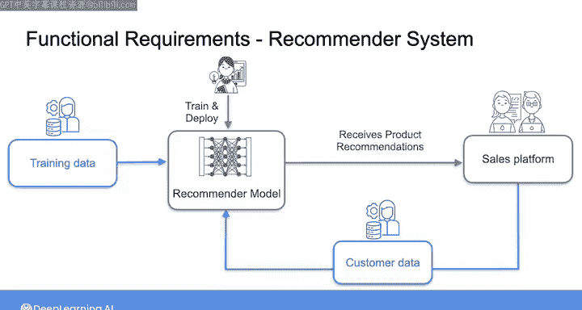

# 吴恩达《数据工程（导论，源系统、数据摄取和管道，数据存储和查询｜1-2-3课）｜DeepLearning.AI Data Engineering》 - P66：68_分析与市场营销部门的对话.zh_en - GPT中英字幕课程资源 - BV1wTtWeeEH5

In the previous video， we had a conversation with the marketing department about their needs。

 and in some ways this conversation included a confirmation of the things you already learned from the data scientist。

Now with more details on exactly what the end user's needs are。

In this video we'll go over what we learned and take a look at starting to document the requirements you've gathered The way I like to document requirements is using the hierarchy that we looked at in a previous video this way it's easy to visualize the connections from system requirements here at the bottom all the way up to the high level business goals so right here at the top I can start by writing down business goals as I understand them In this case。

 the business goals that we learned about where that the company aims to continue on their growth trajectory through a focus on customer retention and loyalty as well as an expansion to new markets and new product offerings in these efforts they are aspiring to be data drivenven and their decision making underneath the business schools we can now add stakeholder needs for the moment I'll just consider the data scientists and the product marketing manager together here as a stakeholders that we talked to so far and at this point we know they need two main things some analytics dashboards and a recommender system let's first take a look at。

Analytics dashboards， both the data scientist and the product marketing manager stated they need realtime or current data presented in the dashboards through digging a little deeper and asking what action they plan to take with the data we learned that the marketing team would like to be aware when demand spikes occur for particular products so they can react to additional promotional campaigns given that the duration of these demand spikes is expected to last from several hours to one or two days it looks like hourly dashboard updates would be sufficient and marketing confirmed this would serve their needs just fine。

 So there you have a stakeholder need and you might capture the related functional requirement for the data system like this the data system needs to serve transform data that is no more than one hour old when it comes to the recommender system it sounds like the current solution is just to display a few popular products on the page when someone is checking out what the marketing team would like to have instead is。

That provides product recommendations that are customized based on someone's browsing or purchase history as well as what they have in the card at checkout So there you have another stakeholder need and when it comes to a functional requirement for your data system to serve that need you could write down something like the system first needs to provide the appropriate training data for the development of the recommender model then be able to ingest transform and serve user data to the trained recommender model and then return the model outputs perhaps in the form of product I back to the sales platform Now I'd like to pause for a moment and highlight the fact that translating stakeholder needs into functional requirements for your system can be a little tricky as you can see here with the analytics dashboard what the marketing team actually needs or the dashboards themselves and so it might be tempting to write down some details about the dashboard features or metrics to be displayed but really building the dashboard is going to be the responsibility of the data scientist and。

those features and metrics， the data scientist needs access to data that is no more than an hour or old so when it comes to your data system as long as you're able to serve data that the data scientist needs in a timely manner then your system is achieving this functional requirement for the recommender system the marketing team needs to make customized product recommendations to do that there will be multiple people and teams involved the data scientists will need to train and deploy a recommender model and the platform team will need to be able to receive product recommendations from the model to display on the platform when it comes to your data system you'll need to provide training data to the data scientists to development model。

 then you need to be able to pass customer data from the platform to the model and then send the model outputs back to the platform so here we have documented one functional requirement for each of these data systems In practice you could have many functional requirements for any given system as well as more detail。

Then we have listed here for each functional requirement to keep things simple for now though let's leave it at just these two functional requirements so this is how you might get started with documenting your functional requirements coming soon we'll also get into documenting nonfunctional requirements but before doing that we're going to have some more stakeholder conversation join me in the next video for a conversation with the software engineer who maintains a sales platform which is the So system you'll be ingesting data from。

