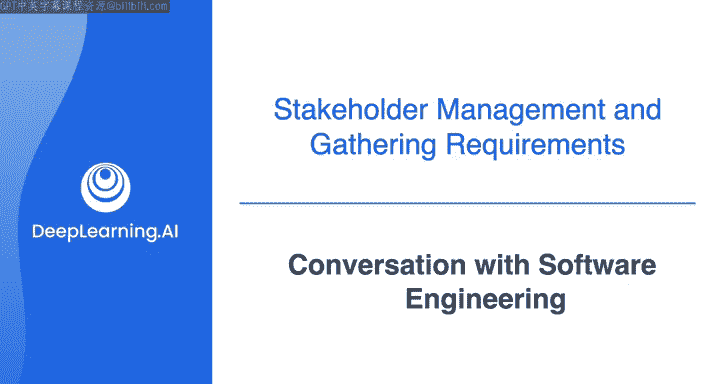
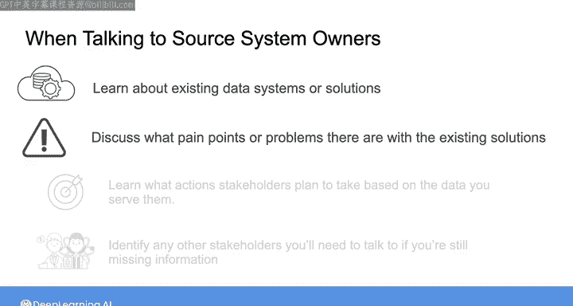

# 吴恩达《数据工程（导论，源系统、数据摄取和管道，数据存储和查询｜1-2-3课）｜DeepLearning.AI Data Engineering》 - P67：69_与软件工程师的对话.zh_en - GPT中英字幕课程资源 - BV1wTtWeeEH5

When we spoke with the data scientist， they mentioned that they would occasionally get stuck because the data is unavailable for a period of time or schema change breaks their processing scripts as I mentioned in the second week of this course。

 these kinds of disruptions to the dataflow or changes in the data format are very common and the kinds of things that you should be anticipating as a data engineer when you ingest data from So systems the best thing you can do to mitigate these issues is to open lines of communication with the source system owners and discuss how to best anticipate and deal with disruptions or changes in the data when they occur and that's exactly what we're going to do in this video I'll be having a conversation with the software engineer responsible for the development and maintenance of the sales platform that we're hoping to set up an ingestion data pipeline to when you talk to source system owners you can still use the first two key elements of the requirements gathering process to help guide the conversation。

You can ask a system owner about the existing system that generates the data needed by your downstream stakeholder and talk to the owner about any problems your stakeholder currently has with the solution in the next course you'll learn more about So systems and what to consider when working with source system owners。

Let's jump into the conversation。Hi， I'm Joe。 Hi， it's good to meet you。 Nice see you too。

 So I met with a。😊，Marketing manager and a data scientist。

 both of whose name was Colleen and you look a lot like those other two people， huh？Yeah， I。

 I don't know what you're talking about。 I heard they're great， though。 They are great。 Yeah。

 for sure。 Well， I'm looking forward to talking with you about how I can best set up some data injection from the sales platform。

😊，Yeah， definitely， let's talk about it。 I think it's great that the company is taking a more serious approach to data and looking forward to seeing how we can work better together。

 Great I think to start with， I'd like to learn more about what you've been doing so far to provide data to other teams and maybe that we can take it from there。

 Yeah， Well， to be honest， it feels like we're just getting started to exploring how to best share data with others in the company。

 For instance， the marketing team has been interested in analyzing product sales data。

 and so we've been providing data to our data scientists on a daily basis。

 so they can provide some metrics to the marketing team。

 but it sounds like they're looking to do something that's a little closer to realtime analytics。

 Yeah， I've spoken with both the data scientists and the product marketing manager to learn more about what they're hoping to accomplish。

 and it definitely sounds like more continuous access to the data would be good for what they're trying to do。

 Yeah， so one of the problems we've faced is that we aren't able to give。😊。

Direct access to the production database because that would present a risk to the sales platform that's what led us to what I guess you could say is the suboptimal solution of just providing them files for download on a daily basis right that makes sense so have you thought about other ways in which you could provide access to the data without presenting a risk to your production systems。

Well， yes， in fact， what I think would work is if we set up a read replica of the production database where we would push a copy of everything that's stored in the product database immediately after it's recorded。

We could then set up an API so that you or anyone else for that matter could query the data in the read replica without disturbing the production system。

 Okay， that sounds like it could work pretty well actually the other thing that the data scientists mentioned was that occasionally they would have to wait longer than expected for the data Do you think that issue will be mitigated to some degree with the new read replica database setup that you just described。

Well， yes and no。 I think it's fair to say that sometimes we don't get the regular data deliveries out because we are running maintenance on our own systems and fail to export the regular set of files on time。

 with a readrelica database being updated continuously。 That should not be a problem going forward。

 However， we do occasionally experience server or data center failures that cause our platform or data to go down for a period of time。

 We're working to build in redundancies and minimize our exposure to these types of system failures。

 But if that sort of thing happens， then the data could be unavailable while the system is down。

 I think the best we could do is send an automatic notification to downstream data users to alert them of doage。

 Okay， yeah， that makes sense。 If your systems that are generating and storing the raw data go down。

 then the best any downstream data consumer could help for is a notification to let them know about it。

 I also heard that sometimes the database schema。Changes and that could cause problems with the processing scripts。

 I can understand there are times when you need to change the schema for one reason or another Could you say more about your process around those schema changes Sure。

 so we're constantly working to improve the sales platform and often that means adding new features for customers to interact with So the user interaction data。

 we're recording changes with each new feature we add effectively changing the schema of the database。

 We're also expanding into new regions and product lines on a pretty regular basis and sometimes we realize we to add or remove or combine various elements of product and purchase records just to keep up with the changing collection of things we're selling and where we're selling them Okay that makes sense how far in advance would you say usually know when you're going to make a change to the data schema Well。

 it varies， but we're usually pretty careful about it since we don't want to introduce any breaking changes。

to our own systems so I would say we typically know about a week in advance before we're going to deploy any new changes Okay well right now I'm gathering requirements for the data pipelines。

 we need to provide data for the marketing teams projects and I think it would be great if we could figure out a way for me to stay in the loop about any upcoming changes to database schema such that I can anticipate those changes and modify my pipelines accordingly I can also build in automatic checks in the data ingestion process to verify whether the data can so a particular schema but it would be ideal if I could get notify it as soon as you're know you're be planning some sort of a schema change for sure we can definitely keep you in the loop we certainly don't want to be pushing any changes that break things downstream so we can make sure you get notified well in advance we could also think about ways to make the read database more stable than the production database for example。

 if you know exactly what data。Need in terms of customer activity or purchase history for downstream use cases we can aim to provide that in a consistent manner via the API for the Read replica or in the event that we can't avoid changing something there we can at least give you plenty of advanced notice Okay cool I think with advanced notice of any changes and some degree of stability in the database or ingesting data from we should be in good shape Well I think it's all I need to know for now but please let me know when you get the read repa database set up and I'll start building some data pipeline for testing。

Okay， we'll do thanks Joe， Yeah， like glasses too those are pretty cool All right。

 so that was an example of what a conversation might look like between you。

 the data engineer and a software engineer who is responsible for these source systems you're planning to ingest data from。

😊，So like I said before， open communication with your sources and owners can go a long way when it comes to building robust data systems。

As you saw here， it's often the case that SOAR system owners will be happy to collaborate with you and once they understand what you need from them。

 join me in the next video to continue the process of documenting requirements and looking at what some of the nonfunctional requirements of the system might be。

