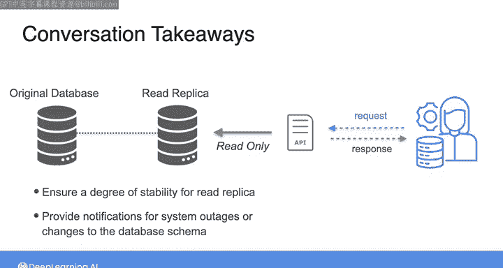
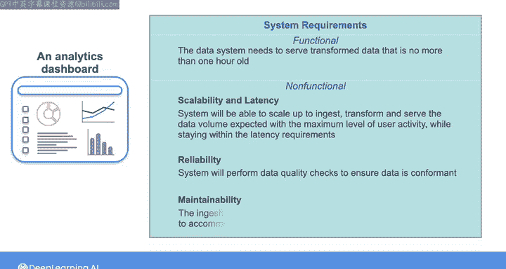
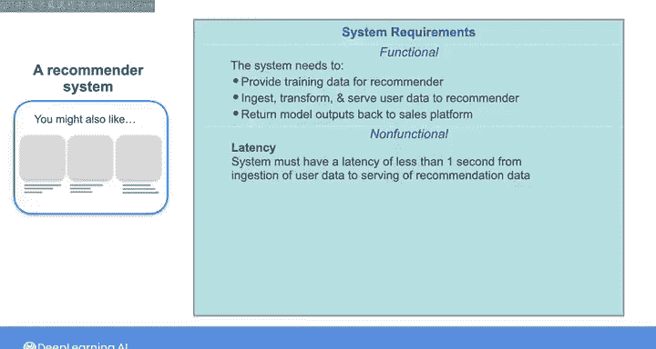
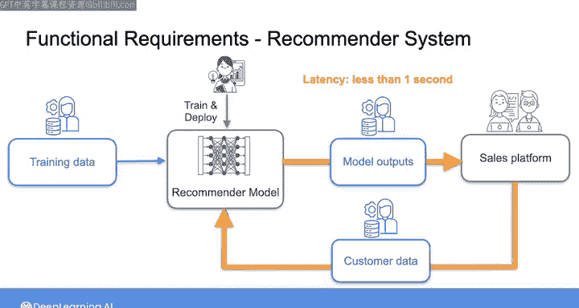
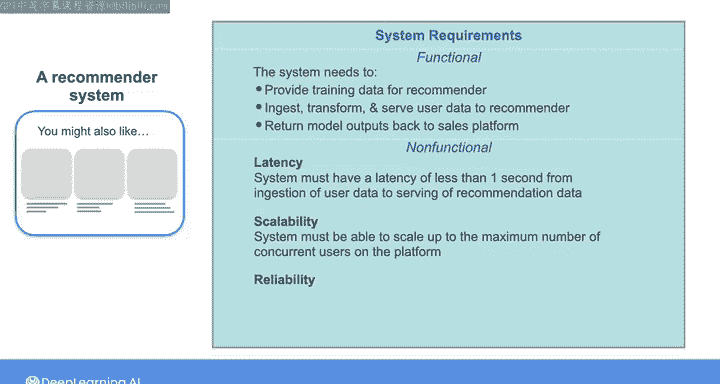

# 吴恩达《数据工程（导论，源系统、数据摄取和管道，数据存储和查询｜1-2-3课）｜DeepLearning.AI Data Engineering》 - P68：70_记录非功能性需求.zh_en - GPT中英字幕课程资源 - BV1wTtWeeEH5

In the last video， we looked at an example of how a conversation might go between you。

 the data engineer and a software engineer who is responsible for the source system you aim to ingest data from。

Here we'll look at some of the takeaways from that conversation and continue documenting the requirements for our data system In our conversation with the software engineer we learned a few key things first they suggested that a way to solve the data access issue would be to set up a read replica database and an API to provide continuous access to the data this is actually a pretty common approach to providing access to data while protecting production systems they also briefly discuss some ways in which they could ensure a degree of stability in the read replica database in order to minimize breaking changes to downstream systems and they also said that they would be able to provide notifications when any system outages occur or when they anticipate making changes to the database schema Now let's take another look at documenting the requirements for the data systems wherere looking to build so as a reminder we're approaching the documentation process using this hierarchical format where I've written down the business goals up top。

Then stakeholder needs below that and then system requirements under that we have two functional requirements written down here。

 one for the analyticstic dashboards and one for the recommender system now we could start to write down some nonfunctional requirements for these systems as well nonfunctional requirements can be a little trickier than functional requirements in the sense that they won't typically be things that your stakeholders explicitly ask for。

Rather these are the characteristics or attributes that your system must have in order to get the job done well。

 so for the analytics dashboards we've already wrote down the functional requirement that the data must be ingested。

 transformed and served such that it's available in the database being used for dashboards no more than one hour after it's recorded in the source system。

 you could write down a non-functional requirement around scalability and latency。

 given that the volume of data being ingested can vary based on how many users on the platform a nonfunctional requirement could be that the system will be able to scale up to ingest。

 transform and serve the data volume expected with a maximum level of user activity on the platform while saying within the latency requirements。

In other words， the data processing can't slow down as a result of higher data volume Another nonfunctional requirement for the dashboards could be regarding the reliability and maintainability of the system in this case。

 as mentioned in the conversation with the software engineer。

 you could set up checks on the data to make sure it conforms to the expected format and source system engineers can let you know when to expect changes in the data schema so in terms of reliability your nonfunctional requirement here could be that the system willform data quality checks to ensure ingested data is conformant。

And then in terms of maintainability you could write that the ingestion and transformation stages must be easily adaptable to accommodate any changes in the data schema Now let's think about the recommender system in terms of nonfunctional requirements here again。

 you have a latency requirement as you can imagine if you're aiming to serve product recommendations while someone is browsing or purchasing items and needs to be relatively instantaneous so far we've been saying real time or a little closer to real time。

 but what do we mean by that in practice defining real time depends on the nuances of the system you're building but here let's just assume that the data system must have a latency of less than one second from ingestion of user data to serving of recommendation data In other words。

 the time that passes between your system receiving customer data from the platform and serving product recommendation data back to the platform should be less than one。

There may be circumstances where this latency requirement could be smaller or larger。

 but one second is at least on the order of what would be expected for a typical recommendation system you would also have a nonfunctional requirement around the scalability for the recommender system similar to the dashboards application here you would need your system to be able to scale up to the maximum number of concurrent users on the platform and you could have a non-functional requirement in terms of reliability as well if for example。

 the system fail to generate recommendations or experience some other error you might want to execute a predictable behavior that doesn't cause a bad user experience So for example。

 we could maybe capture the reliability requirement like this the system must always return a set of recommendations within one second such that if the recommender pipeline fails for any reason it should default back to just serving a selection of the most popular products So now you have a handful of non-functional。

quirements for these two systems。As I said before， in practice。

 you could have many functional and non functional requirements for any data system。

And here we've just written down some of the relatively obvious ones for these two systems。

 the key thing to take away from these requirements gathering examples is that it's important to understand the systems you build not just in terms of how they will function。

 but how that functionality will serve stakeholders and the ultimate goals of the business。

 join me in the next video where I'll summarize some of the major themes from this lesson before we go on to choosing tools and technologies based in your system requirements。

