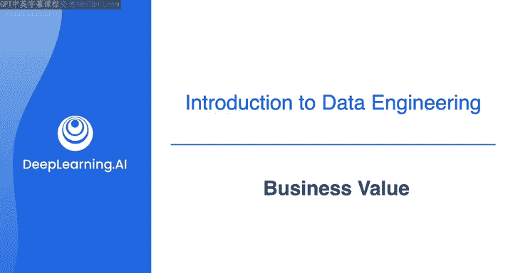
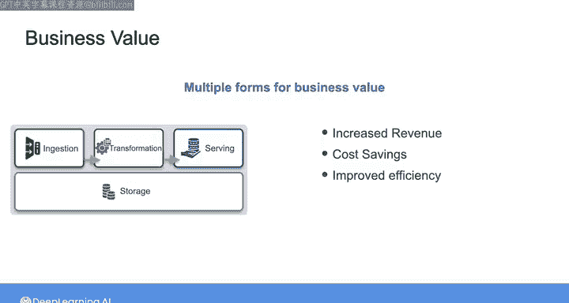

# 吴恩达《数据工程（导论，源系统、数据摄取和管道，数据存储和查询｜1-2-3课）｜DeepLearning.AI Data Engineering》 - P6：5_可选：商业价值.zh_en - GPT中英字幕课程资源 - BV1wTtWeeEH5

My goal in creating these courses is to set you up for success in your work as a data engineer。

 so let's pause for a minute and visualize what success looks like。

Any company that hires you as a data engineer does so because they believe you will add value for the organization。

 just the same as any other employee really， I recently spoke to my friend Bill Inman。

 who is one of the thought leaders and most knowledgeable people in the field of data when I asked him about what advice he would give someone whos starting out in the industry。

 he emphasized the importance of finding and delivering business value。Here's what Bill said。

 What advice do you have for somebody who's getting started in the field of data。

 I'm going to give them the same advice as if they were a bank robber。

 go to where the money is if you want to have long term great success in our industry find business value don't get hung up on every technology that comes out every new fangled thing that comes out。

 go to where there's business value because at the end of the day business value drives everything we do in technology and it's easy to get lost and hung up on technology and there's nothing wrong with technology that I'm a technician myself。

 I love technology， but the number one thing you need to think about Now。

 if you don't care about success and you want to go off and do some fancy stuff that looks interesting in whatever that go go ahead and do it but don't expect to have。

Have any great reward for what you've done like Willie Sutton said in terms of why did you rob banks because that's where the money is do you do a technology you look for business value so as a data engineer you need to look for business value but what does it actually mean to add value as a data engineer Well and my experience business value is somewhat you might say in the I beholder and what I mean by that is for example。

 suppose your organization is hoping that your work as a data engineer can help with revenue growth in this case if your manager or those in leadership perceive your work as contributing to the growth of revenue for the company by thegratulations it's highly likely you'll be recognized as adding value for the organization on the other hand。

 if you work as a data engineer is perceived as simply costing large sums of money with little or no return on investment then you might。

need to start looking for another job， but in many cases。

 business value is not just as simple as profit and loss it takes many different forms as we looked at in the previous video in your work as a data engineer。

 you'll interact with various stakeholders oftentimes it'll be those stakeholders who decide for themselves whether you're adding value and in general that means whether or not they perceive you as helping them achieve their goals notice that in all these examples I'm talking about how your work is perceived rather than what it is that you actually do the amount of value you provide for the business and the stakeholders will be determined by those to whom you are providing that value and so in general。

 when you're fulfilling stakeholdersholder needs， you're providing them with value whether that comes in the form of increased revenue cost savings work made more efficient or something else like helping with a successful product launch with all that being said once youve successfully identified all the data needs of stakeholders in your organization。

It's not uncommon to discover that their collective needs far exceed the capacity or resources you have to create solutions。

And so you'll need to prioritize， figure out which projects are more feasible and how long they might take to implement among many things。

Now realistically I think figuring out exactly what to focus on and how to best spend your time as a data engineer could be the subject of an entire other course so Emma we' go further into the details here。

 but if you're curious you can check out the link and the resources section at the end of this week to a podcast at Matt Howsley and I did with our friend So Rahiti where she provides insight and perspective as a data executive on what business value really means but for now we're going to move on assuming you figured out what sort of system you want to build the next step is identifying the requirements for that system join me in the next video for a look at gathering system requirements。

