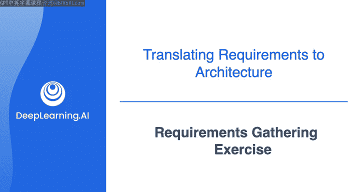
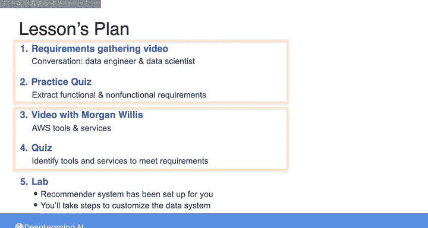

# 吴恩达《数据工程（导论，源系统、数据摄取和管道，数据存储和查询｜1-2-3课）｜DeepLearning.AI Data Engineering》 - P70：72_需求收集练习.zh_en - GPT中英字幕课程资源 - BV1wTtWeeEH5

In this lesson， your goal is to take a project from requirements gathering， to implementation。

 drawing on the material we covered in this course。

 so this will be a sort of micro simulationimulation of what a project in the real world might look like I say micro because in practice getting from requirements gathering to a final implementation of your system could take weeks or even months or years or。

Longer and so here we'll be getting from one end to the other and maybe just a couple hours。

 but I still think this is a very useful exercise of practice of what we've been talking about so far in this course so here's the plan and the next video you'll find the conversation between the data engineer and the data scientist we've already been in touch with in week one of this course the focus of this conversation will be the recommender system we looked at in some detail in the previous lesson you'll also have access to the transcript of this conversation and the reading item that follows this video so you can easily review any details of this conversation your goal in reviewing this conversation we'll be to extract functional and nonfunctional requirements in addition to those we wrote down in the previous lesson you'll do this by answering the questions in the quiz that comes up after the transcript reading item once you've completed the quiz to identify requirements and the next set of videos you'll hear from Morgan at AWS about the variety of AWS tools and services that you can choose from to implement your solution and once you've had a chance to review those you'll。

You're ready to take the next quiz where you'll identify which tools and services meet the requirements for your data system finally you'll head over to the lab environment where the basic infrastructure for recommend system has been set up for you and you'll take steps to customize the system based on the tool choices you made in the quiz Now as I mentioned already this is a microsimulation and is a much more brief and limited experience than what you can expect on the job as a data engineer。

But if you take a moment to imagine yourself going through this experience in the real world and consider what it might be like to build a system like this without all the guardrails。

 then I think it can be a really useful exercise and with that let's jump right into it go ahead and work through the reading items and quizzes and then I'll see you in the video after that for a walkthrough of the lab exercise。

